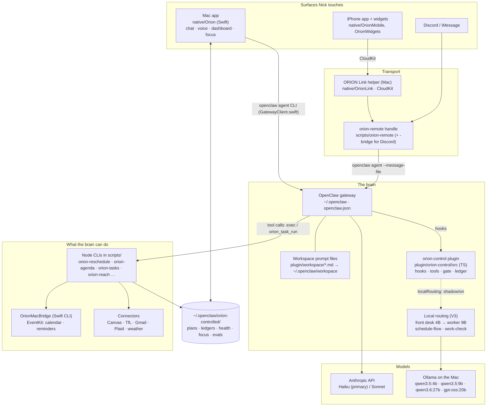
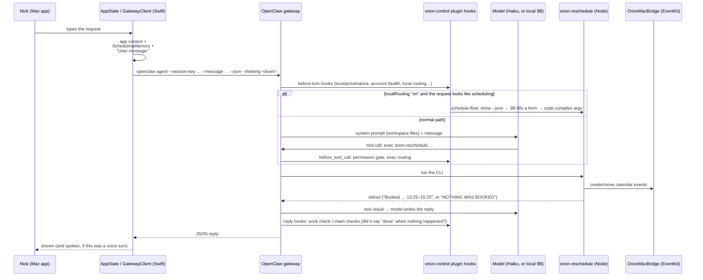

# 01 — The Big Picture
> Part of the ORION Learning Guide. Snapshot: 6c93032 (2026-10-14).
> Covers: the whole system at one level of zoom. Read after: `00_START_HERE.md`.
> Every later chapter zooms into one box on the diagram below.

## In this file
1. [What ORION is, in one paragraph](#1-what-orion-is)
2. [The map: every moving part on one page](#2-the-map)
3. [The three stacks (and why only two are live)](#3-the-three-stacks)
4. [How one message moves through the system](#4-how-one-message-moves)
5. [Where state lives on disk](#5-where-state-lives)
6. [The processes that are running right now](#6-the-processes)
7. [Models: who thinks, and when](#7-models)
8. [The safety spine: permissions, approvals, truth checks](#8-the-safety-spine)
9. [The story in ten lines](#9-the-story-in-ten-lines)
10. [Vocabulary](#10-vocabulary)
11. [Questions to ask your tutor](#11-questions)

---

## 1. What ORION is

ORION is a personal assistant that acts as **external executive function** for one person,
Nick. It holds his plan for the day (classes, deadlines, gym, sleep, study), reminds him, notices
when the plan slips, steps in, follows up, and re-plans. The loop, as the README puts it:

> Plan → remind → observe → intervene → follow up → adapt.

ORION has three faces: a **native macOS app** (menu bar, voice, dashboard, focus sessions), an
**iPhone app** (chat, plan, widgets, Screen Time locks), and **chat channels** (Discord,
iMessage). They all talk to one **brain**, an agent running inside the **OpenClaw gateway**.
The brain doesn't get open-ended access to the machine. It acts through a **gated, audited
set of tools** that a TypeScript plugin defines, and most of those tools are Node CLIs in `scripts/`.

Size: ~79k lines of Swift, ~27k TypeScript, ~29k Node (`.mjs` and the CLIs), ~48k Python, 644
commits from 2026-07-28 to 2026-10-13 (`git log --oneline | wc -l`).

---

## 2. The map

Read the diagram like this. **Everything ends in one call: `openclaw agent`.** The Mac app runs it
directly. The phone and Discord reach it through `orion-remote`. Inside the gateway, the
**plugin's hooks** fire at fixed points of every turn. The model then calls tools, and the
tools are almost all **Node scripts** that read and write files under
`~/.openclaw/orion-controlled/` and touch the calendar through a small Swift EventKit bridge.

Chapter map for the boxes:

| Box | Chapter |
|---|---|
| Mac app | 07 |
| iPhone, widgets, ORION Link, CloudKit, EventKit bridge, launchd | 08 |
| Gateway config, workspace prompts, memory | 03 |
| Plugin: hooks, tools, permissions, approvals, ledger | 04 |
| Local routing, front desk, schedule-flow, work check, account health, orion-remote | 05 |
| Node CLIs and the life loop | 06 |
| Evals, tests, the dev loop, phases and gates | 09 |
| End-to-end traces across all boxes | 10 |

---

## 3. The three stacks

The repo holds **three implementations** from different eras. Only two run.

| Stack | Where | Status | Why it exists |
|---|---|---|---|
| **Swift** | `native/` | **Live.** The Mac app, the phone app, widgets, the Link helper, the EventKit bridge | macOS permissions (microphone, accessibility, calendar), voice, native UI |
| **TypeScript + Node** | `plugin/orion-control/`, `scripts/` | **Live.** The plugin is the brain's rulebook; the scripts are its hands | OpenClaw plugins are TypeScript; the life loop was built as small, testable Node modules |
| **Python** | `orion/`, `backend/`, `scripts/orion_v2_*.py` | **Not the implementation path.** The policy/registry code survives as CI checks | The original ChatGPT-era runtime (July 2026). Superseded first by the OpenClaw gateway, then by CloudKit for the phone |

The project wrote down the rule that governs this (`CLAUDE.md`, `AGENTS.md`):

> Where a phase's requirements refer to the Python runtime or to `orion/*.py`, interpret them
> against the LIVE stack — the Swift app in `native/Orion` and the TypeScript plugin in
> `plugin/orion-control`. … This changes how requirements are READ; it does not change their ORDER.

Why the Python wasn't deleted: `orion/core` holds the **v2 policy engine and capability
registry**. CI scripts such as `scripts/orion_v2_policy_check.py` use it to prove the live
TypeScript gate is never *more permissive* than the policy (the AGENTS.md table says 390
combinations). So it now works as a specification and a check, not as a runtime. Chapter 08
tells the full story, and chapter 02a covers the July handoff from ChatGPT to Claude.

---

## 4. How one message moves

Here is Nick typing *"fill the time between my classes with cert courses"* into the Mac app.
Chapter 10 (trace T1) walks this hop by hop with code. This is the 30-second version:

Three things in that picture are the reason ORION looks the way it does:

1. **Context is added by code, not left to memory.** The app and `orion-remote` both prepend
   live facts (the day, open apps, focus state) before Nick's words. The plugin cuts the prompt at
   the markers `"User message:\n"` and `"--- Nick's message follows ---"` to find what he actually said
   (`plugin/orion-control/src/local-routing.ts:85`).
2. **The model never touches the calendar directly.** It runs a CLI, and the CLI's stdout is
   ground truth. That is what made the honesty checks possible: "Done" after `NOTHING WAS BOOKED`
   is detectable.
3. **Every channel goes through the same hooks.** That is why one plugin feature (local routing)
   could cover Mac chat, voice and the phone at once (chapter 05 §3).

---

## 5. Where state lives

ORION keeps almost all of its state as **plain JSON/JSONL files**, not in a database. The live
copy is outside the repo:

| Path | What |
|---|---|
| `~/.openclaw/openclaw.json` | Gateway config: models, providers (Anthropic, Ollama and its params), agents, plugins, channels. Has secrets; never copy it. Many dated `.bak-*` siblings record each config change |
| `~/.openclaw/workspace/` | The **installed** copies of the workspace prompt files that the gateway actually reads (`AGENTS.md`, `SOUL.md`, `SCHEDULING.md` …). The repo copies are in `plugin/workspace/` |
| `~/.openclaw/extensions/orion-control/dist/` | The **installed**, compiled plugin. `scripts/orion-deploy` puts it there |
| `~/.openclaw/orion-controlled/` | ORION's own data: `life-config.json`, `pins.json`, `reschedule-undo.json`, `health-log.json`, `focus-state.json`, `task-ledger.jsonl`, `remote-audit.jsonl`, `local-routing/` (shadow log + acceptance record), `evals/`, `project-agent/`, `account-health.json`, and dozens more |
| `~/.openclaw/logs/` | `orion-app.log`, `config-audit.jsonl` (every live config change, with argv) |
| macOS Keychain | Secrets (service tokens, OAuth refresh tokens). Exactly two call sites in Swift (AGENTS.md "Not done yet") |
| CloudKit (private DB) | Phone ↔ Mac messages and plan sync (chapter 08) |
| Apple Calendar / Reminders | The real schedule. Written only through `OrionMacBridge` |

Lesson the project learned twice: **a file's mtime is not a date, and the repo copy is not
necessarily the copy that runs.** The workspace prompt and the plugin both have a repo copy and
an installed copy. More than one incident came from editing one and testing the other
(chapters 02b and 09).

---

## 6. The processes

What runs on the Mac when ORION is "on" (from `~/Library/LaunchAgents`, at snapshot time):

| launchd label | Runs | Notes |
|---|---|---|
| `ai.openclaw.gateway` | Node: the OpenClaw gateway, via an env-wrapper script | The brain. Plugin hooks run inside it |
| `com.nickmadaio.orion.remote` | Node: `~/.openclaw/orion-gate/integrity/verifier.mjs run orion-remote …`, an integrity check that then starts the installed `orion-remote` bridge | Discord WebSocket → `orion-remote handle`. Runs the *installed* copy in `~/.openclaw/orion-remote/`, not the repo |
| `com.nickmadaio.orion.tts` | Python (mlx-audio): `~/.openclaw/orion-tts/orion_tts_daemon.py` | Warm local text-to-speech so replies start fast |
| `com.nickmadaio.orion.voiceid` | Python venv: `~/.openclaw/orion-voiceid/orion_voiceid_daemon.py` | Speaker verification: only Nick's voice starts a turn |
| `com.nickmadaio.orion.dashboard` | `/usr/bin/open -na Orion` | Just launches the Mac app at login |
| `native/launchd/com.nickmadaio.orion.daily.plist` (template, `__NODE__`/`__REPO__` placeholders) | `scripts/orion-daily` at 00:20 | Daily roll-over job |
| `native/launchd/com.nickmadaio.orion.plist` (repo only) | `.venv/bin/python main.py serve` | **Legacy.** The July Python server. Not installed in LaunchAgents at the snapshot |
| Orion.app | The Swift app | Voice, menu bar, focus enforcement, 5-minute life-watch timer |
| ORION Link helper | CloudKit ↔ `orion-remote` | Phone messages |
| Ollama | Local models | `127.0.0.1:11434` |

OpenClaw also has its own **cron** (scheduled agent turns: morning brief, check-ins). One
surprise the research turned up: the main proactive *nudge* isn't started by cron or
launchd at all. It runs on a timer inside the Mac app (chapter 10, trace T4).

---

## 7. Models

| Role | Model | Where configured | Since |
|---|---|---|---|
| Main brain (default) | Claude **Haiku 4.5**, escalating to **Sonnet** for hard turns | `openclaw.json`; thinking level from `scripts/lib/thinking-policy.mjs` / Swift `ThinkingPolicy` | Aug 2026 |
| Front desk (local routing) | `qwen3.5:4b-q4_K_M` via Ollama | `plugin/orion-control/src/front-desk.ts`, prompt in `front-desk-prompt.ts` | Oct 2026 (V3) |
| Worker (local routing) | `ollama/qwen3.5:9b` | `local-routing.ts`, `job-instructions.ts`; Ollama params in `openclaw.json` | Oct 2026 (V3) |
| Mac-app narratives (brief, health rail, finance) | Local model via `LocalModel.swift` → Ollama `/api/generate` | `native/Orion/Sources/Orion/LocalModel.swift` | Sep 2026 |
| Dev-loop worker + reviewer | `qwen3.6:27b` (both roles) | `~/.openclaw/orion-controlled/agentic-config.json` | Sep 2026 |
| Phone on-device | Apple on-device model | `RemoteViews.answerOnDevice` (now **off**: the phone always goes to the Mac) | Oct 2026 |

**Local routing is in `shadow` mode at the snapshot.** Haiku answers. The local front desk and
worker only log what they *would* have done. The plugin refuses `"on"` unless a real-route
acceptance record shows ≥85% pass, ≤20 s median, ≥20 cases, ≤14 days old, or unless a short testing window
is open (`local-routing.ts`). This gate exists because local routing went live on 2026-10-12 on
eval numbers alone and failed Nick's first real request (chapter 02d, and the memory note
"No live switch without a real-route test").

---

## 8. The safety spine

Four layers stop a model from doing damage or lying about what it did:

1. **Permission profile.** A ladder from `restricted_read_only` upward (`permissions.ts`).
   `scripts/orion-lock` is the off switch: it drops to read-only and disables cron.
2. **Approval gate.** Risky actions pause, and Nick approves them in the app or by
   `orion-approve` (`approvals.ts`, trace T7 in chapter 10).
3. **The ledger.** Every action is written to `task-ledger.jsonl` with provenance and redaction
   (`ledger.ts`, `provenance.ts`). That makes "what actually ran" answerable.
4. **Truth checks on replies.** `orion-remote`'s claim classifier and reply lint, and the plugin's
   work check. Both compare the reply against tool output and catch "done" when nothing ran
   (chapter 05).

Under all four sits the invariant AGENTS.md calls the only one that matters: **the app's
code-signing identity never changes**, because macOS ties microphone, accessibility and other
permissions to it (chapter 07 and 09).

---

## 9. The story in ten lines

1. **Jul 28:** a ChatGPT-built Python runtime is snapshotted and handed to Claude for review (`1abb90b`).
2. **Jul 30:** a native Mac app replaces the browser UI. Warm TTS, structural trust hardening.
3. **Aug:** OpenClaw becomes the brain. Permissions, signing identity, Sparkle updates, the dashboard,
   connectors, focus-session engine, "Orion edits himself" (`orion-forge`).
4. **Sep 1:** the 85-phase v2 manifest is the roadmap. A "Batch A–H" rewrite is proposed and withdrawn the same day.
5. **Sep 2–20:** Discord goes live, phases sprint toward 84, health firewall, London move (Phase 40).
6. **Sep 21–Oct 1:** a local Qwen agentic dev loop (worker + reviewer). The life loop and adaptive
   rescheduling. Phone Screen Time locks. "ORION truthful": the claim checks.
7. **Oct 2–7:** schedule evals, the phone redesign, cost pressure. A prompt trim makes ORION worse and is reverted.
8. **Oct 8–11:** **ORION V3, local-first.** A rigorous eval campaign (J1–J7, held-out finals) picks per-job local models.
9. **Oct 12:** local routing goes live, fails a real request, and is rolled back to shadow behind an acceptance gate.
   The same day, schedule-flow and a live gauntlet go 12/12. The Anthropic account runs out of credit, so account-health alerts are added.
10. **Oct 13:** reminder and to-do fixes: code builds the `alarm_set` call itself, and finished to-dos come off the calendar.

Chapters 02a–02d tell each of these with commits, and chapter 12 pulls out the decisions.

---

## 10. Vocabulary

| Term | Meaning |
|---|---|
| **OpenClaw** | Third-party agent runtime ("the gateway") that ORION runs inside. Loads workspace prompts, runs the tool loop, fires plugin hooks |
| **Workspace** | The Markdown files that make up ORION's system prompt (`plugin/workspace/` in the repo, `~/.openclaw/workspace/` installed) |
| **Plugin / orion-control** | ORION's TypeScript OpenClaw plugin: hooks, typed actions, gate, ledger |
| **Hook** | A function the gateway calls at a fixed point in a turn (before prompt build, before tool call, before sending a reply…) |
| **Action / `orion_task_run`** | A typed, gated operation defined in the plugin's catalog (e.g. `alarm_set`) |
| **exec** | The gateway tool that runs an allowlisted script with plain argv |
| **Life loop** | The Node modules in `scripts/lib/life/` that plan, replan and check the day |
| **Front desk** | Small local model that classifies a message: answer / tool / escalate / ask / ignore |
| **Worker** | The bigger local model that does the turn when local routing takes it |
| **Schedule-flow** | Fixed code sequence for calendar edits: show the day → model fills one form → code compiles argv → run → phrase |
| **Work check** | The plugin's check that a reply's claims match what the tools printed |
| **Shadow mode** | Local routing runs alongside but only logs; Claude answers |
| **Eval mode** | Marker file that makes every "send" script print `Not sent:` instead (chapter 09) |
| **Phase / gate** | One of 85 numbered roadmap phases, each with a recorded gate in `PHASE_GATES.json` |
| **REC-\*** | Additive recovery checkpoints in `ROADMAP_AMENDMENTS.json` (not enforced by the gate script) |
| **Handoff** | `HANDOFF.md`, the relay file between Claude and Codex sessions |
| **Astra** | ChatGPT/Codex in the role of senior architect for the dev loop (invoked by Nick manually) |
| **TCC** | macOS's permission database (mic, accessibility…), keyed to the code-signing identity |
| **Sparkle** | The Mac auto-update framework (feed not yet published) |
| **J1–J7** | The V3 eval jobs: front desk, simple tools, scheduling, honesty, brain, continuity, conversation |

---

## 11. Questions to ask your tutor

1. "Draw the map from memory, then check it against §2. What did I leave out?"
2. "Why does every channel end in `openclaw agent`, and what did that make possible?"
3. "The Python stack isn't running. Name two ways it still affects the live system."
4. "Where would you look first if ORION said 'Done' but the calendar didn't change?"
5. "What's the difference between the repo copy and the installed copy of the workspace and the plugin, and which incidents came from mixing them up?"
6. "Why does local routing need an acceptance record when the evals already passed?"
