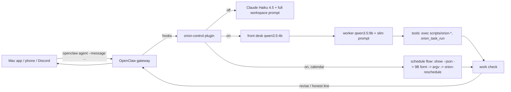
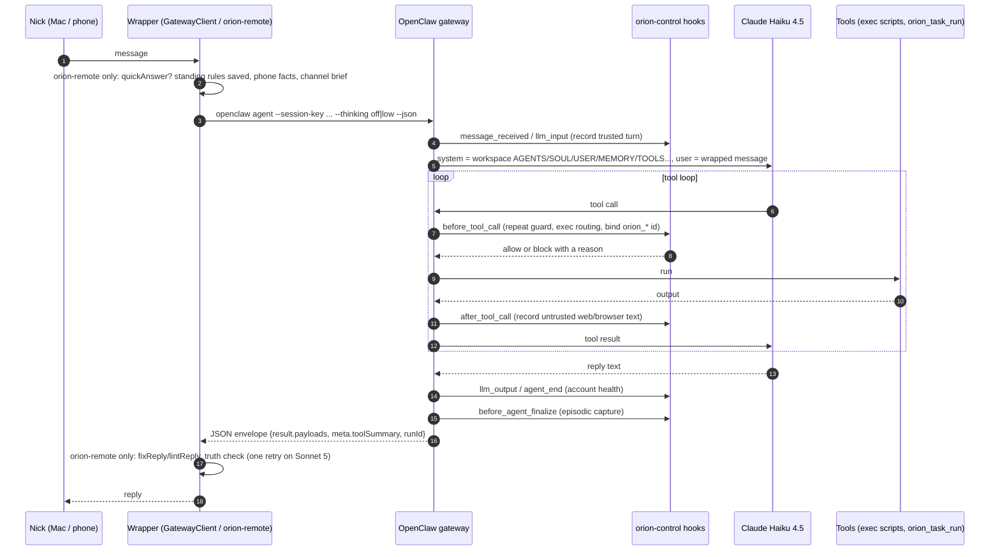
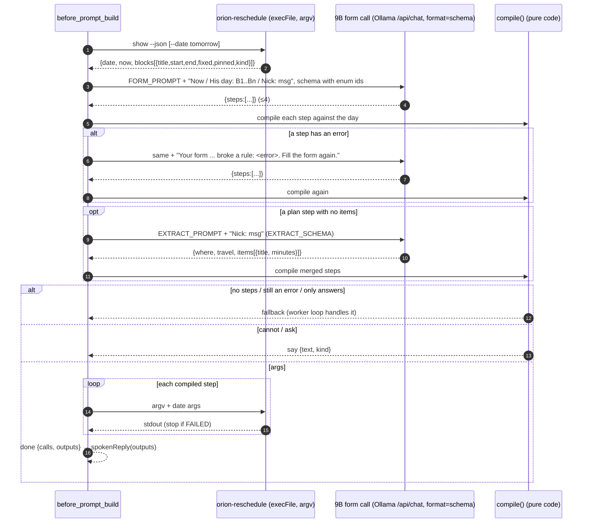

# 05 — The Plugin Turn Pipeline (one chat turn, end to end)
> Part of the ORION Learning Guide. Snapshot: 6c93032 (2026-10-14).
> Covers: `plugin/orion-control/src/{index,front-desk,front-desk-prompt,local-routing,schedule-flow,work-check,account-health,conversation-routing,conversation-modes,exec-routing,personalities,job-instructions,strictness}.ts`, `scripts/orion-remote`, `scripts/orion-remote-bridge`, `scripts/orion-remote-install`, `scripts/lib/remote/{claims,reply-lint,reply-person,reply-times,standing-rules}.mjs`, `scripts/lib/thinking-policy.mjs`, and the structure (no secrets) of `~/.openclaw/openclaw.json`.
> Read after: the overview chapters (01–04) that explain what the OpenClaw gateway, the Mac app and the phone are.

This chapter follows a single message from Nick ("move gym to 7", "fill the time between my classes with cert courses", "remind me at 11 to text the group") from the moment it enters the OpenClaw gateway to the moment a reply leaves it, and names every place where code, a small local model, a bigger local model or Claude touches it.

## In this file

1. [Orientation: the picture in one page](#1-orientation-the-picture-in-one-page)
2. [What is live at the snapshot, and what is uncommitted](#2-what-is-live-at-the-snapshot-and-what-is-uncommitted)
3. [How a message reaches the plugin (channels)](#3-how-a-message-reaches-the-plugin-channels)
4. [The hook map: every hook the plugin registers for a turn](#4-the-hook-map-every-hook-the-plugin-registers-for-a-turn)
5. [A turn with `localRouting: "off"`](#5-a-turn-with-localrouting-off)
6. [A turn with `localRouting: "shadow"`](#6-a-turn-with-localrouting-shadow)
7. [A turn with `localRouting: "on"`](#7-a-turn-with-localrouting-on)
8. [Component: the front desk (`front-desk.ts`, `front-desk-prompt.ts`)](#8-component-the-front-desk)
9. [Component: local routing (`local-routing.ts`) — gate, testing window, hooks](#9-component-local-routing)
10. [Component: the scheduling flow (`schedule-flow.ts`)](#10-component-the-scheduling-flow)
11. [Component: the work check (`work-check.ts`)](#11-component-the-work-check)
12. [Component: worker instructions (`job-instructions.ts`) and the other prompt text](#12-component-worker-instructions-and-other-prompt-text)
13. [Component: account health (`account-health.ts`)](#13-component-account-health)
14. [Component: provenance hooks, repeat guard and exec routing (`index.ts`, `exec-routing.ts`)](#14-component-provenance-hooks-repeat-guard-and-exec-routing)
15. [Component: strictness, as it shows up in replies (`strictness.ts`, `validator.ts`)](#15-component-strictness-as-it-shows-up-in-replies)
16. [Component: conversation routing, modes and personalities — designed, not wired](#16-component-conversation-routing-modes-and-personalities)
17. [Component: `orion-remote` — the phone/Discord turn wrapper and its reply checks](#17-component-orion-remote)
18. [Every model call in a turn: model, prompt, parameters, output form, retries](#18-every-model-call-in-a-turn)
19. [Configuration: `openclaw.json` (structure only) and plugin flags](#19-configuration)
20. [Failure modes and incidents, in date order](#20-failure-modes-and-incidents-in-date-order)
21. [What the shadow log says (aggregates only)](#21-what-the-shadow-log-says)
22. [Gotchas and lessons, consolidated](#22-gotchas-and-lessons-consolidated)
23. [Walk it yourself (whole chapter)](#23-walk-it-yourself)
24. [Questions to ask your tutor (whole chapter)](#24-questions-to-ask-your-tutor)

---

## 1. Orientation: the picture in one page

ORION's "brain" is not one program. A chat turn passes through four layers:

1. **A channel wrapper** that turns Nick's words into one `openclaw agent` call. The Mac app does it in Swift (`native/Orion/Sources/Orion/GatewayClient.swift:115-130`); the phone and Discord do it through `scripts/orion-remote` (`scripts/orion-remote:790-900`). The wrapper adds context text around Nick's words.
2. **The OpenClaw gateway** (a vendored third-party agent runtime, `~/.openclaw/bin/openclaw`). It picks a model from `~/.openclaw/openclaw.json`, builds a system prompt from the workspace files (`~/.openclaw/workspace/AGENTS.md` and friends), runs the tool loop, and fires **plugin hooks** at fixed points of the turn.
3. **The `orion-control` plugin** (`plugin/orion-control/src`, built to `dist/`, installed at `~/.openclaw/extensions/orion-control/dist/`). It registers the hooks. Some hooks are always on (trust/provenance, repeat guard, exec routing, account health, episodic capture). One feature, **local routing**, can take over the turn: a small local model (the *front desk*, `qwen3.5:4b-q4_K_M`) decides what kind of message it is, the turn is moved to a larger local model (the *worker*, `ollama/qwen3.5:9b`), calendar changes are run by code as a fixed sequence (the *scheduling flow*), and a *work check* compares the reply with what the tools actually printed before the reply leaves.
4. **The tools** the model calls: `exec` of `scripts/orion-*` programs (allowlisted by absolute path), and the plugin's own typed tool `orion_task_run` (catalog actions behind the permission/strictness gate). Those are covered in other chapters; here they matter only as "the evidence the work check reads".

The design idea that runs through all of local routing, in Nick's and the code's words: the model should not be trusted to say what happened. **Ground truth is what the tools printed** (`plugin/orion-control/src/work-check.ts:11`). Where a small model kept getting something wrong, the fix was nearly always to move that decision into code: code computes the time shift, code builds the argv, code builds the reply sentence, code decides whether a reminder was set.



---

## 2. What is live at the snapshot, and what is uncommitted

Read on 2026-10-14 from `~/.openclaw/openclaw.json` and `~/.openclaw/orion-controlled/` (structure only):

| Item | Value at snapshot | Source |
|---|---|---|
| Gateway primary model | `anthropic/claude-haiku-4-5-20251001`, fallbacks `ollama/qwen3.5:9b`, then `ollama/llama3.2:3b` | `openclaw.json` → `agents.defaults.model` |
| `localRouting` | `"on"` | `openclaw.json` → `plugins.entries.orion-control.config.localRouting` |
| `localRoutingTestingUntil` | `2026-10-14T17:04:46Z` (a deliberate testing window; it ends the same day as the snapshot) | same |
| `localRoutingTrace` | `true` (one line per hook stage to `shadow.jsonl.trace`) | same |
| `localRoutingScheduleToCloud` | `false` | same |
| `accountHealth` / `accountFailFast` | not set → health on (default), fail-fast off (default) | same; defaults at `plugin/orion-control/src/index.ts:1661-1669` |
| Acceptance record | `~/.openclaw/orion-controlled/local-routing/acceptance.json`: `at 2026-10-10T15:30Z, n 21, pass 7, medianMs ≈35 297` → **fails** the gate (needs ≥85 %, ≤20 s, ≤14 days, ≥20 cases) | file; gate at `local-routing.ts:218-229` |
| Account health state | `account-health.json`: active problem, provider `anthropic`, kind `credit`, since `2026-10-13T01:02Z`, alerted once | file |
| Deployed plugin build | `~/.openclaw/extensions/orion-control/dist/*.js` is byte-identical to the repo's `plugin/orion-control/dist/*.js` for `index`, `local-routing`, `front-desk`, `schedule-flow`, `work-check`, `account-health` (built 2026-10-13 ~02:07–02:10) | `cmp` |
| Installed `orion-remote` copy | `~/.openclaw/orion-remote/scripts/orion-remote` and its `lib/remote/*` and `lib/thinking-policy.mjs` are identical to the repo | `cmp` |

So at the snapshot, "on" is running **only because of the testing window**. When the gateway is next started after 17:04Z without a new window or a passing acceptance record, the plugin will log `localRouting "on" REFUSED — acceptance passed 7/21 (needs 85%)` and run shadow (`local-routing.ts:240-247`). If the window closes while the gateway keeps running, see the gotcha in §9 ("window closed mid-session").

**Committed vs uncommitted.** All TypeScript sources in scope are committed at `6c93032`. What is *not* committed is the **build output**: `git status` shows the V3 files `plugin/orion-control/dist/{front-desk,front-desk-prompt,local-routing,schedule-flow,work-check,account-health,job-instructions}.{js,d.ts}` and their test builds as untracked (`??`), and `dist/index.js`, `dist/index.d.ts`, `dist/executors.*`, `dist/permissions.d.ts`, `dist/index.test.js` as modified (`M`). In other words, the code that is actually running in the gateway was compiled from committed source but the compiled copy itself lives only in the dirty worktree (and in `~/.openclaw/extensions/`). `scripts/orion-remote` and `scripts/lib/remote/*` are committed and unmodified. Also uncommitted, outside this chapter's code but related: `docs/evals/2026-10-02-schedule/*` (a qwen thinking eval run).

---

## 3. How a message reaches the plugin (channels)

Every channel ends in the same CLI call, `openclaw agent --session-key <key> ... --json`, which means every channel goes through the same gateway hooks. That is why local routing could cover phone, Mac chat and voice with one piece of code (`local-routing.ts:24-25`).

### 3.1 Mac app chat and voice

- `GatewayClient.ask` (`native/Orion/Sources/Orion/GatewayClient.swift:115-130`) runs:
  ```
  openclaw agent --session-key <session> --message "<recentOutreach><SchedulingMemory.context><text>" --json --timeout <agentTimeout> [--model <m>] --thinking <level>
  ```
  The thinking level comes from Swift `ThinkingPolicy.level(...)`, the same rule as `scripts/lib/thinking-policy.mjs` (see §17).
- The `text` it sends is itself wrapped by `AppState` (`native/Orion/Sources/Orion/AppState.swift:2101-2111`): an `[Orion app context — factual state supplied by the native app]` block (focus session state, firm enforcement, allowed apps), an optional spoken-reply instruction ("Nick SAID this out loud and your answer will be SPOKEN: one to three short sentences…"), then the line `User message:` and Nick's words.
- **Why it matters here:** the plugin's `userText()` cuts the prompt at the marker `"User message:\n"` and keeps only what follows (`local-routing.ts:85, 97-100`). The front desk, the scheduling-flow trigger regexes and the work check all read Nick's words only, not the app context.

### 3.2 Phone (iPhone ORION tab)

- The phone talks to the Mac's OrionLink engine. `CommandRunner` (`native/OrionLink/Sources/LinkCore/CommandRunner.swift:20-60`) runs the *installed* copy:
  ```
  ~/.openclaw/tools/node-v24.15.0/bin/node ~/.openclaw/orion-remote/scripts/orion-remote handle --from <sender> --id <id> --at <ms> --mode chat|command -- <text>
  ```
  with `ORION_BRAIN_SESSION=orion-chat-<conversation>` (or `orion-app-v2`), and, when the phone picked a model, `ORION_BRAIN_MODEL=<m>` and `ORION_BRAIN_THINKING=off` for `ollama/*` or `low` otherwise.
- `orion-remote handle` applies its guards (sender allowlist, device routing, LOCK ORION, freshness, replay, rate limit — `scripts/orion-remote:1512-1700`), then for chat mode sends the text to `askBrain()` (`scripts/orion-remote:1639`). `askBrainOnce()` writes a message **file** and calls `openclaw agent --session-key <BRAIN_SESSION> --timeout 90 [--model] --thinking <level> --json --message-file <file>` (`scripts/orion-remote:790-812`).
- The message file is: phone live-facts block (`phoneContext()`, `:625-672`, which includes up to 12 000 characters of `~/.openclaw/workspace/SCHEDULING.md`, open apps, today's schedule, check-ins, phone lock, outreach) + optional "already saved" note for standing rules + the channel brief (`CHANNEL_BRIEF`, `:493-536`) ending in the line `--- Nick's message follows ---` + Nick's text.
- **Why it matters here:** the plugin's other marker is `"--- Nick's message follows ---"` (`local-routing.ts:85`). For a phone turn the front desk sees only what follows. **(inferred)** The worker, however, still receives the whole user message (phone facts included) as the user turn, because `before_prompt_build` replaces the *system* prompt and appends context, but does not strip the user message.

### 3.3 Discord

`scripts/orion-remote-bridge` holds an outbound WebSocket to Discord's gateway and hands each allowlisted message to `orion-remote handle` unchanged (`scripts/orion-remote-bridge:1-35`). From there it is the same path as the phone, with `@discord` lines of the channel brief instead of `@phone` lines (`briefFor`, `scripts/orion-remote:539-546`). `scripts/orion-remote-install` copies `orion-remote` and the bridge to `~/.openclaw/orion-remote/` so launchd can run them without Desktop access (`scripts/orion-remote-install:1-40`).

### 3.4 Internal sessions are skipped

Both local routing and account health ignore sessions whose key matches `/\b(?:cron|heartbeat|doctor|test|subagent|eval)\b/i` (`local-routing.ts:84, 274`; `account-health.ts:57, 230`). Eval runs use keys starting `agent:main:orion-eval-sched-` (ORION_V3_CONTINUE.md §6), so they never reach the front desk.

---

## 4. The hook map: every hook the plugin registers for a turn

`index.ts` composes the plugin's `register` so that `installProvenanceHooks(api)` runs before the tool registration (`plugin/orion-control/src/index.ts:1740-1744`). `installProvenanceHooks` (`index.ts:1528-1720`) registers, in this order:

| # | Hook | Registered by | When active | What it does in a turn | Code |
|---|---|---|---|---|---|
| 1 | `message_received` | provenance | always | records the raw inbound message as the turn's trusted user text | `index.ts:1544-1551` |
| 2 | `llm_input` | provenance | always | records the assembled prompt (fallback trust source) | `index.ts:1552-1559` |
| 3 | `after_tool_call` | provenance | always | records web/browser results as untrusted text for taint checks | `index.ts:1564-1571` |
| 4 | `before_tool_call` | provenance | always | repeat guard (block 3rd identical consecutive / 5th total call; lockout after 3 blocks), exec routing (`routeForDoomedExec`), binds `orion_*` tool-call ids to the run | `index.ts:1572-1654` |
| 5 | `agent_end` | provenance | always | clears repeat-guard state for the run | `index.ts:1655-1660` |
| 6 | `llm_output` | account health | `accountHealth !== false` (default on) | reads the provider error body of each model attempt | `account-health.ts:221` |
| 7 | `agent_end` | account health | same | reads the run's own error | `account-health.ts:222` |
| 8 | `before_agent_reply` | account health | only with `accountFailFast: true`, a known primary provider, and `localRouting !== "on"` | answers at once with the account problem while it is fresh | `account-health.ts:233-237`; gating `index.ts:1667` |
| 9 | `before_prompt_build` | account health | same as 8 | gives fallback attempts a tiny "say exactly this" prompt | `account-health.ts:238-243` |
| 10 | `before_model_resolve` | local routing | `shadow` or `on` | runs the front desk; in `on`, moves the turn to the 9B | `local-routing.ts:269-296` |
| 11 | `before_agent_reply` | local routing | `on` only | sends the front desk's own answer without a model call (when the host fires this hook) | `local-routing.ts:299-305` |
| 12 | `before_prompt_build` | local routing | `on` only | replaces the system prompt: reminder / scheduling flow / day question / exact reply / drafted answer / job instructions | `local-routing.ts:307-373` |
| 13 | `reply_payload_sending` | local routing | `on` only | rewrites the outgoing text to the remembered exact reply | `local-routing.ts:380-387` |
| 14 | `after_tool_call` | local routing | `shadow` or `on` | collects each tool result (canonical call + text) for the work check | `local-routing.ts:389-394` |
| 15 | `before_agent_finalize` | local routing | `shadow` or `on` | work check; in `on`, may return `revise` (up to 2), remembers an honest line; logs one line per turn | `local-routing.ts:396-445` |
| 16 | `before_agent_finalize` | episodic capture | `enableEpisodicCapture: true` (it is, live) | appends high-signal preferences/corrections from Nick's latest turn to the daily journal | `index.ts:1687-1719` |

The hook names and result shapes come from the vendored OpenClaw type file (`plugin/orion-control/node_modules/openclaw/dist/hook-types-DQ9eTy2x.d.ts`, package version `2026.7.1-2`):

- `before_model_resolve` → `{ modelOverride?, providerOverride? }` (`:39-46`). The event has only `prompt` (no session messages yet).
- `before_prompt_build` → `{ systemPrompt?, prependContext?, appendContext?, prependSystemContext?, appendSystemContext? }` (`:47-60`).
- `before_agent_reply` → `{ handled: boolean, reply?, reason? }` (`:418-422`).
- `before_agent_finalize` → `{ action?: "continue" | "revise" | "finalize", reason?, retry?: { instruction, idempotencyKey?, maxAttempts? } }`; "revise: block finalization and ask the harness for another model pass" (`:505-532`).
- `reply_payload_sending` → `{ payload?, cancel?, reason? }` (`:684-702`).

No `message_sending` hook is registered by this plugin (it exists in OpenClaw's list, `:342`); the delivery-time rewrite uses `reply_payload_sending` instead.

**Two facts found live that shape everything below** (both from commit messages, so they are observations of the host, not documented behaviour):
- `before_agent_reply` **does not fire on the agent-CLI / phone route** (`e42de88`, 2026-10-11). The Mac app also uses the agent CLI, so **(inferred)** it likely does not fire there either.
- `reply_payload_sending` **does not fire on the CLI route** either ("delivery hook does not fire there", `46235d4`, 2026-10-12). That is why the exact reply is enforced three ways (system prompt, `appendContext` in the latest message, and a finalize `revise`), not just rewritten at delivery.

---

## 5. A turn with `localRouting: "off"`

This is ORION as it was before V3 and as it is whenever local routing is off: Claude Haiku with the full workspace prompt, with the plugin only guarding and observing.



Notes:
- If an Anthropic call fails, the gateway falls back to `ollama/qwen3.5:9b` then `ollama/llama3.2:3b` with the **same full prompt** (`openclaw.json` → `agents.defaults.model.fallbacks`). That is what made turns take 60–300 s when the Anthropic account ran out of credit on 2026-10-11 (`account-health.ts:5-10`).
- With `accountFailFast: true` (off at the snapshot), steps 8/9 of the hook map would answer the turn with the account problem instead (§13).

---

## 6. A turn with `localRouting: "shadow"`

Shadow adds observation and nothing else: the configured model (Haiku) answers exactly as in "off", while the front desk runs in parallel and the work check grades the reply that was actually sent. One JSON line per turn goes to `~/.openclaw/orion-controlled/local-routing/shadow.jsonl`.

```mermaid
sequenceDiagram
  autonumber
  participant G as OpenClaw gateway
  participant LR as local-routing hooks
  participant FD as Front desk (Ollama qwen3.5:4b)
  participant C as Configured model (Haiku)
  participant T as Tools
  G->>LR: before_model_resolve(prompt)
  LR->>LR: skip internal sessions; userText() strips the channel brief
  LR-)FD: decide({message, clock}) — fire and forget
  LR-->>G: undefined (no override)
  G->>C: normal turn, full workspace prompt
  C->>T: tool calls
  T-->>LR: after_tool_call → run.tools.push({canonical, stdout})
  C-->>G: reply
  G->>LR: before_agent_finalize(lastAssistantMessage)
  LR->>LR: checkWork(reply, run.tools)
  LR->>LR: await decision (max 5 s)
  LR->>LR: append {runId, message, decision, findings, model, tools, turnMs} to shadow.jsonl
  LR-->>G: undefined (never revises)
```

Code walk:
- `registerLocalRouting` returns immediately for `"off"` (`local-routing.ts:232`).
- In `before_model_resolve` (`:269-296`), the decision is started as a promise and stored in a `Run` keyed by both `runId` and `session:<sessionKey>` (`:279-282`); in shadow it returns `undefined` at `:283` ("fire and forget").
- `after_tool_call` (`:389-394`) turns each call into a canonical string with `canonicalCall()` (`:117-121`: `exec <command without its leading path>` or `<toolName> <json params>`) and the result text with `resultText()` (`:109-114`).
- `before_agent_finalize` (`:396-445`) computes `checkWork(...)`, waits for the front desk at most `finalizeWaitMs` = 5 000 ms (`settle`, `:264-267`), logs, and returns `undefined`.

Shadow costs no latency for Nick (the front desk is not awaited before the model), and one Ollama call to the 4B per real turn.

---

## 7. A turn with `localRouting: "on"`

"On" takes the turn off the cloud model entirely. Every non-internal turn runs on `ollama/qwen3.5:9b` (or on the configured model only for calendar changes, if `localRoutingScheduleToCloud` is true). The diagram shows the main branches; §9 walks each one.

```mermaid
sequenceDiagram
  autonumber
  participant G as OpenClaw gateway
  participant LR as local-routing hooks
  participant FD as Front desk 4B (Ollama /api/chat)
  participant BR as orion-brain search
  participant SF as Schedule flow (code + 9B form)
  participant W as Worker 9B (via gateway)
  participant T as Tools
  G->>LR: before_model_resolve(prompt)
  alt testing window closed
    LR-->>G: undefined (configured model answers)
  else
    LR-)BR: brain search(message) (pre-fetch, 8 s)
    LR->>FD: decide() (awaited, 8 s timeout)
    FD-->>LR: {move, tool, args, tier, say, answer} or fallback "escalate"
    alt scheduleChangesToCloud and calendar change
      LR-->>G: undefined (Haiku with full prompt)
    else
      LR-->>G: providerOverride ollama, modelOverride qwen3.5:9b
    end
  end
  G->>LR: before_agent_reply (only on routes where it fires)
  LR-->>G: front desk answer as the reply (move answer, not a change request)
  G->>LR: before_prompt_build
  alt reminder ("remind me", "set an alarm"...)
    LR->>W: (extract time+label: separate 9B call, form-constrained)
    LR-->>G: systemPrompt = "call orion_task_run with exactly {...alarm_set...}"
  else calendar statement (not a question)
    LR->>SF: runScheduleFlow(message, clock)
    SF-->>LR: done (calls, outputs) / say (cannot/ask) / fallback
    LR-->>G: systemPrompt+appendContext = "reply exactly: <code-built text>, no tools"
  else calendar question ("...?")
    LR->>LR: readDay() = orion-reschedule show --json
    LR-->>G: systemPrompt = "answer from this list only, no tools"
  else front desk answered
    LR-->>G: systemPrompt = "send this draft if right"
  else everything else
    LR-->>G: systemPrompt = job instructions + PRODUCTION_NOTES + LOOK_IT_UP + brain matches + Now
  end
  G->>W: 9B turn (temp 0.2, num_ctx 32768, think false, num_predict 2048)
  W->>T: tool calls (exec, orion_task_run)
  T-->>LR: after_tool_call (collected)
  W-->>G: reply
  G->>LR: before_agent_finalize
  LR->>LR: reminder not called? revise (≤2) / exact reply missing? revise (1) / work-check findings? revise (≤2, second = HONEST_STOP)
  LR->>LR: still a false claim: remember honest line; log to shadow.jsonl
  LR-->>G: revise or undefined
  G->>LR: reply_payload_sending (where it fires)
  LR-->>G: payload.text = remembered exact / honest line
```

The ordering inside `before_prompt_build` matters and is exactly (`local-routing.ts:307-373`):

1. `if (!run?.settled || run.cloud) return undefined;` — nothing to do if the front desk never settled (window closed) or the turn went to the cloud (`:309`).
2. **Reminder** (`REMINDER` regex, `:89`) → alarm path (`:316-328`). Returns early.
3. **Calendar statement** — `SCHEDULING.test(message)` and the message does not end in `?` and no flow ran yet → run the scheduling flow (`:333-342`). Does *not* return yet.
4. **Calendar question** — `SCHEDULING` and ends in `?` and `readDay` wired → read the day, return "answer from this list" (`:344-348`).
5. Flow **done** → return exact reply prompt (`:349-356`).
6. Flow **say** (cannot/ask) → return exact reply prompt (`:357-361`).
7. Front desk **answer** and not a change request → return the draft-confirm prompt (`:365-367`).
8. Otherwise (flow fell back, tool, escalate, ask, ignore) → job instructions prompt, plus the front desk's question as a hint if the move was `ask` (`:368-372`).

Note that the scheduling flow **executes the scheduler inside the hook**, before the worker model is ever called. By the time the 9B sees anything, the calendar has already been changed; its only job is to repeat a sentence that code wrote.

---

## 8. Component: the front desk

### The front desk
- **What it is** — One call to a small local model (`qwen3.5:4b-q4_K_M`) that reads Nick's message and outputs one JSON object naming one of five moves: `answer`, `tool`, `escalate`, `ask`, `ignore`. It is the V3 evaluation's "J1" job, frozen and exported into the plugin. It must never block a turn: any failure becomes `escalate` with a `fallback` reason.
- **Where** — `plugin/orion-control/src/front-desk.ts` (110 lines): `FRONT_DESK_CTX` `:21`, `MOVES` `:23`, `MENU_TOOLS` `:25`, `Decision` type `:27-36`, `SCHEMA` `:41-53`, `frontDeskRequest` `:56-68`, `decide` `:73-102`, `warmUp` `:105-110`. The prompt is generated into `plugin/orion-control/src/front-desk-prompt.ts` (6 lines) by `scripts/eval/v3/ops/export-front-desk.mjs` — "do not edit by hand" (`front-desk-prompt.ts:1`).

#### How it works

1. **Request shape.** The request is built exactly as the evaluation built it: a stable system prompt first (so Ollama can reuse the cached prefix), then one user message with the clock, recent turns and Nick's message last (`front-desk.ts:9-12`).

```ts
// plugin/orion-control/src/front-desk.ts:56-68
export function frontDeskRequest({ message, clock, history = [] }: FrontDeskInput, model = FRONT_DESK_MODEL) {
  const earlier = history.slice(-8).map((m) => `${m.role === "assistant" ? "ORION" : "Nick"}: ${m.content}`).join("\n");
  const content = [`Now: ${clock}.`, earlier ? `Earlier:\n${earlier}` : null, `Message:\nNick: ${message}`].filter(Boolean).join("\n\n");
  return {
    model,
    stream: false,
    think: false,
    format: SCHEMA,
    options: { temperature: FRONT_DESK_TEMPERATURE, num_ctx: FRONT_DESK_CTX },
    keep_alive: "24h",
    messages: [{ role: "system", content: FRONT_DESK_SYSTEM }, { role: "user", content }],
  };
}
```

   The clock is `localClock()` = `"Sat 18:05"` style (`local-routing.ts:103-106`).

2. **Forced JSON.** `format: SCHEMA` makes Ollama constrain decoding to the schema: all seven fields required (`move, tool, args, tier, think, say, answer`), `move` an enum of the five moves, `tier` ∈ quick/standard/deep, `think` ∈ off/low/high (`front-desk.ts:41-53`). The prompt says the same ("Always output all seven fields").

3. **Validation** (`decide`, `:73-102`), each failure becomes `{ move: "escalate", fallback: <reason>, ms }`:
   - HTTP not ok → `http <status>`;
   - `JSON.parse` fails → `unparsable output`;
   - move not in `MOVES` → `invalid move`;
   - move `tool` with a tool not in `MENU_TOOLS` → `unknown tool`;
   - move `answer`/`ask` with empty `answer` → `empty answer`;
   - any thrown error → `timeout` if the 8 s `AbortController` fired, else `error: <message>`.
   On success it returns `move`, plus `tool`/`args` for tool, `tier` (default `standard`) for escalate, `say` and `answer` when non-empty, and `ms`. The `think` field is required by the schema but **dropped** here.

4. **Warm-up.** At registration `warmUp()` posts `{ model, keep_alive: "24h", options: { num_ctx: 16384 } }` to `/api/generate` (`:105-110`). The comment at `:20` explains why `num_ctx` is one constant: "a different num_ctx makes Ollama reload the model" (the first warm-up used another value and every call reloaded the 4B, ~7 s — `e42de88`).

#### The prompt (8 903 characters, hash `d4fa34b8be16`, config `{"style":"p6","schemaAll":true,"temp":0,"restate":true}`)

Quoted verbatim, the parts that define behaviour:

```text
// plugin/orion-control/src/front-desk-prompt.ts:6 (FRONT_DESK_SYSTEM, excerpt)
You are the FRONT DESK of ORION, Nick's personal assistant on his Mac and iPhone. You do not do big jobs yourself. For every message you decide ONE move, fast, and output ONE JSON object — nothing else, no prose, no code fences.
...
# How to decide (in this order)
1. Is it for ORION? If it reads like part of a conversation with someone else, a reaction, or a fragment → ignore.
2. Does it change his day/calendar/plans beyond one simple step, or need several steps or judgement? → escalate.
3. Can exactly one tool do it completely? → tool.
4. Is a detail missing that only he knows? → ask.
5. Otherwise → answer.

When torn between tool and escalate for anything about his calendar, choose escalate. When torn between answer and ignore for a fragment, choose ignore. When torn between ask and escalate, choose escalate.
```

Summary of the rest:
- **Tiers and thinking** (only for escalate): `quick + off` one small change; `standard + low` a few changes or the day must be read first; `deep + high` rebuild the day, hard constraints, impossible requests.
- **Field rules**: `say` < 15 words, about to do, never "done"; `answer` 1–3 spoken sentences, 12-hour times; empty fields `""`/`{}`.
- **Hard rules**: a change request is never answered with words alone; never run a tool on chit-chat; never claim done; reminders need a label; "at 9" after 9 AM means 21:00; focus sessions use the `session` tool.
- **"Patterns that trip front desks (learned from Nick's real messages)"**: fragments → ignore; Nick thinking out loud about ORION → short acknowledgement or `repair_note`; focus questions → `session status`; "add X to my to-dos" → `tasks add`; two requests → escalate quick; a short go-ahead after a proposal → escalate; "why didn't you…" → escalate standard; clearing several calendar things → escalate.
- **"Three mistakes to avoid"**: past times, to-dos, cut-off continuations (messages starting "(Continuing — my last message was cut off…)").
- **Tool menu (17 tools)**: `weather, lights, alarm, wake, session, phone_time, agenda, tasks, reschedule, show, app_open, browser, media, log_intake, supplements, brain, repair_note`, each with a one-line description and an `args` shape (e.g. `alarm: {"at":"HH:MM or ISO","label":"what it is for"}`).

#### Contracts
- Input: `{ message: string, clock: string, history?: Turn[] }`.
- Output: `Decision = { move, tool?, args?, tier?, say?, answer?, fallback?, ms? }`.
- Endpoint: `POST http://127.0.0.1:11434/api/chat` (Ollama), no auth.

#### What the plugin does with each move (live, `on`)
This is the most important thing to understand about the front desk: **its decision steers, it does not execute.**

| Move | What happens | Code |
|---|---|---|
| `answer` | If `before_agent_reply` fires and the message is not a change request: its `answer` is the reply, no model call. Otherwise the 9B gets "The front desk drafted this reply: … If it is right … send exactly that". | `local-routing.ts:303, 365-367` |
| `ask` | **Not** sent as is. The 9B gets the job's instructions plus "The front desk thought you might need to ask: … Ask only if no tool can tell you; otherwise do the job." | `:370-372` (`966cd63`) |
| `tool` | The named tool is **not** run by the plugin. `decision.tool` only picks the worker's instruction set (`brain`/`repair_note` → brain; `agenda`/`reschedule`/`tasks` → scheduling; else general). `args` are unused. | `instructionsFor`, `:124-128` |
| `escalate` | The 9B with the job instructions (picked from the message by regex). `tier` is logged only; the hand-off to `gpt-oss:20b` (plan step 5) is not built — logged as `escalationNeeded`. | `:20-22, 437-438` |
| `ignore` | **Deliberately not silenced**: the 9B answers. "A wrong 'not for ORION' must never swallow a real request (6/138 critical misroutes held-out)." | `:14-15` |
| fallback | Treated as escalate; a front-desk *error* still moves the turn to the 9B and keeps the flow on (`490535f`). | `:287` |

Also: the `say` field ("Checking the weather.") is never shown to Nick anywhere in the plugin; it is only logged. And **the front desk never receives conversation history live**: `decideImpl` is called with `{ message, clock }` only (`:277`), so the "Earlier:" section and the "cut-off continuation" rule in the prompt have nothing to work with in production.

#### Calls out to
Ollama `/api/chat` and `/api/generate` on `127.0.0.1:11434`.

#### History
- `e12def4` 2026-10-10 — built: frozen 4B prompt, exact eval request shape, never blocks; live smoke ~1.3 s warm; "Not wired into any hook yet".
- `151c27c` 2026-10-11 — first live turn timed out at 4 s on a cold 4B; warm-up at start, keep 24 h, 8 s timeout.
- `e42de88` 2026-10-11 — warm-up used a different `num_ctx`, so every call reloaded the model (7 s); unified.

#### Gotchas & lessons
- The eval numbers (`ORION_V3_CONTINUE.md` §2, J1): 4B 123/138 held-out (89.1 %), pass^3 0.89, 6 critical misroutes; **no model passed the J1 gate (≥95 %)**. Thinking ON made the 4B time out on 86 % of messages, so the front desk is think-off. That is why its decision only steers.
- A cold model is the main latency risk: 8 s timeout, `keep_alive: "24h"`, one `num_ctx`.
- The field `think` in the schema is required but ignored — removing it would change the frozen prompt's contract and require a re-eval.

#### Walk it yourself
1. Open `plugin/orion-control/src/front-desk.ts:73-102` and list every early `return fallback(...)`.
2. `node -e 'const s=require("fs").readFileSync("plugin/orion-control/src/front-desk-prompt.ts","utf8");console.log(JSON.parse(s.match(/FRONT_DESK_SYSTEM = (.*);/)[1]))' | less` — read the whole prompt.
3. `grep -n "decideImpl\|history" plugin/orion-control/src/local-routing.ts` — confirm history is never passed.
4. `grep -n "\.say\b\|d.say" plugin/orion-control/src/*.ts` — confirm `say` is unused.

#### Questions to ask your tutor
1. Why does an Ollama JSON-schema `format` make "unparsable output" rare but not impossible?
2. What would change if the front desk's `tool` move executed its tool directly instead of steering the worker? What did the 6 critical misroutes have to do with that choice?
3. Why does keeping the system prompt first and identical across calls make warm calls fast?
4. The prompt has rules about "Earlier:" turns but the live call passes none. What breaks, and what would it cost to pass the last 8 turns?

---

## 9. Component: local routing

### Local routing
- **What it is** — The orchestrator. It registers the hooks that run the front desk, swap the model, choose the worker's prompt, run the scheduling flow, collect tool results, run the work check, force exact replies, and log every turn. It also enforces the **acceptance gate** that decides whether "on" may run at all.
- **Where** — `plugin/orion-control/src/local-routing.ts` (446 lines). Options type `:40-67`; `Run` state `:69-82`; regexes `:84-92`; helpers `:97-121`; `instructionsFor` `:124-128`; `LOOK_IT_UP` `:132`; `brainSnippets` `:135-140`; `liveReadDay` `:147-149`; `liveScheduleFlow` `:152-165`; `exactReply` `:168-172`; `liveExtractReminder` `:177-186`; `LOCAL_IDENTITY` `:188`; `dateLine` `:191-197`; `PRODUCTION_NOTES` `:202-208`; `HONEST_STOP` `:210`; gate `:218-229`; `registerLocalRouting` `:231-446`. Wired from `index.ts:1671-1686`.

#### How it works — registration and the gate

```ts
// plugin/orion-control/src/local-routing.ts:218-247
export const ACCEPTANCE = { minPassRate: 0.85, maxMedianMs: 20000, maxAgeDays: 14, minCases: 20 };
export function acceptanceVerdict(path: string, now = Date.now()): { ok: boolean; why: string } {
  let record: { at?: string; n?: number; pass?: number; medianMs?: number };
  try { record = JSON.parse(readFileSync(path, "utf8")); } catch { return { ok: false, why: `no acceptance record at ${path}` }; }
  ...
}

export function registerLocalRouting(api: HookApi, options: LocalRoutingOptions): void {
  if (options.mode === "off") return;
  let on = options.mode === "on";
  // A deliberate, time-boxed test window (Nick testing local models himself): at most 48 h ahead.
  const testing = options.testingUntil ? Date.parse(options.testingUntil) : NaN;
  const testingActive = Number.isFinite(testing) && testing > Date.now() && testing - Date.now() <= 48 * 3600000;
  // Checked again on every turn below: a window that ended mid-session must not keep "on" running.
  const windowOpen = () => !Number.isFinite(testing) || Date.now() < testing;
  if (on && testingActive) api.logger?.warn?.(`[orion-control] localRouting "on" under a TESTING WINDOW until ${options.testingUntil} — acceptance not required`);
  if (on && !testingActive && options.acceptancePath !== undefined) {
    const verdict = acceptanceVerdict(options.acceptancePath);
    if (!verdict.ok) {
      api.logger?.warn?.(`[orion-control] localRouting "on" REFUSED — ${verdict.why}. Running shadow: the configured model answers.`);
      on = false;
      options = { ...options, mode: "shadow" };
    }
  }
```

The gate's order of checks: record missing → age > 14 days → n < 20 → pass/n < 0.85 → medianMs > 20 000. The record is written by `node scripts/eval/v3/ops/local-acceptance.mjs`, which copies the latest `kind: "pipeline"` entry from `~/.openclaw/orion-controlled/evals/v3/ledger.jsonl` (a Phase 8 run through the real route, `scripts/orion-v3-pipeline`) into `{ at, runId, n, pass, medianMs, front, tiers }` (`scripts/eval/v3/ops/local-acceptance.mjs:1-18`). The plugin only *reads* it; "It records what happened; the plugin decides."

`index.ts` always passes `acceptancePath` (`index.ts:1680`), so in production the gate always applies unless the testing window is active. The window is checked at registration (must be in the future and ≤48 h ahead) and again on every turn (`windowOpen()`, used at `:284`).

#### How it works — the trigger regexes (`:84-92`)

| Name | Pattern summary | Used for |
|---|---|---|
| `INTERNAL` | `cron|heartbeat|doctor|test|subagent|eval` as words | skip non-Nick sessions |
| `MARKERS` | `--- Nick's message follows ---`, `User message:\n` | `userText()` |
| `SCHEDULING` | word **stems**: `schedul, reschedul, plan, calendar, day, today, tonight, tomorrow, morning, afternoon, evening, block, move, push, pull, swap, resiz, extend, shorten, shorter, longer, clear, drop, ditch, nuke, scrap, cancel, skip, free, fit, stick, put, add, slot, book, class, lab, lectur, seminar, stud, revis, gym, nap, dinner, lunch, breakfast, meeting, appointment, undo, commute, after my, before my, between, out from, leaving at, leetcode, deck, presentation` + any `\w*` suffix; or a clock time with am/pm | scheduling instructions, scheduling flow, day questions |
| `REMINDER` | `remind me, reminder, set a(n) alarm, alarm for/at, wake me, ping me, nudge me, don't let me forget` | alarm path |
| `CHANGE_REQUEST` | `schedul*, reschedul*, move, put, add, book, fit, clear, cancel, push, pull, swap, replace, rebuild, redo, plan my/the, change of plans, shorten, extend, resize, drop, skip` | "always work", work-check `changeRequest`, cloud routing |
| `BRAIN` | `remember, note(s), brain, wrote, write down, repair queue/list, bug, save that/this/it` | brain instructions |

Why stems: "studying", "shorter", "ditch", "nuke", "stick" missed the flow and "the old loop answered 'Done' for changes it never made (live gauntlet, 2026-10-12)" (`:86-87`, commit `a847ba8`).

#### How it works — `before_model_resolve` (`:269-296`)

1. Skip if no prompt or internal session (`:274`).
2. `message = userText(raw)`; start `decision = decideImpl({message, clock})` (never throws: `.catch` → `{ error }`) (`:275-278`).
3. Create the `Run`: `{ message, decision, tools: [], started, passes: 0, findings: [] }`, and in `on` start a brain search (`defaultBrainSearch` = `execFile(scripts/orion-brain, ["search", message.slice(0,200)], timeout 8 s)`, `:142-144`) (`:279-280`). Store under `runId` and `session:<sessionKey>`.
4. Shadow → `return undefined` (`:283`). Window closed → `return undefined` (`:284`).
5. `await decision`. On error → `settled = { move: "escalate", fallback }`, return the worker override (`:287`).
6. If `scheduleChangesToCloud` and the message is a calendar change → `run.cloud = true`, return `undefined` (Haiku with full prompt) (`:289-292`).
7. Return `{ providerOverride: "ollama", modelOverride: "qwen3.5:9b" }` for **every** move (`:293-295`). The comment explains: "the direct-reply hook does not fire on every route (agent CLI / phone), and falling through to the configured cloud model costs money."

#### How it works — `before_agent_reply` (`:299-305`)
If the settled move is `answer` with text and the message is not a change request, return `{ handled: true, reply: { text: d.answer }, reason: "front desk answered" }`. On routes where the host fires this hook, that answer is sent with no worker call at all.

#### How it works — `before_prompt_build` (`:307-373`)

**Reminder path** (`:316-328`). Added after a live failure on 2026-10-13 00:44 ("remind me tomorrow around 11 am to text the marketing group chat" became an `orion-tasks add … --at 11:00` to-do booked at 5:50 PM, while the reply said 11 AM — `b5bf4ab`). Now:
- The day is today, or tomorrow when `meansTomorrow(message)` (which is false before 05:00, so "tomorrow" said after midnight means the coming daytime — `schedule-flow.ts:213-216`).
- `extractReminder` (wired to `liveExtractReminder`, `:177-186`) asks the 9B, form-constrained, for `{ time: "HH:MM", label }`.
- If it worked, code builds the exact arguments `{"steps":[{"action":"alarm_set","at":"<YYYY-MM-DD>T<HH:MM>","label":"<label>"}]}` and the exact reply "Reminder set for <Weekday> at <h:mm AM/PM>: <label>.", and returns a system prompt that tells the 9B to make ONE `orion_task_run` call with exactly those arguments, plus `appendContext: "[ORION: call orion_task_run now with exactly … — do not reply before calling it.]"`.
- If extraction failed, a softer prompt gives the template and "Never use orion-tasks."
- The call still goes through `orion_task_run`'s own permission/approval gate (`26f914d`).

**Scheduling flow** (`:333-342`): `SCHEDULING.test(message)` and not a question and no flow yet → `run.flow = options.scheduleFlow ? await options.scheduleFlow(message, clock()) : { outcome: "fallback", reason: "no scheduling flow wired" }`. A thrown error becomes a fallback. If `done`, each flow call is pushed into `run.tools` with its output, so the work check sees the scheduler's lines as tool evidence. There is deliberately **no built-in default** — see the B4 incident (§20).

**Day question** (`:344-348`): `SCHEDULING` and ends in `?` → `readDay(tomorrow)` (`liveReadDay`: `orion-reschedule show --json [--date tomorrow]`, rendered by `blockList`) → system prompt "His day…, read just now from his calendar: <list> Answer his question from this list only … Do not call any tools." Added because the 9B said "I can't see your schedule" (`46235d4`).

**Exact replies** (`:349-361`): if the flow is `done` or `say`, `exactReply(flow)` (`:168-172`) builds the text:
- `done` → `spokenReply(outputs)` (e.g. "Done: cert courses now 12:35 PM–3:25 PM.");
- `say` + `ask` → the form's question text;
- `say` + `cannot` → "That doesn't fit: <reason>".
Both the system prompt ("You already made this change. Reply to Nick with exactly this text and nothing else, and do not call any tools") and `appendContext` ("[ORION scheduler — already done. Your whole reply must be exactly: …]") carry it. The `appendContext` exists because "from the system prompt alone the 9B paraphrased old turns (live gauntlet)" (`:351-352`).

**Drafted answer** (`:365-367`): front desk `answer`, not a change request → "The front desk drafted this reply: "…". If it is right for Nick's message, send exactly that (no tools); otherwise answer him briefly yourself."

**General worker** (`:368-372`): `instructionsFor(settled, message)` + `PRODUCTION_NOTES` + `LOOK_IT_UP` + up to 1 400 chars of brain matches (`brainSnippets`, first 4 `## ` blocks, 500 chars each, waited for ≤4 s) + `Now: <clock> (Europe/London). <dateLine>` + the `ask` hint. This replaced the ~17k-token workspace prompt, which cost "60-100 s a turn" on the 9B (`b4c8b55`; 186k input tokens for one calendar turn).

#### How it works — `before_agent_finalize` (`:396-445`)

```ts
// plugin/orion-control/src/local-routing.ts:403-431 (condensed order)
const reply = str(event.lastAssistantMessage) ?? "";
const findings = checkWork({ reply, turnResults: run.tools, finished: reply.trim().length > 0,
  changeRequest: CHANGE_REQUEST.test(run.message) && !/\?\s*$/.test(run.message.trim()) && run.flow?.outcome !== "say" });
// 1. reminder: no orion_task_run …alarm_set… call yet and passes < 2 → revise "You have NOT set the reminder yet…"
//    still not called → remember "I didn't manage to set that reminder — nothing was set. Can you say it again?"
// 2. flow done/say: remember the exact reply; if the reply does not contain its first 60 squashed chars and passes < 1 →
//    revise "Ignore the earlier conversation. Your whole reply must be exactly this text…"
// 3. findings, passes < 2, and the flow did not act → revise: 1st retryInstruction(findings), 2nd HONEST_STOP
// 4. out of retries, no flow, no reminder, findings include "claims what the tools…" or "promised but did not act" →
//    remember "I didn't manage to make that change — nothing on your calendar changed. Can you say it again?"
```

Every revise carries an `idempotencyKey` (`<runId>:reminder:<n>`, `<runId>:exact-reply`, `<runId>:work-check:<n>`) and `maxAttempts: 1`. `run.passes` is shared across the three kinds, so a turn gets at most two revises in total. Then one log line is appended (`:437-438`):

```
{ at, mode, runId, message, decision, flow: {outcome, calls?|reason?} | null, cloud, model, tools, findings, passes, escalationNeeded (on only), turnMs }
```

"After the scheduling flow acted, its result is final: the worker only reports it (a retry with tools let the model act on its own)" (`:406-407`, `110bc80`).

#### How it works — `reply_payload_sending` (`:378-387`)
`remember(keys, text)` stores the exact or honest text under `runId` and `session:<key>`. At delivery, if a stored text is less than 120 s old, the outgoing payload's `text` is replaced, and the stored text deleted. "The 9B paraphrased it from session history ('Done: grind leetcode 6:15…' after a clear)" (`:376-377`).

#### Contracts
- Config: `localRouting`, `localRoutingTrace`, `localRoutingTestingUntil`, `localRoutingScheduleToCloud`, `localRoutingLogPath` (schema `index.ts:267-278`).
- Files: reads `~/.openclaw/orion-controlled/local-routing/acceptance.json`; writes `shadow.jsonl` (mode 0600, dir 0700) and, with trace, `shadow.jsonl.trace` (`{ at, stage, runId, sessionKey, … }` per hook).
- Runs: `/Users/nickmadaio/Desktop/ORION/scripts/orion-brain search <q>`, `/Users/nickmadaio/Desktop/ORION/scripts/orion-reschedule show --json [--date tomorrow]` and the flow's argv (all `execFile`, no shell).

#### History
- `76436dc` 2026-10-10 shadow mode; `2afffb8` 2026-10-10 "on" mode (4B answers/asks itself, tool/escalate/ignore to 9B, check → retry → honest stop).
- `151c27c`, `e42de88`, `b4c8b55` 2026-10-11: warm-up, never fall through to the cloud, slim prompt.
- `18c8f85` 2026-10-11 23:56: the first real request's tool mismatches (bare script names, `--date tomorrow`, `&` in titles, CS2101 vs CS2100) → `PRODUCTION_NOTES`.
- `966cd63`, `fe24f80`, `0372a72` 2026-10-12 00:01–00:16: ask/change requests always go to the worker; "asked instead of acting" and "promised but did not act" findings; optional cloud for calendar changes.
- `612f962` 2026-10-12 09:51: the acceptance gate (the rollback; §20).
- `15f0775` 2026-10-12 10:35: brain-backed manual, `LOOK_IT_UP`, brain pre-fetch, testing window.
- `f0b2b67` … `490535f` 2026-10-12 13:10–15:56: the scheduling flow and the gauntlet fixes.
- `b5bf4ab`, `26f914d` 2026-10-13: reminders via code-built `alarm_set`; per-turn window check.

#### Gotchas & lessons
- **Window closed mid-session (from reading the code; not observed live).** `on` is a `let` fixed at registration. When the window closes, `before_model_resolve` returns early before `run.settled` is set, so the prompt hooks do nothing and Haiku answers with the full prompt. But `before_agent_finalize` is registered for both modes and still has `on === true`, so the work check can still **revise** Haiku's reply (up to two passes) and replace a surviving false claim with the honest line — behaviour that shadow mode would not have. Logs still say `mode: "on"`.
- **The flow trigger is broad.** `SCHEDULING` matches "add", "put", "free", "day", "today", "study". Any non-question with one of those stems runs the scheduling flow (one or more 9B calls and possibly a scheduler call) before anything else. **(inferred)** A to-do request like "add milk to my to-dos" matches `add` and enters the flow; it is protected only by the form model choosing a non-change step or by `compile()` rejecting the form (e.g. "add needs minutes"), which ends in a fallback to the worker.
- `ignore` is never silent, by design; the cost is a 9B turn for background chatter.
- A front-desk error is not allowed to disable the flow ("it did once: 'scrap the gym tmrw'", `:286`).

#### Walk it yourself
1. `sed -n 269,296p plugin/orion-control/src/local-routing.ts` — trace the four ways `before_model_resolve` can return.
2. `cat ~/.openclaw/orion-controlled/local-routing/acceptance.json` and compute the verdict by hand against `ACCEPTANCE`.
3. `tail -3 ~/.openclaw/orion-controlled/local-routing/shadow.jsonl.trace` — see the stages a real turn passed through (contains session keys; no message text).
4. `grep -n "passes" plugin/orion-control/src/local-routing.ts` — prove a turn gets at most two revises.

#### Questions to ask your tutor
1. Why does the code store each run under both `runId` and `session:<sessionKey>`? What breaks if a host event lacks `runId`?
2. Walk through what happens to "push gym back half an hour?" (with a question mark) versus without it.
3. Why is the gate a file written by an eval script rather than a config flag?
4. Explain the "window closed mid-session" behaviour and whether it is desirable.

---

## 10. Component: the scheduling flow

### The scheduling flow
- **What it is** — A fixed four-step sequence for any statement about Nick's day: code reads the whole day, the 9B fills one small JSON form whose block references can only be today's real block ids, code compiles the form into exact `orion-reschedule` argv (no shell, no time arithmetic by the model), the scheduler runs it, and code writes the reply from the scheduler's printed lines. It replaced an open-ended tool loop that failed Nick's real request three ways on 2026-10-11/12. Its sources are research ideas #3/#4 in `docs/evals/v3/RESEARCH_IDEAS.md` (TinyAgent, Apple's on-device model, SMCalFlow), per `schedule-flow.ts:1-3`.
- **Where** — `plugin/orion-control/src/schedule-flow.ts` (290 lines): `blockList` `:33-36`, `intentSchema` `:39-57`, `FORM_OPTIONS` `:62`, `FORM_PROMPT` `:64-90`, `EXTRACT_PROMPT`/`EXTRACT_SCHEMA` `:92-94`, `knownTravel` `:97-107`, `compile` `:112-192`, `FAILED` `:194`, `summarize` `:197-206` (exported, not used live), `TOMORROW` `:209`, `meansTomorrow` `:213-216`, `RESCHEDULE` `:218`, `FlowResult` `:219-222`, `runScheduleFlow` `:225-267`, `spokenReply` `:272-290`. The live wiring (`liveScheduleFlow`) is in `local-routing.ts:152-165`.

Nick's own description of the decomposition is quoted in the file header: "you go okay, the start time is a because the class ends at b, and the end time is x because the lab starts at y" — "that decomposition is compile() below" (`schedule-flow.ts:11-12`).



#### How it works

1. **Read the day.** `exec(["show", "--json", ...dateArgs])`, where `dateArgs = ["--date","tomorrow"]` if `meansTomorrow(message)` (`:230-232`). `TOMORROW` accepts `tomorrow|tmrw|tmr|tmrow|tomoz|2moro|2morrow` ("'tmrw' read today's calendar, 2026-10-12", `:208-209`). `show --json` (in `scripts/orion-reschedule:217-223`) returns the whole day including past blocks, because "'today' hid DS once it ended" (`f0b2b67`); `fixed` is false for `pinned` ORION blocks so Nick can still move them. Parse failure → fallback "could not read the day".
2. **Number the day.** `blockList` renders `B1 09:00–10:30 CS2100 … (FIXED) (already happened)` (`:33-36`).
3. **Form call.** `ask(FORM_PROMPT, user, intentSchema(day))` with `user = "Now: <clock>.\n\nHis day[ (tomorrow)]:\n<blockList>\n\nNick: <message>"` (`:233-234`). The schema (`:39-57`) is `{ steps: array(maxItems 4) of { do: enum[14], what (≤60), after/before/with: enum of today's ids, to/until "HH:MM", minutes, by, where (≤40), travel, items (≤8), text (≤200) } }`. Enumerating real ids means the model *cannot* name a block that does not exist — unless the day is empty, in which case refs are free strings.
4. **Compile** each step (`compile`, `:112-192`). Guards first (`:114-126`):
   - a `B<n>` that is not on the day → error;
   - a title that names an existing *movable* block is rewritten to that block's id (except for `add` and `plan`) — "push cert courses to 2" (`:117-122`);
   - `after/before/with` must be real ids;
   - the block to place cannot be its own anchor;
   - a FIXED block (class or plan with people) cannot `fill_between/move/resize/drop/swap`.
   Then per step:

   | Step | Compiles to | Rule |
   |---|---|---|
   | `fill_between` | existing block: `move "<title>" --to <start> --until <end>`; new: `add "<what>" <mins> --at <start> --before <end+5>` | start = max(A.end + 5, now) rounded up to 5 min; end = B.start − 5; < 15 min → `cannot` "there are only N minutes between A and B" |
   | `plan` | `day --plan "<t1>, <m1>, <arrive>" --plan "<t2>, <m2>" …` | arrive = max(anchor.end, now) + (stated travel, else `places.json` travel, else 5), rounded up to 5; minutes clamped 5–240, default 45; commutes are **invisible** (no "Travel to" event, `70ebf12`) |
   | `clear_after` | `drop --after "<anchor title>"` | classes and plans with people stay (the scheduler's rule) |
   | `move` | `to`/`until`/`by`/`after[+before]` variants | a `to` equal to one block's end and `until` equal to another's start is turned into `fill_between` (buffers added); `by` is added to the block's start **by code** (`46235d4`: "the 9B computed 16:15") |
   | `resize` | `resize "<title>" <minutes>` | |
   | `extend` | `extend "<title>" --until <HH:MM>` | the prompt says "N more minutes" = now + N |
   | `add` | `add "<what>" <minutes> [--at HH:MM | --after "<title>"]` | refused if a block with a similar title exists ("move it instead of adding it again") |
   | `drop` | `drop "<title>"` | movable only |
   | `skip` | fixed → `skip "<title>"`; own block → `drop "<title>"` | "ditch the macro stuff" (`46235d4`) |
   | `swap` | `swap "<A>" "<B>"` | |
   | `tidy` | `tidy` | |
   | `cannot` / `ask` / `answer` | `{ say, text }` | default "That can't be done today." |

5. **Correction round** (`:237-242`). If any compiled step has an error, the form is asked once more with "Your form <json> broke a rule: <error>. If what he names is not on his day, use its name as a new title. Fill the form again." The comment names the pattern: "LLM-Modulo: the scheduler's rules check the model".
6. **Plan extraction** (`:243-251`). If a `plan` step has no items, a separate call with `EXTRACT_PROMPT` gets `{ where, travel, items[{title, minutes}] }` — "Nick: break it into smaller tasks; one form doing both made the 9B unsure" (`cd91e9d`).
7. **Outcome** (`:252-257`): no steps → fallback "no steps"; still an error → fallback with the error; any `cannot`/`ask` → `say`; no runnable steps (only `answer`) → fallback "a question, not a change".
8. **Run** (`:258-266`): for each runnable step, `exec([...args, ...dateArgs])`, record `exec orion-reschedule <argv quoted>` and stdout; stop at the first output matching `FAILED` = `/NOT BOOKED|NOTHING WAS|did not fit|usage:|not a real block|is in the past|no block called|Error/i` ("the rest depended on this one").
9. **Reply** (`spokenReply`, `:272-290`): only lines the scheduler printed, converted to 12-hour times: `planned X: a–b` → "X a–b"; `X moved: old → a–b` → "X now a–b"; `X is now N min: a–b`; `cleared … : list` / `removed …` → "cleared …"; `skipped X` → "X is off today". Up to 6 items, "Done: …." plus "Not done: <first failed line>" or "Nothing on your day changed."

The live `exec` (`local-routing.ts:154-155`) is `execFile(RESCHEDULE, args, { timeout: 60000, maxBuffer: 1 MiB })` and concatenates stdout+stderr; exit code is 1 on any error. Titles with `&` survive because there is no shell ("titles with & are passed as one argv item", test at `schedule-flow.test.ts:43`).

#### The form prompt (verbatim core)

```text
// plugin/orion-control/src/schedule-flow.ts:64-90 (FORM_PROMPT, excerpt)
You fill in a form for ORION's scheduler. You get the time now, Nick's day as numbered blocks (B1, B2…; FIXED = a class or plan with people) and what he says. Choose the steps that do exactly what he asked; the scheduler does the times and slides other blocks.
...
Examples, for this SAMPLE day only (his real day below has its own ids — never copy these ids):
  B1 11:00–12:30 Discrete Structures (FIXED) · B2 15:30–17:00 Lab (FIXED) · B3 17:50–21:50 cert courses
...
Never drop a block and add it again — move it (or fill_between). Name blocks by their id. ...
Output JSON only: {"steps":[...]}
```

The "SAMPLE day only … never copy these ids" line is a scar from the B4 incident (§20).

#### Contracts
- `runScheduleFlow({ message, clock, exec, ask, now? }) → FlowResult`:
  `{ outcome: "done", calls: string[], outputs: string[] } | { outcome: "say", text, kind: "cannot"|"ask" } | { outcome: "fallback", reason }`.
- `exec(args) → { stdout, code }`; `ask(system, user, schema) → parsed JSON | null`.
- Files: `~/.openclaw/orion-controlled/places.json` (`{"<place>": <minutes>}`, cached on first read; at snapshot three Spitalfields aliases at 15 min).
- Constants: `BUFFER = 5` minutes ("his rule: five minutes between activities", `:30`); `LATE_NIGHT_UNTIL = 5` (hour).

#### Calls out to
- `scripts/orion-reschedule` with: `show --json`, `move`, `add`, `day --plan`, `drop`, `drop --after`, `resize`, `extend`, `skip`, `swap`, `tidy` (plus `--date tomorrow`).
- Ollama `/api/chat` with `qwen3.5:9b` (form, correction, extraction).

#### History
- `f0b2b67` 2026-10-12 13:10 — built; offline on his real day 7/8 right and identical across runs, 0.3–2.2 s per decision.
- `110bc80` 13:17 — guards, correction round, no real flow reachable from tests (B4).
- `cd91e9d` 13:45 — `plan` + extraction; any non-question about his day goes through the flow (his plan had no change verb); form capped (`num_predict 500`, `maxItems`, `maxLength`) after "a 14k-token runaway".
- `70ebf12` 13:57 — invisible commutes, `places.json`.
- `3076cbb` 14:01 — reply built by code ("before you head to the spit" for a plan that starts there).
- `ea28355` 15:32 — `clear_after`.
- `46235d4` 15:51 — `by` shifts, skip→drop on own blocks.
- `490535f` 15:56 — "tmrw".
- `b5bf4ab` 2026-10-13 — after midnight, "tomorrow" is today's date.

#### Gotchas & lessons
- `FORM_OPTIONS.num_predict = 500`: "at temperature 0 a list can loop forever — one call generated 14k tokens for 5 minutes" (`:60-61`).
- At most **4 steps** per form and **one** correction round; anything it cannot compile falls back to the open worker loop, which is the path that failed before. The fallback rate in the shadow log is low (4 of 30 flow runs, §21) but not zero.
- `summarize()` is dead code in production (only `spokenReply` is used).
- The `FAILED` regex is case-insensitive, so any line containing "error" stops the run.

#### Walk it yourself
1. `node --test` is not needed: open `plugin/orion-control/src/schedule-flow.test.ts:27-35` and read the "cert courses between DS and the lab" case; compute 12:35–15:25 by hand from the buffers.
2. `scripts/orion-reschedule show --json | python3 -m json.tool | head -40` (read-only) — see what the model is shown.
3. Read `compile()` `:160-172` and list the six `move` variants in priority order.

#### Questions to ask your tutor
1. Why is "block refs are an enum of real ids" stronger than telling the model "use real ids"?
2. What does LLM-Modulo mean, and where exactly is it implemented here?
3. Why does the flow stop at the first failed command, and what would a partial multi-step change look like to Nick?
4. Why is the spoken reply built from the scheduler's output rather than from the form?

---

## 11. Component: the work check

### The work check
- **What it is** — A pure-code checker that reads the final reply and this turn's tool results and returns a list of findings ("claims what the tools don't show", "failure not mentioned", …). In `on` it drives the retry and the honest stop; in shadow it is only logged. Its reply half is "a straight port of the evaluation's claim checker (`scripts/lib/eval/v3/claims.mjs` — 65/65 on Nick's hand-labelled replies); a parity test keeps the two identical" (`work-check.ts:9-11`).
- **Where** — `plugin/orion-control/src/work-check.ts` (212 lines): regexes `:21-27, 42-51`; `outcomeOf` `:30-40`; `claimsIn` `:56-67`; `timesIn` `:78-95`; `bookedTimes` `:97-105`; `withoutCorrectMoves` `:110-117`; `recoveredBy` `:121-123`; `checkReply` `:128-157`; `checkCalendar` `:164-173`; `checkWork` `:176-194`; `FIX` + `retryInstruction` `:196-212`.

#### How it works
1. **Grade each tool result** (`outcomeOf`, `:30-40`) into `success | partial | nothing | pending | failed | read` by text: `executed=true`/"DONE — this really happened" → success (partial if `NOT BOOKED:`, `Left out:`, `did not fit`…); JSON-ish metadata → read; `needs approval`, `still running`, `queued` → pending; `NOTHING WAS …`, `executed=false`, `Not sent:` → nothing; non-zero exit → failed; `usage:`, `Unknown tool`, `Error`, `exec denied`, `not found`, `timed out`, `exec routing`, `repeat guard` … → failed; success verbs (`added|moved|cleared|planned|Undone|Logged|Showing|Opened|…`, "Changed ", "Alarm set", "Lights: sent", "Sent to") → success; else read. Live, `exit` is always `null` (`local-routing.ts:393`), so grading is by text only.
2. **Find claims in the reply** (`claimsIn`, `:56-67`). Sentences are split; quotes are blanked so quoted titles are not claims; a bare "Done." is merged with the next sentence. A question is not a claim. Then, first match wins: denial (`couldn't|didn't|can't|nothing was|doesn't fit…`) → promise (`I'll|I will|let me|I'm going to`) → strong done (`booked|moved|added|scheduled|set for|I've set|is set|…`) unless narration ("he booked") or hypothetical ("may|could|would|if|need to|going to") → status done (`all set|good to go|is now|fits now|…`). `(i'?ve|i have|i) set` was added after "I've set a reminder" slipped through (`26f914d`).
3. **Verdict** (`checkReply`, `:128-157`):
   - `falseClaim` = a done claim and no success/partial in the evidence (unless something is pending and the reply admits it);
   - `omittedFailure` = a final failure (not recovered by a later successful call of the same script on the same object) that the reply does not acknowledge;
   - `falseDenial` = says it did not happen although it did;
   - `wrongDetail` = a time in a done sentence that is not a booked start/end (with "moved from <old> to <new>" removed when correct, and removed blocks named by their calendar time allowed — fixes from `e74d09b` 2026-10-09);
   - `unbackedPromise` = a promise with no attempt.
4. **Turn findings** (`checkWork`, `:176-194`): `did not finish` (empty reply); for a change request with nothing changed by `orion-reschedule|orion-tasks|orion_task_run`: `asked instead of acting` (reply ends in `?`) and `promised but did not act` (`let me|I'll|…`); then `claims what the tools don't show`, `failure not mentioned`, `reply times don't match`; `last change incomplete` if the last reschedule/tasks output has `NOT BOOKED|did not fit|NOTHING WAS|usage:|error`; calendar findings if a before/after calendar is given.
5. **Retry text** (`retryInstruction`, `:210-212`): "Before Nick sees this, fix what the check found:" + one line per finding from `FIX` (`:196-207`), capped at 590 characters. The second retry is `HONEST_STOP` (`local-routing.ts:210`): "The check still finds a problem. Undo any change you made in this turn (orion-reschedule undo, or the matching undo), then tell Nick in one or two plain sentences what you could not do and why. Do not say it is done."

#### Contracts
- `ToolResult = { canonical: string, stdout: string, exit?: number | null }`.
- `checkWork({ reply, turnResults, finished, calendar?, changeRequest? }) → string[]`.
- Finding vocabulary (exact strings, used in logs and in `FIX`): `did not finish`, `promised but did not act`, `asked instead of acting`, `claims what the tools don't show`, `failure not mentioned`, `reply times don't match`, `last change incomplete`, `overlap left`, `block lost`, `duplicate block`.

#### History
- `7575167` 2026-10-10 — port of the eval checker + calendar sanity + retry instruction.
- `fe24f80` 2026-10-12 — "asked instead of acting".
- `0372a72` 2026-10-12 — "promised but did not act" (the 9B stopped at "let me book that").
- `26f914d` 2026-10-13 — "I've set a…" is a claim.

#### Gotchas & lessons
- `checkCalendar` (overlaps, lost blocks, duplicates) is never called live: `local-routing.ts:404` passes no `calendar`. Only the reply/tool-text checks run.
- The eval numbers that justified "9B + check + one retry": 28/36 held-out scheduling with 0 false claims, gpt-oss used on 4/36 (`work-check.ts:5-7`; `ORION_V3_CONTINUE.md` 2026-10-10 22:40). The gpt-oss hand-off is not built.
- Because the flow's commands are pushed into `run.tools`, a flow reply is checked against the scheduler's own lines — but `flowActed` stops any work-check revise after the flow ran (`local-routing.ts:426-427`).

#### Walk it yourself
1. Read `FIX` (`work-check.ts:196-207`) — these are the exact words the 9B receives on retry.
2. `node --input-type=module -e 'import("./plugin/orion-control/dist/work-check.js").then(m=>console.log(m.checkWork({reply:"Done, gym is at 7 PM.",turnResults:[{canonical:"exec orion-reschedule move",stdout:"NOTHING WAS BOOKED",exit:null}],finished:true,changeRequest:true})))'` (pure function, no side effects) — see two findings.
3. Compare `work-check.ts:42-51` with `scripts/lib/eval/v3/claims.mjs` to see the parity.

#### Questions to ask your tutor
1. Why is a regex claim checker acceptable here when an LLM judge is not (the 9B self-review "flags ~everything", `ORION_V3_CONTINUE.md`)?
2. What is the difference between `falseClaim` and `omittedFailure`, with an example of each?
3. Why does `recoveredBy` require the same script and object?

---

## 12. Component: worker instructions and other prompt text

### Worker instructions (`job-instructions.ts`)
- **What it is** — The V3-frozen worker prompts for `qwen3.5:9b`, generated by `scripts/eval/v3/ops/export-job-instructions.mjs` ("do not edit by hand", `job-instructions.ts:1`). Three exports plus `WORKER_MODEL = "qwen3.5:9b"`.
- **Where** — `plugin/orion-control/src/job-instructions.ts` (7 lines; the strings are JSON-encoded constants).

| Constant | Size | Frozen config (from the file header) | Chosen when (`instructionsFor`, `local-routing.ts:124-128`) |
|---|---|---|---|
| `SCHEDULING_INSTRUCTIONS` | 10 504 chars, hash `27096e783aa3` | J6 `{"base":"pcoach","honesty":true,"rules":true,"examples":true,"temp":0}` | front desk tool `agenda`/`reschedule`/`tasks`, or `SCHEDULING` matches |
| `BRAIN_INSTRUCTIONS` | 2 885 chars, hash `f6f140e00bf9` | J5 `{"base":"p0","iface":"T1","honesty":true,"rules":true,"examples":true,"temp":0}` | tool `brain`/`repair_note`, or no tool and `BRAIN` matches (checked first) |
| `GENERAL_INSTRUCTIONS` | 2 896 chars | J2 command reference (exec) + honesty + rules | everything else |

`SCHEDULING_INSTRUCTIONS` contains: the full `orion-reschedule` usage (late, busy, overrun, now, add, fill, day --plan/--replace/--rebuild/--todos, tidy, clear, drop, extend, resize, rename, move, swap, early, skip, undo, --dry-run), "`extend "<title>" <minutes>` ADDS that many minutes" (the semantic every model misread, `ORION_V3_CONTINUE.md` §3.1), `orion-tasks`, a six-step "How to do this job well" (read clock and day once → decide if possible → ONE command → respect standing rules → check → reply and STOP, ≤4 tool calls), reply rules (quote times ONLY from command output), multi-turn rules ("Actually make it 5" adjusts the same block), the shared honesty block, and two examples. All three share the honesty block, quoted here because it is the heart of the V3 honesty work:

```text
// plugin/orion-control/src/job-instructions.ts (shared block, excerpt)
Reading tool results — what each one means and what you must say:
- "Command still running" or a timeout: it has NOT finished. Say you started it but can't confirm it yet. Never say it is on/done.
- "needs approval" / "needs_approval" / an approval code: NOT done yet. Say it is waiting for his approval and give the code.
- "NOTHING WAS …", "NOT DONE", "executed=false", "NOT BOOKED", "did not fit": it did not happen. Say so plainly, and what did not fit.
- Only output that clearly says it happened ("Changed …", "Lights: sent", "Session finished", "Logged …", "executed=true", "Sent to his phone") lets you say it is done.
- If you did not call any tool, you did not do anything: never say "I've set/added/turned/started".
```

`GENERAL_INSTRUCTIONS` lists the exec scripts (`orion-lights`, `orion-session`, `orion-phone-time`, `orion-wake`, `orion-log`, `orion-show`, `orion-agenda`, `orion-tasks`, `orion-brain`) and the `orion_task_run` actions (`weather_now`, `alarm_set(at, label)`, `reminder_cancel`, `reminder_list`, `timer_set`, `app_open`, `browser_open_url`, `media_*`, `volume_set`, `supplement_*`).

### The other prompt text in `local-routing.ts`

| Name | Text (summary, verbatim where short) | Code |
|---|---|---|
| `LOCAL_IDENTITY` | "You are ORION, Nick's personal assistant on his Mac and iPhone. Reply in one to three short sentences, the way you would say it out loud: no lists, no markdown, times like 8:15 PM. Never say something happened unless a tool result shows it did." | `:188` |
| `PRODUCTION_NOTES` | five lines: full script paths are required on this Mac; read a day with `orion-agenda day <today|tomorrow|weekday|YYYY-MM-DD>` and use `--date` for another day; never put `& ; | >` inside an argument; "fill the time between two classes with X" is one `move "X" --after … --before …` call (or `add`); "read his calendar instead of asking him for times you can look up" | `:202-208` |
| `LOOK_IT_UP` | the manual and memory live in the brain; look things up with `/Users/nickmadaio/Desktop/ORION/scripts/orion-brain search "<words>"` or read "ORION Manual - Index"; "Never guess a fact about Nick or a command's syntax that you could look up." | `:132` |
| `dateLine()` | "Today is <Weekday> <YYYY-MM-DD>; tomorrow is …" or, before 05:00, "It is after midnight and he is still up: today is …, and when he says 'tomorrow' he means … (the day after he sleeps)" | `:191-197` |
| `HONEST_STOP` | see §11 | `:210` |
| reminder prompts | "Set Nick's reminder now with ONE orion_task_run call using exactly these arguments: … Then, only if the result shows it was set, reply: 'Reminder set for …'" | `:324-327` |
| reminder extraction system prompt | "From Nick's message, give the time of day for his reminder (24-hour HH:MM; 'around 11' or '11 am' = 11:00, '5ish' in the afternoon = 17:00) and a short label of what it is for, in his words. JSON only: {"time":"HH:MM","label":"…"}" | `:182` |
| day-question prompt | "His day…, read just now from his calendar: … Answer his question from this list only, in one or two short spoken sentences with 12-hour times. Do not call any tools." | `:347` |
| exact-reply prompts | "You already made this change. Reply to Nick with exactly this text and nothing else, and do not call any tools:" + `appendContext` "[ORION scheduler — already done. Your whole reply must be exactly: …]" | `:354-360` |

#### History
- `2afffb8` 2026-10-10 (appended to the workspace prompt), `b4c8b55` 2026-10-11 (became the whole system prompt — "the 9B read ~17k input tokens per call … 60-100 s a turn").
- `18c8f85` 2026-10-11 — `PRODUCTION_NOTES` ("what the live system needs that the evaluation sandbox did not", `:199-201`).
- `15f0775` 2026-10-12 — `LOOK_IT_UP` and the brain manual (also found that AGENTS.md, 31k chars, was cut at 20k so Dates / Memory and Brain / Safety never reached Claude).

#### Gotchas & lessons
- These prompts are **evaluation-frozen**: changing them by hand breaks the link to the measured numbers. Re-export with the ops scripts instead.
- The eval sandbox let scripts run by bare name and used fixture tools; production needs absolute paths. "Eval ≠ production" is failure #11 in `docs/evals/v3/LOCAL_FAILURES.md`.

---

## 13. Component: account health

### Account health
- **What it is** — Hooks that notice when a model provider's *account* is unusable (out of credit, usage cap reached, API key rejected), send Nick one phone alert with the fix, remember the episode across gateway restarts, announce recovery once, and optionally fail fast instead of falling back to slow local models.
- **Where** — `plugin/orion-control/src/account-health.ts` (244 lines): `PATTERNS` `:65-69`, `TRANSIENT_AUTH` `:71`, `classifyAccountError` `:92-101`, `ANTHROPIC_FIX` `:103-110`, `alertText` `:118-124`, `inspectAttempt` `:134-144`, `inspectRun` `:147-150`, state I/O `:152-171`, `registerAccountHealth` `:173-244`. Wired at `index.ts:1661-1670`.

#### How it works
1. **Detect.** `llm_output` fires once per model attempt; its `lastAssistant.errorMessage` carries the provider's error body. Only a *fresh* message (≤10 min old) from the attempt's own provider counts, because `lastAssistant` can be an older turn's message (`:134-144`). `agent_end` contributes only its own `error`, never the session's messages (`:147-150`).
2. **Classify** (`:65-101`): `credit` = "credit balance is too low|insufficient credits/balance/funds|purchase credits"; `usage_limit` = "(reached|exceeded) your (specified )?(api )?usage limit(s)"; `auth` = "invalid x-api-key|invalid api key|api key (is) invalid/revoked/disabled" unless it mentions OAuth/expired/refresh token. Rate limits, overload, timeouts, DNS are ignored. `regainOn` is pulled from "regain access on YYYY-MM-DD".
3. **Alert once per episode per kind** (`observe`, `:201-220`): state in `~/.openclaw/orion-controlled/account-health.json` (`{ active: { provider, kind, detail, regainOn?, since, lastSeen, alerted[] } }` or `{ clearedAt }`), written atomically via a temp file and rename (`:161-166`). An episode with no failure for 24 h has expired (`EPISODE_TTL_MS`, `:60`). The alert is one line in `~/.openclaw/orion-controlled/alerts-outbox.jsonl`: `{ id: "account-<provider>-<kind>", at, kind: "checkin", level: 1, text }`, which the Mac app's LinkEngine forwards to the phone (`:168-171`). Text ≤240 chars, e.g. "ORION can't use Claude: the Anthropic account is out of credit, so replies fall back to slow local models. Fix: console.anthropic.com → Plans & Billing → buy credits." (`:104-105`). Recovery sends "Claude is answering again — ORION is back on its normal model." (`:126-129`).
4. **Fail fast** (opt-in, `:224-243`): only if `accountFailFast: true`, the primary provider (from `agents.defaults.model.primary`, `index.ts:1722-1726`) is the broken one, and `localRouting !== "on"` (`index.ts:1667`: "Local routing 'on' already keeps turns off the cloud model; answering for it would be wrong"). While the failure is <10 min old (`recheckMs`), `before_agent_reply` answers with the alert text. Where that hook does not fire, the primary attempt still runs with its full prompt (so a recovered account answers normally) and only *fallback* attempts get `systemPrompt: "Reply to Nick with exactly the text below and nothing else. Do not call any tool.\n\n<alert>"`.

#### History
- `513276d` 2026-10-12 10:09 — built after the 2026-10-11 ~19:23 outage; 23 tests; replay of 231 real attempts → exactly two alerts, no false ones; classifier over 110 real errors: 26 credit, 5 usage-limit, 9 real July "API key is invalid", 0 of 45 aborts / 23 DNS / timeouts / overload (HANDOFF.md 2026-10-12 10:09). Initially not deployed; `ORION_V3_CONTINUE.md` 13:25 says it was later deployed "on by default; fail-fast off".

#### Gotchas & lessons
- Known pre-existing loss: "the app reads then truncates the outbox, so a line appended in between is lost" (HANDOFF.md 2026-10-12).
- The state file is re-read on every hook because "the agent CLI can run this plugin in its own process" (`:178-179`).
- At the snapshot the state shows an active `credit` episode for Anthropic since 2026-10-13 01:02Z — the Haiku path is still unusable, which is one reason local routing is on.

#### Walk it yourself
1. `python3 -c 'import json;print(json.load(open("/Users/nickmadaio/.openclaw/orion-controlled/account-health.json"))["active"]["kind"])'`.
2. Read `classifyAccountError` and decide what it does with a 429 "rate_limit_error".

#### Questions to ask your tutor
1. Why must only a fresh, same-provider message count? Describe the false alert the reviewer found.
2. Why is fail-fast pointless (and disabled) when local routing is on?

---

## 14. Component: provenance hooks, repeat guard and exec routing

### Provenance, repeat guard, exec routing
- **What it is** — The always-on part of the turn: trust recording (who actually said what), a guard against tool-call loops, and a pre-refusal that replaces OpenClaw's unhelpful "exec denied: allowlist miss" with the route that works.
- **Where** — `plugin/orion-control/src/index.ts:1528-1660`; `plugin/orion-control/src/exec-routing.ts` (139 lines).

#### How it works
- **Trust.** `message_received` and `llm_input` are "the ONLY writers of Orion's trust state"; "The model cannot invoke a hook … If none of these fire, no authenticated user turn exists and every gated action fails closed" (`index.ts:1517-1527`). `before_tool_call` binds an `orion_*` tool-call id to its run (`:1646-1652`). `after_tool_call` records untrusted web/browser results for taint checks (`:1560-1571`). (The trust model itself is another chapter's subject.)
- **Repeat guard** (`:1580-1625`). Per run, a stable signature of `{toolName, params}`. A third identical consecutive call, or the fifth identical call anywhere in the run, is blocked with "Orion repeat guard: this exact tool call has already been attempted in this run…". After three such blocks (`REPEAT_LOCKOUT = 3`, `:1537`) every further tool call in the run is blocked with "this turn is stuck … Reply to Nick NOW in one or two sentences". Origin: 2026-10-06, "delete all scheduled tasks for today" spun for two minutes, blocked 30 times (`:1594-1597`, commit `2b4301c`). State is capped at 64 runs.
- **Exec routing** (`routeForDoomedExec`, `exec-routing.ts:76-139`; called at `index.ts:1633-1644` for `exec|shell|bash`). It blocks only commands that would be refused anyway, with a reason the model can act on. Checked in order: shell search of memory (`grep|find|ls|cat|rg|fd` on `workspace/memory`, `orionBrain`) → "use orion-recall"; a catalog action name used as a program → "call it inside orion_task_run"; a host tool id (`read, write, exec, web_fetch, …`) → "call the tool directly"; a wrapper by bare name (`orion-agenda`, `orion-session`, … 23 names) → "allowlisted by absolute path only. Run it as /Users/nickmadaio/Desktop/ORION/scripts/<name>"; redirects (`curl/wget` → `web_fetch`; `vm_stat/top` → `system_status`; `pbpaste` → "no clipboard capability"; `gog` → gmail wrappers; `accli/orion-calendar` → `orion-agenda`; `sqlite3` → `messages_*`; `osascript`; `open` → `app_open`); any shell operator `| > < ; & $( \`` → "Exec runs ONE allowlisted program with plain arguments". Evidence in the header: 26 retry loops across 10 sessions, 11 826 304 tokens (`exec-routing.ts:4-5`).

#### Why it matters for local routing
The work check counts `exec routing` and `repeat guard` texts as failures (`work-check.ts:24-25`), and `PRODUCTION_NOTES` tells the 9B the same rules up front (full paths, no `&`), because the 9B's first live day hit exactly these refusals (`18c8f85`).

#### History
`ceb6b79` 2026-09-15 (folded into `plugin/`); repeat lockout `2b4301c` 2026-10-06.

---

## 15. Component: strictness, as it shows up in replies

### Strictness (reply-facing part only)
- **What it is** — A second authority axis, "WHAT IT COSTS" (four modes: `contained`, `guarded` (default), `open`, `sovereign`), next to the permission profile, "WHAT EXISTS" (`plugin/orion-control/src/strictness.ts:8-27`, `scripts/orion-mode:7-33`). It decides whether an `orion_task_run` action needs Nick's approval.
- **How it reaches a reply.** In a turn, the only visible effect is text in a tool result. When an action needs approval, the validator refuses it with an `approval_required` issue whose message the model must relay, e.g. "Action 'X' requires approval because Orion is in 'contained' mode, which asks before anything that is not a read. Nick can lift it with orion-mode, or approve this one." (`plugin/orion-control/src/validator.ts:775-791`). The worker's honesty block then requires: "'needs approval' / an approval code: NOT done yet. Say it is waiting for his approval and give the code." The work check grades `needs[_ ]approval|requires approval` as `pending` (`work-check.ts:21`) and accepts replies that acknowledge it (`ACKNOWLEDGES`, `:50`).
- **The floor** no mode lowers: changing what Orion may do, reaching a third party, anything irreversible (`strictness.ts:29-42`).
- **Where the mode lives**: `~/.openclaw/orion-gate/strictness.json`, written only by `scripts/orion-mode` (which is not in the exec allowlist, so the model cannot run it, `scripts/orion-mode:42-58`), read once per graph run (`index.ts:853-861`).
- The reminder path keeps this: the code-built `alarm_set` call "still goes through orion_task_run's own gate" (`26f914d`).

---

## 16. Component: conversation routing, modes and personalities

### Conversation routing / modes / personalities — designed, not wired
- **What it is** — A design for "one voice; several models behind it": five personalities (`main, vent, coach, research, creative`) that may change tone, memory lean, planning style and which model **role** they lean on (`reasoning, fast, local, local_deep, coder, unrestricted`), never a capability; three conversation modes (`main`, `project` → research personality, reasoning role, `modes/project/SOUL.md` overlay, root id `brain`; `offline` → local role, automatic when offline); and `routeConversation()` that turns lean + conditions (offline, urgency, unassigned roles) into a role and a one-sentence reason.
- **Where** — `plugin/orion-control/src/personalities.ts` (264 lines; `PERSONALITIES` `:99-140`, `parsePersonalityProfile` `:187-245`, `composeConversationConfiguration` `:260-264`), `conversation-modes.ts` (143 lines; `CONVERSATION_MODES` `:62-92`, `resolveMode` `:111-120`, `modeForConnectivity` `:123-143`), `conversation-routing.ts` (103 lines; `routeConversation` `:70-103`).
- **Status in a turn: none.** No production file imports them — `grep` finds them only in their own tests (`personalities.test.ts`, `conversation-modes.test.ts`) and each other. The live model choice is made by OpenClaw's config and, with local routing, by `before_model_resolve`. Treat these files as a typed specification of the invariant "Unrestricted speech; restricted capabilities", enforced at compile time (a personality literal with an authority field is error TS2353, proven in `personalities.test.ts`) and by an allowlist parser — not as part of the current pipeline.
- **History** — single commit `ceb6b79` 2026-09-15 (moved into `plugin/`); unchanged since.

#### Question to ask your tutor
How would you wire `routeConversation` into `before_model_resolve` without letting a personality introduce a model id? (Hint: roles map to models in `model-roles.seed.json`, mentioned at `conversation-routing.ts:32`.)

---

## 17. Component: `orion-remote`

### `orion-remote` (the phone/Discord wrapper around a turn)
- **What it is** — A Node CLI that receives every phone and Discord message, applies transport guards, answers trivial clock questions itself, saves standing rules from Nick's own words *before* the model answers, adds live facts and a channel brief, calls `openclaw agent`, cleans the reply, and runs a one-retry truth check that escalates to Claude Sonnet 5. It is the pre-V3 honesty layer and still runs on every phone turn, in front of the plugin's local routing.
- **Where** — `scripts/orion-remote` (1 870 lines): constants `:49-64, 91-96`; channel brief `:493-546`; `phoneContext` `:625-672`; truth-check texts `:674-689`; `ESCALATION_MODEL` `:700-701`; `quickAnswer` `:709-721`; `askBrain` `:723-747`; `saveStandingRules` `:754-788`; `askBrainOnce` `:790-900`; `handleUnlocked` `:1512-1696`. Libraries: `scripts/lib/remote/claims.mjs` (291), `reply-lint.mjs` (293), `standing-rules.mjs` (47), `reply-times.mjs` (120), `reply-person.mjs` (188); `scripts/lib/thinking-policy.mjs`.

#### How it works (chat mode)
1. **Guards** in `handleUnlocked` (`:1512-1640`): sender allowlist (silence for strangers), device routing, LOCK ORION, chat mode means "nothing is a verb", admission (freshness ≤10 min, replay, rate limit 40 per 10 min), message ≤4 000 bytes.
2. **`quickAnswer`** (`:714-721`): only the whole plain question "what time is it" / "what day is it" (with leading fillers removed) is answered by code ("'what time is it' cost a brain round trip and came back as '20:32 GMT+1 (8:32 PM)'").
3. **Standing rules** (`saveStandingRules`, `:754-788`, using `readStandingRules`, `scripts/lib/remote/standing-rules.mjs:31-47`): sentences with `always|going forward|from now on|in the future|every time|never again|remember that|by default…` are standing; "<thing> should be at least <duration>" becomes a scheduling minimum via `lib/life/config.mjs setMinimum` and `orion-reschedule minimums`; the statement is appended to `~/Documents/orionBrain/20 Areas/Me/Learned about Nick.md` and saved with `orion-remember --user` (skipped in eval mode). The model is then told "[orion-remote] Already saved from his message (by the transport, not by you): … never say 'noted' for anything that is not in this line." Origin: 2026-10-01, "naps at least an hour and 15 ALWAYS" got "Noted" and nothing was saved (`3034d64`).
4. **Thinking level** (`thinkingLevel`, `scripts/lib/thinking-policy.mjs`): `off` for any `ollama/*` model; `low` when `needsReasoning(text)` (a narrative plan, a whole-day verb, ≥2 change verbs, one verb plus an anchor like before/after/until/between, or ≥35 words); else `off`. Overridable with `ORION_BRAIN_THINKING`.
5. **The call** (`askBrainOnce`, `:790-812`): the message goes in a 0600 temp file (never argv), `openclaw agent --session-key <ORION_BRAIN_SESSION|orion-app-v2> --timeout 90 [--model <m>] --thinking <level> --json --message-file <file>`, with a 120 s exec safety net.
6. **Envelope** (`:813-863`): reply text = joined `result.payloads[].text`, minus gateway "⚠️ 🛠️ Exec failed" lines; `fixReply` rewrites 24-hour times to 12-hour (dropping duplicates like "20:32 GMT+1 (8:32 PM)") and removes repeated sentences; `lintReply` records remaining `meta_talk`, `time_24h`, `time_both`, `repeated_sentence` findings in the audit (markdown/length rules only when `spoken`, which this caller does not set). Tool count = `meta.toolSummary.calls`, or 0 when meta exists but no summary ("A turn that ran no tool has NO toolSummary at all").
7. **Truth check** (`askBrain`, `:723-747`): if the turn ran **zero** tools, `classifyClaim` (`claims.mjs:259-291`) classifies the reply: data absence ("I don't have a location for that event") → none; inability ("I can't", "I don't have a … tool") on the opening sentence → `CHECK_CANT`; completion ("done.", "all set", "I've set|added|…", "set for", "reminder set", "combined|renamed|…") → `CHECK_DONE`. Also an empty "Agent couldn't generate a response" after tools → `CHECK_SILENT`. Each sends **one** retry in the same session, raw (no brief), on `ESCALATION_MODEL` = `anthropic/claude-sonnet-5` unless `ORION_ESCALATION_MODEL` overrides or is `off`: "Haiku stays the everyday brain … the one retry goes to the stronger model. It is rare, so it is cheap" (`:691-701`). The second answer wins if non-empty.
8. **Error replies** (`:864-898`): a busy session → "You have a turn running at the Mac — give it a moment and send that again."; a killed/crashed CLI → "Orion is taking too long to answer — try again in a moment." (so paths and session keys never leak to Discord, fixed 2026-09-05).

#### Interaction with local routing (from reading both sides)
- The channel brief marker `--- Nick's message follows ---` is exactly what `userText()` cuts on, so the front desk reads only Nick's words.
- Flow replies built by `spokenReply` ("Done: X now 12:35 PM–3:25 PM.") are classified `none` by `classifyClaim` (verified by running the pure function on sample strings), so they do not trigger `CHECK_DONE` even though the flow's scheduler calls are not host tool calls and `toolSummary` is 0. A reminder reply "Reminder set for …" *would* be classified `done`, but that path makes a real `orion_task_run` call, so tools > 0 and the check does not run.
- **(inferred)** When the truth check fires on a local-routing turn, its retry passes `--model anthropic/claude-sonnet-5`, but `before_model_resolve` in `on` mode returns a 9B override for every turn, and the retry text has no channel marker, so the front desk sees the check text itself. Whether the CLI `--model` or the hook override wins is not verified here; with the Anthropic account out of credit the Sonnet path would fail anyway.

#### Not wired: `reply-times.mjs` and `reply-person.mjs`
`checkReplyTimes(reply, booked)` (times in the reply vs booked blocks, clause-aware, bare-hour rule 1–7 → PM, `reply-times.mjs:93-120`) and `findThirdPerson` / `toSecondPerson` ("Talk to him, not about him", `reply-person.mjs:69, 94`) are imported by no production file — only by `tests/truthful-reply-times.test.mjs` and `tests/truthful-reply-person.test.mjs`. The work check's `wrongDetail` (§11) does the time job inside the plugin for local routing.

#### History
`c2eda84` 2026-09-30 truthful replies (claims, reply-lint); `3034d64` 2026-10-01 standing rules; `4032800` 2026-10-01 reply-times; `87bc5e5`/`e58c083`/`83e3637` 2026-10-01 reply-person; `7e1ea26` 2026-10-01 thinking on for text messages; `9e901a9` 2026-10-07 and `26baa71` 2026-10-08 thinking only when it matters; `a139f4b` 2026-10-07 outreach (latest change).

---

## 18. Every model call in a turn

All local calls go to Ollama at `http://127.0.0.1:11434` (no auth). Cloud calls go through the OpenClaw gateway's Anthropic provider (API key in `openclaw.json` → `models.providers.anthropic.apiKey`; value not reproduced; the Mac app passes only `GOG_KEYRING_PASSWORD` from its own secrets, `GatewayClient.swift:140-145`).

| # | Call | When | Model | Endpoint / route | Prompt | Parameters | Output form | Retries / timeout |
|---|---|---|---|---|---|---|---|---|
| 1 | Front desk warm-up | plugin registration (shadow/on) | `qwen3.5:4b-q4_K_M` | `POST /api/generate` | none | `keep_alive 24h`, `num_ctx 16384` | ignored | none; never throws |
| 2 | Front desk decide | every non-internal turn (shadow: fire-and-forget; on: awaited) | `qwen3.5:4b-q4_K_M` | `POST /api/chat` | `FRONT_DESK_SYSTEM` + "Now / Message" | `stream false`, `think false`, `format` = 7-field schema, `temperature 0`, `num_ctx 16384`, `keep_alive 24h` | `{move, tool, args, tier, think, say, answer}` | none; 8 s abort → escalate fallback |
| 3 | Reminder extraction | on, `REMINDER` matches | `qwen3.5:9b` | `POST /api/chat` | reminder system prompt (`local-routing.ts:182`) + message | `think false`, `FORM_OPTIONS` (below), `format` `{time: pattern ^HH:MM$, label ≤100}` | `{time, label}` | none; 30 s; null → soft prompt |
| 4 | Schedule form | on, calendar statement | `qwen3.5:9b` | `POST /api/chat` | `FORM_PROMPT` + day + message | `think false`, `FORM_OPTIONS`, `format` = `intentSchema(day)` | `{steps:[≤4]}` | one correction call with the broken rule; 30 s each |
| 5 | Plan extraction | on, a `plan` step without items | `qwen3.5:9b` | `POST /api/chat` | `EXTRACT_PROMPT` + "Nick: msg" | same | `{where, travel, items[≤8]}` | none |
| 6 | Worker turn | on (all moves) | `ollama/qwen3.5:9b` | gateway, `modelOverride` | slim prompt from `before_prompt_build` + session history + user message | from `openclaw.json`: `temperature 0.2, top_p 0.9, top_k 20, presence_penalty 0, repeat_penalty 1.0, num_ctx 32768, keep_alive 24h, think false, num_predict 2048`; `maxTokens 2048`, `contextWindow 65536`; provider `timeoutSeconds 300`; agent `timeoutSeconds 600` | text + native tool calls | finalize `revise` ≤2 per turn |
| 7 | Primary turn | off / shadow / window closed / cloud-routed calendar change | `anthropic/claude-haiku-4-5-20251001` | gateway | full workspace prompt (AGENTS/SOUL/USER/MEMORY/TOOLS…; AGENTS.md cut at 20 000 chars, `15f0775`) | `cacheRetention: "long"` (1-hour cache); `thinkingDefault: "off"`, per-turn `--thinking off|low`; temperature not set in config | text + tool calls | gateway fallbacks `ollama/qwen3.5:9b` → `ollama/llama3.2:3b` with the same prompt |
| 8 | Truth-check retry | orion-remote, 0 tools and a done/can't claim, or no reply | `anthropic/claude-sonnet-5` (`ORION_ESCALATION_MODEL`) | `openclaw agent --model …` | the check text + his message (raw, no brief) | `cacheRetention: "long"`; thinking per `thinkingLevel` | text | exactly one |
| 9 | Brain search (not a model call to Ollama chat; `orion-brain` may embed) | on, every turn (pre-fetch) | — | `execFile scripts/orion-brain search` | — | 8 s | text (`## ` blocks) | none |

```ts
// plugin/orion-control/src/schedule-flow.ts:59-62
/** Sampling for the form call: deterministic (thinking off, so greedy is safe). */
// num_predict caps the form (a real one is <200 tokens): at temperature 0 a list can loop forever —
// one call generated 14k tokens for 5 minutes (2026-10-12).
export const FORM_OPTIONS = { temperature: 0, top_p: 1, top_k: 20, presence_penalty: 0, repeat_penalty: 1.05, num_predict: 500, num_ctx: 32768 };
```

Why these numbers:
- **Temperature 0 for decisions, 0.2 for the worker.** "The live 9B ran at Ollama's model defaults (temperature 1.0, presence_penalty 1.5) while evals used temperature 0" — the root cause found on 2026-10-12, fixed in `openclaw.json` params (`ORION_V3_CONTINUE.md` 13:25).
- **`think: false` everywhere local.** Qwen 3.5 thinking is on by default and on/off only in Ollama (no low/high; ORION_V3_HANDOFF.md §2.1, A1). On 2026-10-12 15:22 "the gateway ran the 9B with thinking on and it generated 11k tokens relaying a reply" and the request timed out (`ea28355`).
- **`num_ctx 32768` in both the form options and the gateway params.** **(inferred)** Using one context size for the 9B avoids Ollama reloading it between the flow's direct calls and the gateway's worker call — the same reason given for the 4B (`front-desk.ts:20`).
- **`num_ctx 16384` for the 4B**, constant across warm-up and calls (`e42de88`).
- **`keep_alive 24h`** keeps both models resident; serving contention (another process loading `gpt-oss:20b`) is listed as open (`ORION_V3_CONTINUE.md` 16:15: "consider OLLAMA_MAX_LOADED_MODELS=2").

---

## 19. Configuration

### `~/.openclaw/openclaw.json` (structure; secrets omitted)
Top-level keys: `gateway, meta, models, agents, auth, session, tools, wizard, plugins, skills, talk, messages, secrets, mcp`.

- `agents.defaults.model`: `primary: "anthropic/claude-haiku-4-5-20251001"`, `fallbacks: ["ollama/qwen3.5:9b", "ollama/llama3.2:3b"]`.
- `agents.defaults.models`: entries for `ollama/gpt-oss:20b`, `ollama/qwen3.6:27b`, `anthropic/claude-sonnet-5` (`cacheRetention: "long"`), `ollama/qwen3.5:9b`, `anthropic/claude-haiku-4-5-20251001` (`cacheRetention: "long"`). Note: `qwen3.5:4b-q4_K_M` is **not** registered in the gateway; the plugin calls it directly on Ollama.
- `agents.defaults`: `thinkingDefault: "off"`, `timeoutSeconds: 600`, `utilityModel: "ollama/llama3.2:3b"`, `experimental.localModelLean: true`, `contextInjection: "continuation-skip"`, `contextPruning` (`cache-ttl`, `ttl 1h`, `keepLastAssistants 3`, soft trim 0.18 / hard clear 0.28 ratios, placeholder "[Older tool output omitted; rerun the tool if needed.]"), `memorySearch` (Ollama `nomic-embed-text`, extra path `~/Documents/orionBrain`, sources memory + sessions).
- `models.providers.ollama`: `timeoutSeconds: 300`; one model entry `qwen3.5:9b` (`reasoning: true`, `contextWindow 65536`, `maxTokens 2048`, `params` as in §18). API key field present (value not reproduced).
- `models.providers.anthropic`: only `apiKey` (value not reproduced).
- `plugins.entries.orion-control.config`: many `enable*Actions` flags (other chapters) plus the turn-pipeline flags below; `hooks.allowConversationAccess: true`.

### Plugin flags that affect a turn

| Flag | Read at | Default | Live | Effect |
|---|---|---|---|---|
| `localRouting` | `index.ts:1671` | off | `"on"` | off / shadow / on |
| `localRoutingTestingUntil` | `index.ts:1679` | none | `2026-10-14T17:04:46Z` | lets "on" run without acceptance (≤48 h ahead) |
| `localRoutingTrace` | `index.ts:1675` | false | true | per-stage trace file |
| `localRoutingScheduleToCloud` | `index.ts:1681` | false | false | calendar changes to the configured cloud model |
| `localRoutingLogPath` | `index.ts:1682-1684` | `~/.openclaw/orion-controlled/local-routing/shadow.jsonl` | default | turn log |
| `accountHealth` | `index.ts:1661` | on | default | detection + alerts |
| `accountFailFast` | `index.ts:1667` | false | default | fail-fast (ignored when localRouting is "on") |
| `enableEpisodicCapture` | `index.ts:1687` | false | true | finalize-time journal capture |
| `strictnessStatePath` | `index.ts:476-478, 861` | `~/.openclaw/orion-gate/strictness.json` | default | approval friction |

### Environment variables (orion-remote side)

| Name | Where | Default | Effect |
|---|---|---|---|
| `ORION_BRAIN_SESSION` | `orion-remote:91` | `orion-app-v2` | session key (phone sets `orion-chat-<id>`) |
| `ORION_BRAIN_BIN` | `:95` | `~/.openclaw/bin/openclaw` | CLI path (test seam) |
| `ORION_BRAIN_MODEL` | `:804` | none | `--model` for the whole run |
| `ORION_BRAIN_THINKING` | `:810` | per message | `--thinking` level |
| `ORION_ESCALATION_MODEL` | `:700` | `anthropic/claude-sonnet-5` | truth-check retry model; `off` disables |
| `ORION_REMOTE_ALLOW` | `:192` | `local` | sender allowlist |
| `ORION_DEVICE_ID` | `:163` | hostname | device routing |

---

## 20. Failure modes and incidents, in date order

Each line: date, what happened, what changed (commit). "Live" means on Nick's real system.

**Before V3 (the honesty layer in `orion-remote`)**
- 2026-09-02 — The brain, attached to the remote channel, described its own configuration from documents and invented approval ids; the channel brief was written. The first brief contained "enable"/"permission", which satisfied the self-modification authority regex on every Discord turn; removed and now checked by `scripts/orion_v2_remote_check.sh` (`scripts/orion-remote:451-492`).
- 2026-09-05 — A crashed CLI call mailed Nick his own paths and session key in Discord; error replies sanitized (`a13ad45`; `orion-remote:874-890`).
- 2026-09-29 — "wake me up at 7:30" → "Done. I'll wake you at 7:30." with no tool; "can you see my screen?" → "No" although capture was live. Truth check with one retry on Sonnet (`orion-remote:674-701`).
- 2026-09-30 — "Combined them into…" false claim; `claims.mjs` and `reply-lint.mjs` (`c2eda84`). Wrong times in replies ("resume at 4:00 PM" for 14:30) → `reply-times.mjs` (2026-10-01, not wired).
- 2026-10-01 — Standing rules "Noted" but not saved → saved by code before the model (`3034d64`).
- 2026-10-06 — A malformed call blocked 30 times over two minutes → repeat lockout (`2b4301c`).

**V3 build and first live days**
- 2026-10-10 — Work check (`7575167`), front desk (`e12def4`), shadow (`76436dc`), on (`2afffb8`) built and committed, not deployed.
- 2026-10-11 ~19:23 — **Anthropic account dead** ("credit balance is too low", later "reached your specified API usage limits … regain access 2026-11-01"). Every Haiku turn failed and fell back to the 9B with the 17k-token prompt: 60–300 s and timeouts, blamed on the wrong layer (`account-health.ts:5-10`; `LOCAL_FAILURES.md` #10).
- 2026-10-11 19:42 — First live "on" turn: the cold 4B timed out at 4 s (`151c27c`).
- 2026-10-11 20:06 — `before_agent_reply` does not fire on the agent-CLI/phone route, so `answer` turns went to Haiku and timed out (95 s); every move now goes to the 9B. The 4B reloaded on every call because of a different `num_ctx` (7 s) (`e42de88`).
- 2026-10-11 20:19 — 9B read ~17k input tokens per call, 186k for one calendar turn, 60–100 s → slim prompt (`b4c8b55`).
- 2026-10-11 23:56 — Nick's real request ("fill the time between my classes") failed on tool mismatches: bare script names refused, `orion-agenda tomorrow` rejected, `--date tomorrow` → "Invalid time value", `&` in a class title refused, `CS2101` matched the `CS2100` lecture (words cut to 5 letters) (`18c8f85`).
- 2026-10-12 00:01 — The 4B called the request `ask`; the 9B only got a drafted question and asked Nick for times (`966cd63`). 00:09 "asked instead of acting" finding (`fe24f80`). 00:16 three live replays: asked, asked, then misread the classes and stopped at "let me book that"; eval agreed 0/3 for every local model on his real scheduling requests (`0372a72`).

**The 2026-10-12 rollback**
- 2026-10-12 ~09:51–10:15 — Local routing was **pulled back to `shadow`** (Haiku answers; front desk and check only log). Nick: "clearly we havent done enough work with the local models to do this. lets make sure this doesnt happen again" (`local-routing.ts:213-214`). The plugin now refuses "on" without a passing real-route acceptance record; the current record (7/21, 35 s median) is refused (`612f962`; `ORION_V3_CONTINUE.md` 10:15). The same update set the phone's on-device model fallback off (`RemoteViews.answerOnDevice = false`). The lesson was saved as a standing memory: "never switch live routing without a real-route test and an API-health check". `docs/evals/v3/LOCAL_FAILURES.md` lists the twelve causes (eval ≠ production, two tool doors, huge context, AGENTS.md truncated, loose course codes, misroutes, asking instead of acting, misread anchors, impossible requests, dead API account, GPU contention).
- 2026-10-12 10:09 — Account health built (`513276d`). 10:35 — brain manual, small core prompt, and **`localRoutingTestingUntil`**, a deliberate, time-boxed way to run "on" without the acceptance record (`15f0775`). By 13:25 "on" was running again under a window until `2026-10-12T23:41Z` (`ORION_V3_CONTINUE.md`).

**The scheduling flow day**
- 2026-10-12 13:10 — Flow built (`f0b2b67`); first live local success: Nick's exact request → `add "cert courses" 120 --at 13:25 --before 15:30` in 9 s (`ORION_V3_CONTINUE.md` 13:25).
- 2026-10-12 ~13:17 — **The "B4" calendar incident.** A plugin test that did not pass a `scheduleFlow` stub fell through to the module's built-in default, which ran the **real** scheduler and the real 9B, and wrote a block titled "B4" to Nick's real calendar (undone by hand). **(inferred)** The title came from the form prompt's examples, which then used real-looking ids ("cert courses is B4"); the model copied `B4`, and the compiler of that version did not reject an id that was not on the day, so it became a new title. Fixes in `110bc80`: no default flow in `local-routing.ts` (only `index.ts` wires `liveScheduleFlow`, `:334-338`); `compile()` rejects nonexistent `B<n>` ids, anchors used as the thing to place, and moving a class (`schedule-flow.ts:116-126`); examples now use "this SAMPLE day only … never copy these ids"; no tool retry after the flow acted.
- 13:45 — Nick's plan ("after my lab I'm going to Spit, 15 min commute, then four things") had no change verb, so the flow never ran and the old loop ended without a reply → plans in the flow; a 14k-token form runaway → `num_predict 500` (`cd91e9d`).
- 13:57 — The plan made a visible Travel event and kept a 45-min commute-home wall → invisible commutes, `places.json` (`70ebf12`).
- 14:01 — "before you head to the spit" for a plan that starts there → reply built by code (`3076cbb`).
- 15:22 — A request timed out: the gateway ran the 9B with thinking on; 11k tokens to relay a reply → gateway params `think: false`, `num_predict`/`maxTokens 2048` (`ea28355`).
- 15:44 — **Live gauntlet 3/8** on his real calendar: stems missed the flow, the old loop said "Done" for changes never made; after the flow acted, the 9B paraphrased session history → stem trigger, exact-reply revise, delivery rewrite, honest line (`a847ba8`).
- 15:51 — "push back half an hour" → the 9B computed 16:15 (refused); replies paraphrased old turns on the CLI route (delivery hook does not fire there); "ditch the macro stuff" used `skip`; "whats left tonight?" had no calendar → `by` shifts, skip→drop, `appendContext`, day questions (`46235d4`).
- 15:56 — "tmrw" read today; a front-desk error silently disabled the flow; "can't" was paraphrased into "I'll set it" (`490535f`).
- 16:15 — **Gauntlet 12/12**, 7–12 s a turn, all local (`ORION_V3_CONTINUE.md`; commit `3389cd4` "live gauntlet (real route, real calendar) — 12/12").

**Reminders**
- 2026-10-13 00:44 — "remind me tomorrow around 11 am to text the marketing group chat" became `orion-tasks add … --due tomorrow --at 11:00`: `--at` ignored, due the wrong day, the planner booked it at 5:50 PM today and pushed cert courses; the reply said 11 AM. Undone by hand → reminders are `alarm_set`; after midnight "tomorrow" is today; `orion-tasks` refuses unknown options; window checked per turn (`b5bf4ab`).
- 2026-10-13 02:05 — The 9B replied "I've set a reminder for Tuesday at 11:00 AM" with no tool call, and both checkers missed "set a" → code builds the exact call; a reply without the call is revised, then replaced (`26f914d`).

**Earlier V3 lessons that still apply** (`ORION_V3_CONTINUE.md` §6): a 0 % score or a whole-model pattern usually means a grader bug; never run two model jobs at once; small practice sets overfit; an unsplit env string once pointed the eval at the real calendar (changed nothing).

---

## 21. What the shadow log says

Aggregates only (no message text) from `~/.openclaw/orion-controlled/local-routing/shadow.jsonl`, 94 turns between 2026-10-11T18:40Z and 2026-10-14T11:27Z:

| Measure | Value |
|---|---|
| Mode | 91 `on`, 3 `shadow` |
| Front-desk moves | escalate 32, tool 23, answer 18, ask 15, ignore 6 |
| Front-desk fallbacks | 1 timeout |
| Scheduling flow | not run 64; done 24; fallback 4 (3 "a question, not a change", 1 "no steps"); say 2 |
| Model logged | `qwen3.5:9b` on all 94 |
| Revise passes | 0 on 81 turns, 1 on 4, 2 on 9 |
| Findings (counted across passes) | failure not mentioned 18; claims what the tools don't show 12; last change incomplete 6; reply times don't match 3 |
| Turn time (median) | on 15.2 s (n 91); shadow 72.9 s (n 3) |
| By day (on) | 10-11: 22, 10-12: 59, 10-13: 4, 10-14: 6 |

How to read it: the 20 % false-claim-related findings show why the check exists; the 9B still produces them, and the check catches them only after the reply was drafted. The 15 s median is close to the 20 s acceptance ceiling, but the acceptance record has not been re-run since 2026-10-10, so the gate still refuses.

---

## 22. Gotchas and lessons, consolidated

1. **Eval numbers are not production numbers.** The 9B scored well in the sandbox and failed Nick's first real request three ways. The gate (`612f962`) encodes this: a real-route pass rate, speed and age, or nothing.
2. **Check the provider account before debugging prompts.** The 2026-10-11 outage looked like "ORION became slow and broken" (`account-health.ts:5-10`).
3. **Move arithmetic and wording into code.** Every recurring small-model error got a code fix: `by` shifts, fill-between buffers, date words, exact reply sentences, the `alarm_set` call.
4. **Host hooks do not all fire on every route.** `before_agent_reply` and `reply_payload_sending` are unreliable on the agent CLI route; the pipeline uses belt-and-braces (system prompt + `appendContext` + finalize revise + delivery rewrite).
5. **Tests must never reach live side effects.** The B4 incident: no default for a function that writes to the calendar; only the entry point wires the live version.
6. **Keep models warm and contexts stable.** One `num_ctx` per model, `keep_alive 24h`, stable system prompt first.
7. **Cap generation.** `num_predict 500` on forms, 2048 on the worker; `think: false` explicitly.
8. **`ignore` is never silent; `ask` is never trusted alone; `tool` never executes by itself.** The front desk is 89 % accurate held-out; its decision steers.
9. **Some code is design only.** Conversation routing/modes/personalities, `checkCalendar`, `summarize`, `reply-times`, `reply-person` do nothing in a live turn.
10. **The running build is uncommitted.** The V3 `dist/*.js` files are untracked; to know what runs, compare `~/.openclaw/extensions/orion-control/dist/` with a fresh build of committed source.

---

## 23. Walk it yourself

All read-only.

1. `git log --format='%h %ad %s' --date=short -- plugin/orion-control/src/local-routing.ts` — the 22-commit story of local routing in two and a half days.
2. `git show 110bc80 -- plugin/orion-control/src/schedule-flow.ts` — read the B4 fix and the old examples that used real-looking ids.
3. `git show 612f962` — the gate and Nick's quoted instruction.
4. `python3 -c 'import json;c=json.load(open("/Users/nickmadaio/.openclaw/openclaw.json"));print(c["agents"]["defaults"]["model"]);print(c["models"]["providers"]["ollama"]["models"][0]["params"]);print({k:v for k,v in c["plugins"]["entries"]["orion-control"]["config"].items() if k.startswith("localRouting") or k.startswith("account")})'` — the live routing config without secrets.
5. `for f in local-routing front-desk schedule-flow work-check account-health index; do cmp plugin/orion-control/dist/$f.js ~/.openclaw/extensions/orion-control/dist/$f.js && echo "$f same"; done` — is the deployed build the repo build?
6. Open `plugin/orion-control/src/local-routing.test.ts:183-220` — the tests that pin the flow and the exact-reply behaviour, each with a stub `scheduleFlow`.

---

## 24. Questions to ask your tutor

1. Draw, from memory, the hook order for an "on" turn and say which hook can change the model, which can change the prompt, which can end the turn without a model call, and which can force another pass.
2. Nick says "ditch the gym tmrw". Walk the message through `userText`, the front desk, `SCHEDULING`, `meansTomorrow`, the form, `compile`, the scheduler, `spokenReply`, the work check and delivery. Where could it go wrong?
3. Why was the open tool loop replaced by a fixed sequence for scheduling but not for everything else? What would a fixed sequence for reminders look like (hint: it already exists)?
4. Compare the honesty checks in `orion-remote` (`claims.mjs`, zero-tool turns, one Sonnet retry) with the plugin's work check (any tools, findings, two revises, honest line). Why do both exist, and which runs first on a phone turn?
5. What exactly would have to be true for the plugin to accept "on" without a testing window, and how would you produce that evidence safely?
6. Which parts of this chapter describe code that does not run in a live turn, and why might they still be worth keeping?
