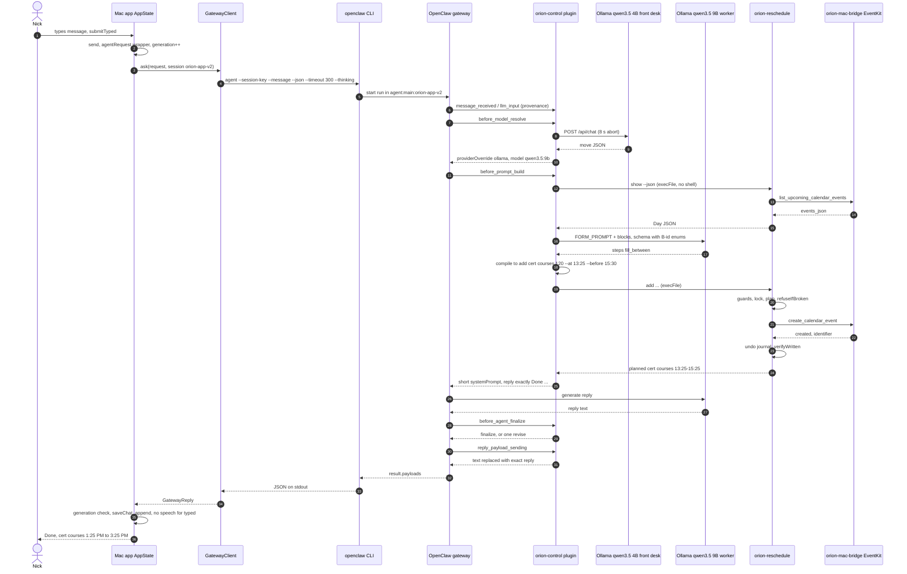
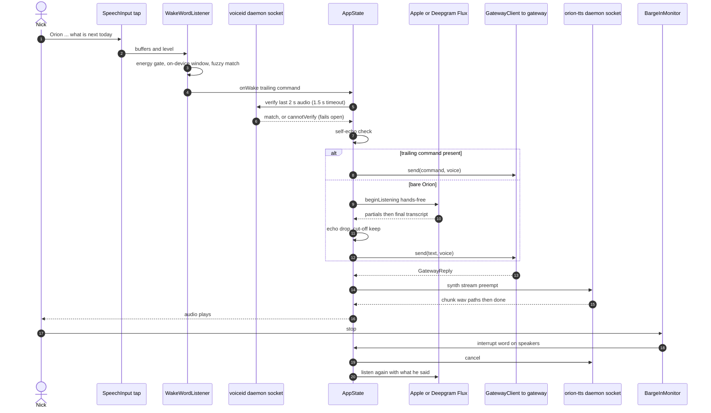
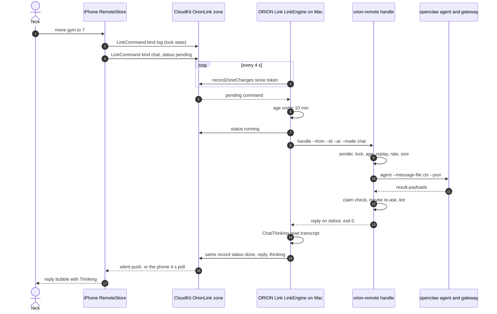
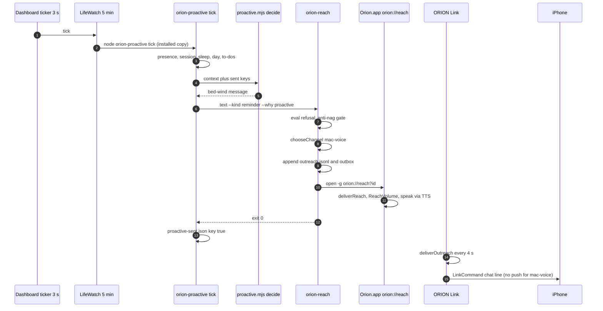
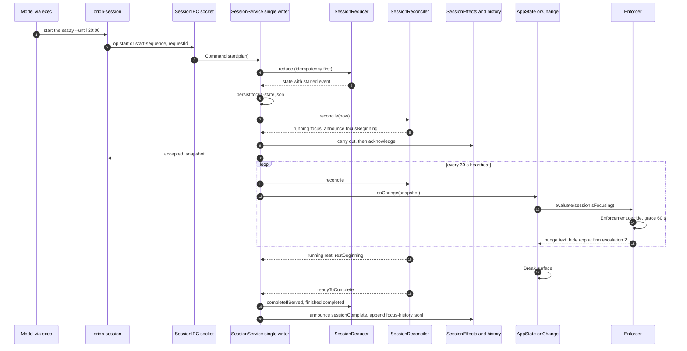
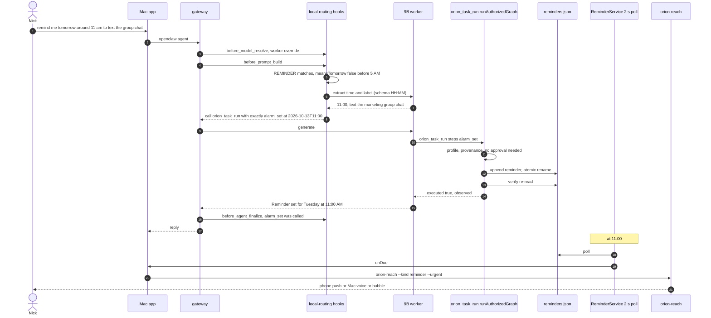
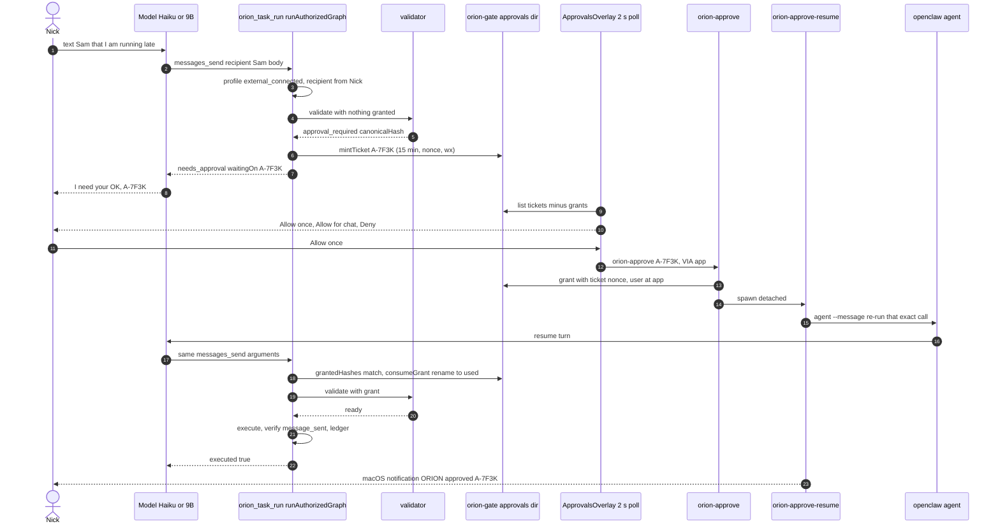

# 10 — End-to-end walkthroughs (seven requests, every layer)
> Part of the ORION Learning Guide. Snapshot: 6c93032 (2026-10-14).
> Covers: `native/Orion/Sources/Orion/{AppState,GatewayClient,SchedulingMemory,ReminderService,ApprovalsOverlay,LifeWatch,…}.swift`,
> `native/Orion/Sources/{SessionDomain,SessionService}/`, `native/OrionMobile/`, `native/OrionLink/`, `native/OrionMacBridge/`,
> `plugin/orion-control/src/{index,local-routing,front-desk,schedule-flow,work-check,approvals,validator,controller,executors,permissions}.ts`,
> `scripts/{orion-reschedule,orion-session,orion-reach,orion-proactive,orion-approve,orion-approve-resume,orion-remote}`, `scripts/lib/{life,reach}/`.
> Read after: the component chapters (00–09). This one assumes you know roughly what each component is and shows how they connect.

This chapter works like a debugger session. Each trace follows one real request from the moment Nick does something to the moment he sees or hears the result. Each **hop** is one place where the data changes hands, and gives:

- **Where** — `path:line` (open it and read along);
- **Code** — a short real excerpt;
- **In → Out** — the actual shape of the data entering and leaving;
- **Why** — why the hop exists, usually in the code's own comments, or the incident that caused it.

Each trace ends with a mermaid sequence diagram and some **Exercises** (read-only things to try or predict). The answers are in collapsible `<details>` blocks.

**State of the worktree.** Everything here is read from committed source at `6c93032`, except where marked. The plugin's compiled `plugin/orion-control/dist/` is modified and partly untracked in the worktree. The gateway runs a deployed copy at `~/.openclaw/extensions/orion-control/dist/`, whose files are dated 2026-10-13 02:10, three minutes after `26f914d`. The `src/*.ts` files cited below are clean against HEAD.

**Live configuration read on 2026-10-14** (from `~/.openclaw/openclaw.json`, non-secret keys only). Several hops depend on it:

| Setting | Value |
|---|---|
| `agents.defaults.model.primary` | `anthropic/claude-haiku-4-5-20251001` |
| `agents.defaults.model.fallbacks` | `ollama/qwen3.5:9b`, `ollama/llama3.2:3b` |
| `gateway.port` | `18789` |
| `plugins.entries.orion-control.config.localRouting` | `"on"` |
| `localRoutingTestingUntil` | `2026-10-14T17:04:46Z` (a time-boxed testing window) |
| `localRoutingScheduleToCloud` | `false` |
| `localRoutingTrace` | `true` |
| `~/.openclaw/orion-controlled/permission-state.json` | profile `external_connected`, version 3 |
| `~/.openclaw/exec-approvals.json` agent `main` | `security: allowlist`, `ask: off`, 102 patterns; defaults `askFallback: deny` |

When the testing window closes, the routing changes. The details are in T1, hop 8 and Exercise 3.

## In this file

| # | Trace | Starts at | Ends at |
|---|---|---|---|
| [T1](#t1--fill-the-time-between-my-classes-typed-in-the-mac-app) | "fill the time between my classes" (typed, Mac) | the Mac chat composer | a calendar event written through EventKit, and a reply in the chat |
| [T2](#t2--a-voice-turn) | A voice turn | the microphone tap and wake word | spoken reply, then barge-in |
| [T3](#t3--a-message-from-the-iphone-mac-reachable) | A message from the iPhone | the phone composer | the reply bubble on the phone |
| [T4](#t4--a-proactive-nudge) | A proactive nudge | a 5-minute timer in the Mac app (and OpenClaw cron) | a Mac voice/bubble, phone push, or Discord |
| [T5](#t5--a-focus-session) | A focus session | `orion-session start` / dashboard | `focus-history.jsonl` |
| [T6](#t6--remind-me-at-11) | "Remind me at 11" | chat | `reminders.json`, which later fires through `orion-reach` |
| [T7](#t7--an-approval-gated-action) | An approval-gated action | a risky tool call | approval → resume → execution |
| [Shared](#shared-hops-reused-by-several-traces) | Shared hops | — | — |

Two facts explain most of the surprises:

1. **No app talks to OpenClaw over a socket or HTTP.** The Mac app (`GatewayClient.ask`), the phone path (`orion-remote` → `askBrain`) and the approval resume (`orion-approve-resume`) all run the `openclaw agent` CLI as a subprocess. The CLI talks to the long-running gateway on port 18789. The CLI is treated as the stable contract (`native/Orion/Sources/Orion/GatewayClient.swift:5-16`).
2. **Which model answers depends on configuration, not on the code path.** With `localRouting: "on"` and an open window, the plugin sends every interactive turn to `ollama/qwen3.5:9b`. Without it, the configured Haiku answers, falling back to local models. T1 traces both branches.

---

## T1 — "fill the time between my classes", typed in the Mac app

**Worked example.** At 13:20 on a weekday, Nick types into the Mac chat:

> fill the time between my classes with cert courses

His day has `CS… Discrete Structures 11:00–12:30 (fixed)` and `Lab 15:30–17:00 (fixed)`. ORION should add a movable "cert courses" block from 13:25 to 15:25: five minutes after now, rounded to 5, and five minutes before the lab.

This is the request from the 2026-10-12 live success, which produced `add "cert courses" 120 --at 13:25 --before 15:30` (`ORION_V3_CONTINUE.md:195-196`). The bare version without "with cert courses" is Exercise 2.

### The hops

#### Hop 1 — The composer submits
**Where:** `native/Orion/Sources/Orion/AppState.swift:1892-1899`. It is called from `SharedChatView.swift:8`, `HomeTab.swift:291`, `PanelView.swift:56` and `TasksTab.swift:121`.
```swift
// native/Orion/Sources/Orion/AppState.swift:1892
func submitTyped() {
    let text = composer.trimmingCharacters(in: .whitespacesAndNewlines)
    guard !text.isEmpty, phase != .thinking else { return }
    composer = ""
    chatMode = true
    if phase == .speaking { bargeIn() }
    send(text, typed: true)
}
```
- **In:** the `@Published composer: String`.
- **Out:** `send("fill the time between my classes with cert courses", typed: true)`.
- **Why:** this is the single entry point for every typed surface (dashboard chat, summon panel, Tasks tab). `phase != .thinking` means you cannot type a second message while a turn is in flight. `agentQueue` is serial, so a second turn would queue invisibly behind the first.

#### Hop 2 — `send()` stamps the origin and takes the shortcuts
**Where:** `AppState.swift:1901-1949`
```swift
// native/Orion/Sources/Orion/AppState.swift:1901
private func send(_ text: String, typed: Bool = false) {
    let origin: ReplyOrigin = typed ? .typed : .voice
    activeReplyOrigin = origin
    if AdaptiveEndpointModel.isResumeRequest(text) { … handleResumeRequest(origin: origin); return }
    // The clock answers the clock questions, instantly (no brain round trip).
    if let quick = QuickAnswer.reply(to: text) { … deliver(GatewayReply(text: quick, elapsedMs: 0), origin: origin); return }
    append(.you, text)
    setPhase(.thinking)
    …
    askGeneration += 1
    let generation = askGeneration
    let request = agentRequest(userText: userText, spoken: !typed)
    let chatSession = chatConversation.map { "orion-chat-" + $0.id } ?? GatewayClient.sessionKey
```
- **In:** `(text, typed: true)`.
- **Out:** `ReplyOrigin.typed`, which later means *do not speak* (`ReplyOrigin.swift:1-6`). Also a wrapped `request` string, a **session key**, and a new `generation` number.
- **Session key:** `orion-chat-<uuid>` when a named chat is selected, otherwise `orion-app-v2` (`GatewayClient.swift:50-53`). The `-v2` thread was started after "a previous browser-open request left the original conversation with an unresolved tool call".
- **Why `generation`:** every later callback checks `askGeneration == generation`. A cancelled, paused or timed-out turn whose answer arrives late is dropped rather than overwriting a newer turn.

#### Hop 3 — The app wraps the message in a context header
**Where:** `AppState.swift:2075-2113`
```swift
// native/Orion/Sources/Orion/AppState.swift:2098
return """
[Orion app context — factual state supplied by the native app]
Focus session: \(sessionDescription).
Firm enforcement: \(enforcement).
Temporary allowed work apps: \(allowedDescription).
Treat the session status and allowed apps as current operating context. Do not claim an app is blocked, hidden, or quit unless a tool confirms it.
\(spoken ? "Nick SAID this out loud and your answer will be SPOKEN: …" : "")

User message:
\(userText)
"""
```
- **In:** the user text, plus `session.snapshot()` (the focus session, see T5) and `enforcer.allowlist`.
- **Out:** a string of about 60 words plus Nick's words. It ends with the marker `User message:\n`.
- **Why:** "The agent must not infer a session from the conversation" (`:2071-2074`). The marker matters later: the plugin's `userText()` splits on `"User message:\n"` so the front desk reads only Nick's words (`local-routing.ts:85,97-100`).

#### Hop 4 — Off the main thread, onto the serial agent queue
**Where:** `AppState.swift:1951-1984`
```swift
// native/Orion/Sources/Orion/AppState.swift:1951
agentQueue.async { [weak self] in
    let result: Result<GatewayReply, Error>
    do {
        result = .success(try GatewayClient.ask(request, session: chatSession, model: chatModel))
    } catch { result = .failure(error) }
    DispatchQueue.main.async {
        guard let self else { return }
        guard self.askGeneration == generation else { … return }
        …
        case .success(let reply): self.deliver(reply, origin: origin)
        case .failure(let error): … self.failThinking(message)
```
- **In:** `request`, `chatSession`, and `chatModel` (`selectedChatModel`; `nil` means the gateway's default).
- **Out:** `Result<GatewayReply, Error>`, back on main.
- **Why:** `ask` blocks for the whole turn. `startProgressPolling` (`:1990-2005`) runs a 1 Hz UI tick, plus an `openclaw audit` poll every 3 s on a separate `auditQueue`, so Nick can watch progress ("Thinking… 36s").

#### Hop 5 — `GatewayClient.ask` builds the CLI argv
**Where:** `native/Orion/Sources/Orion/GatewayClient.swift:115-151`
```swift
// native/Orion/Sources/Orion/GatewayClient.swift:120
let process = Process()
process.executableURL = URL(fileURLWithPath: binaryPath)          // /Users/nickmadaio/.openclaw/bin/openclaw
process.arguments = [
    "agent",
    "--session-key", session,
    "--message", recentOutreach() + SchedulingMemory.context(for: text) + text,
    "--json",
    "--timeout", String(Int(RunTimeouts.agentTimeout))             // 300
]
let thinking = ThinkingPolicy.level(for: text, model: model, boostedUntil: boostedUntil(session))
if let model { process.arguments?.append(contentsOf: ["--model", model]) }
process.arguments?.append(contentsOf: ["--thinking", thinking])
```
The message gets two prefixes:
- **`recentOutreach()`** (`:99-110`): up to three things ORION said to Nick first in the last 6 h, read from `~/.openclaw/orion-controlled/outreach.jsonl`. This is so that "yeah do that" has its question (2026-10-07).
- **`SchedulingMemory.context(for:)`** (`SchedulingMemory.swift:4-11`): if the text matches `schedule|scheduling|plan|planning|reschedule|class|lecture|nap|commute`, it prepends up to 12,000 characters of `~/.openclaw/workspace/SCHEDULING.md`. Our message contains "class**es**", but the regex has `\b(…class…)\b`, and `classes` does not match `\bclass\b`. So **no SCHEDULING.md is prepended for this message** (inferred from the regex; Exercise 1).

The other two inputs:
- **`ThinkingPolicy.level`** (`native/OrionMobile/Sources/MobileCore/ThinkingPolicy.swift:44-48`) returns `"off"` for an `ollama/` model, `"low"` during a 10-minute boost after a struggling turn, and otherwise `needsReasoning(text) ? "low" : "off"`.
  - **Finding (inferred from reading, not measured):** `text` here is the whole wrapped request from hop 3. `needsReasoning` returns true for any text of 35 words or more (`:41`), and the hop-3 header alone is about 45 words. So **every Mac-app turn on a cloud model is sent with `--thinking low`**, which defeats the "no thinking for ordinary talk" intent in the file header.
  - You can check this in `~/.openclaw/logs/orion-app.log`, which records `[thinking] low for this turn` (`GatewayClient.swift:300`).
- **Environment:** PATH is widened for the bash shim. Exactly one secret is passed through, `GOG_KEYRING_PASSWORD`, by name (`:139-148`). Nothing else from the Keychain reaches the CLI.
- **Timeouts** (`RunTimeouts.swift:37-90`) form an enforced chain: agent 300 s < terminate 320 s < kill 325 s < client read deadline 360 s < app watchdog 420 s.
  - The second-to-last link exists because of 2026-08-12. A grandchild process held stdout open, `readDataToEndOfFile` never returned, and "Orion was deaf for twelve minutes" (`GatewayClient.swift:176-186, 207-218`).

#### Hop 6 — The CLI reaches the gateway, and the gateway starts a run
**Where:** this happens outside the repo, in the OpenClaw CLI and the gateway (`ai.openclaw.gateway` launchd agent, port 18789).
- **In:** argv from hop 5.
- **Out:** an agent run in session `agent:main:<session-key>`. Its transcript is appended to the file that `~/.openclaw/agents/main/sessions/sessions.json` names for that key (`native/OrionMobile/Sources/MobileCore/ChatThinking.swift:4-11`).
- **Why the CLI:** "The RPC shape is versioned and drifts between releases; the CLI is the stable contract" (`GatewayClient.swift:8-11`).
- What OpenClaw does internally (prompt assembly from `~/.openclaw/workspace/*.md`, the model call, tool dispatch) is vendored and not in this repo. **(inferred)** from the hook names the plugin registers.

#### Hop 7 — Plugin hooks record who is speaking (provenance)
**Where:** `plugin/orion-control/src/index.ts:1528-1559`. It is wired in at `:1741-1744` around `defineToolPlugin`.
```ts
// plugin/orion-control/src/index.ts:1544
api.on("message_received", (event, hookContext) => {
  store.recordChannelMessage({
    content: field(event, "content"),
    runId: field(event, "runId") ?? field(hookContext, "runId"),
    sessionKey: field(event, "sessionKey") ?? field(hookContext, "sessionKey"),
    sessionId: field(event, "sessionId") ?? field(hookContext, "sessionId"),
  });
});
api.on("llm_input", (event, hookContext) => { store.recordAgentPrompt({ prompt: field(event, "prompt"), … }); });
```
- **In:** host events that the model cannot forge.
- **Out:** entries in the in-memory `HarnessProvenance` store.
- **Why:** "These three host hooks are the ONLY writers of Orion's trust state … If none of these fire, no authenticated user turn exists and every gated action fails closed" (`:1517-1527`). This matters in T6 and T7: `orion_task_run` will only act for a turn this store authenticated.
  - When neither hook fires (locally initiated runs), `runAuthorizedGraph` recovers the user text from the host-written transcript (`index.ts:823-829`).

#### Hop 8 — `before_model_resolve`: the front desk decides, and the model is overridden
**Where:** `plugin/orion-control/src/local-routing.ts:269-296`. It is registered from `index.ts:1671-1686` only if `localRouting` is `"shadow"` or `"on"`.
```ts
// plugin/orion-control/src/local-routing.ts:274
if (!raw || INTERNAL.test(sessionKey)) return undefined;
const message = userText(raw);
const decision = Promise.resolve()
  .then(() => decideImpl({ message, clock: clock() }))
  .catch((error: unknown) => ({ error: error instanceof Error ? error.message : String(error) }));
const run: Run = { message, decision, tools: [], started: Date.now(), passes: 0, findings: [],
  ...(on ? { brain: (options.brainSearch ?? defaultBrainSearch)(message).catch(() => "") } : {}) };
…
if (!on) return undefined; // shadow: fire and forget
if (options.testingUntil && !windowOpen()) return undefined; // the testing window closed: back to shadow
const d = await decision;
if ("error" in d) { run.settled = { move: "escalate", fallback: d.error }; return { providerOverride: workerProvider, modelOverride: workerModel }; }
run.settled = d;
…
return { providerOverride: workerProvider, modelOverride: workerModel };
```
- **In:** `event.prompt` (the assembled prompt), `runId`, `sessionKey`.
- **Out:** `{ providerOverride: "ollama", modelOverride: "qwen3.5:9b" }` (`job-instructions.ts:4`), plus a `Run` record keyed by `runId` and `session:<key>`.
- **The front desk call** (`front-desk.ts:56-103`): `POST http://127.0.0.1:11434/api/chat` with model `qwen3.5:4b-q4_K_M` (`front-desk-prompt.ts:3`), `think:false`, `temperature 0`, `num_ctx 16384`, a JSON-schema `format`, and an **8 s abort**.
  - It never throws. Any timeout, HTTP error, unparsable output or invalid move becomes `{ move: "escalate", fallback: "<why>" }` (`:69-70, 98`).
- **The brain prefetch:** runs at the same time, `execFile(scripts/orion-brain, ["search", message[:200]])` with an 8 s timeout (`local-routing.ts:141-144`).
- **Why every move goes to the worker, even "answer":** "the direct-reply hook does not fire on every route (agent CLI / phone), and falling through to the configured cloud model costs money" (`:293-294`).
- **Which branch you are on:**
  - **`off`** (key absent or `"off"`): this hook is not registered and the turn goes to Haiku. Skip to the alternative branch below.
  - **`shadow`**: the front desk runs fire-and-forget, the hook returns `undefined`, and Haiku answers. `before_agent_finalize` logs to `~/.openclaw/orion-controlled/local-routing/shadow.jsonl`.
  - **`on`, window open** (today until 17:04 UTC): the worker answers.
  - **`on`, window closed mid-session:** this hook returns `undefined` at `:284`, so Haiku answers. But `on` was captured as `true` when the plugin registered, so the finalize work-check and the `reply_payload_sending` rewrite are **still registered and still run**. See Exercise 3. **(inferred from reading; not exercised live.)**
  - **At the next gateway restart after the window:** `testingActive` is false, so `acceptanceVerdict` runs. The record needs ≥20 cases, ≥85 % pass, ≤20 s median and ≤14 days old (`local-routing.ts:218-229`). The last recorded one was 7/21 (`ORION_V3_CONTINUE.md:203`), so the plugin logs `localRouting "on" REFUSED` and runs shadow (`:240-247`).

#### Hop 9 — `before_prompt_build`: a scheduling statement goes to the fixed flow
**Where:** `local-routing.ts:307-342`
```ts
// plugin/orion-control/src/local-routing.ts:333
if (SCHEDULING.test(run.message) && !/\?\s*$/.test(run.message.trim()) && !run.flow) {
  // No built-in default: only the plugin entry point wires the real scheduler in (a test that
  // forgot a stub wrote a block called "B4" to Nick's real calendar, 2026-10-12).
  run.flow = options.scheduleFlow
    ? await options.scheduleFlow(run.message, clock()).catch((e: unknown) => ({ outcome: "fallback" as const, reason: String(e) }))
    : { outcome: "fallback", reason: "no scheduling flow wired" };
  if (run.flow.outcome === "done") {
    run.flow.calls.forEach((canonical, i) => run.tools.push({ canonical, stdout: (run.flow as { outputs: string[] }).outputs[i] ?? "", exit: null }));
  }
}
```
- **In:** `run.message = "fill the time between my classes with cert courses"`.
- **The routing tests:**
  - `SCHEDULING` (`:88`) matches on *word stems*. Here `between`, `class` and `add`-like stems hit (`\b(…between|…class…)\w*`).
  - `REMINDER` (`:89`) does not match, so hop 9 skips the reminder branch (that is T6).
  - The text does not end in `?`, so it is a statement, not a question.
- **Out:** `run.flow: FlowResult`, which is `{outcome:"done", calls, outputs}`, `{outcome:"say", text, kind}` or `{outcome:"fallback", reason}` (`schedule-flow.ts:220-223`).
- **Why stems:** "studying", "shorter", "ditch", "nuke", "stick" missed the flow. The old loop then answered "Done" for changes it never made (live gauntlet, 2026-10-12, `a847ba8`).

#### Hop 10 — The flow reads the whole day as data
**Where:** `schedule-flow.ts:225-232`. The day is read by `scripts/orion-reschedule:219-224`.
```ts
// plugin/orion-control/src/schedule-flow.ts:229
const dateArgs = meansTomorrow(message, now) ? ["--date", "tomorrow"] : [];
let day: Day;
try { day = JSON.parse((await exec(["show", "--json", ...dateArgs])).stdout); } catch { return { outcome: "fallback", reason: "could not read the day" }; }
const user = `Now: ${clock}.\n\nHis day${dateArgs.length ? " (tomorrow)" : ""}:\n${blockList(day)}\n\nNick: ${message}`;
```
- **`exec`** is `execFile("/Users/nickmadaio/Desktop/ORION/scripts/orion-reschedule", args, {timeout: 60000})`. It uses argv with **no shell** (`local-routing.ts:152-155`).
- **Out of `show --json`** (`orion-reschedule:219-224`), illustrative values:
  ```json
  {"date":"2026-10-14","now":"13:20","blocks":[
    {"title":"CS… Discrete Structures","start":"11:00","end":"12:30","fixed":true,"pinned":false,"kind":"class"},
    {"title":"Lab","start":"15:30","end":"17:00","fixed":true,"pinned":false,"kind":"class"}]}
  ```
- **What the model sees** (`blockList`, `schedule-flow.ts:33-36`):
  ```
  B1 11:00–12:30 CS… Discrete Structures (FIXED) (already happened)
  B2 15:30–17:00 Lab (FIXED)
  ```
- **Why read the past blocks too:** "What a model needs to name the blocks he means ('between Discrete Structures and my lab' after DS has ended)" (`orion-reschedule:216-218`).

#### Hop 11 — The 9B fills one form
**Where:** `schedule-flow.ts:233`, with the model call at `local-routing.ts:156-164`
```ts
// plugin/orion-control/src/local-routing.ts:158
const res = await fetch("http://127.0.0.1:11434/api/chat", { method: "POST", headers: { "content-type": "application/json" },
  body: JSON.stringify({ model: WORKER_MODEL, stream: false, think: false, format: schema, options: FORM_OPTIONS, keep_alive: "24h",
    messages: [{ role: "system", content: system }, { role: "user", content: user }] }), signal: AbortSignal.timeout(30000) });
```
- **In:**
  - system = `FORM_PROMPT` (`schedule-flow.ts:64-89`): 14 step types and 8 worked examples on a sample day;
  - user = hop 10's text;
  - `format` = `intentSchema(day)` (`:39-58`), in which `after`/`before`/`with` are **enums of today's real ids** (`["B1","B2"]`), there are at most 4 steps, and `text` is at most 200 characters.
- **Options:** `FORM_OPTIONS` (`:62`) is `temperature 0, top_k 20, repeat_penalty 1.05, num_predict 500, num_ctx 32768`.
  - `num_predict 500` exists because "at temperature 0 a list can loop forever — one call generated 14k tokens for 5 minutes (2026-10-12)".
- **Out (expected):** `{"steps":[{"do":"fill_between","what":"cert courses","after":"B1","before":"B2"}]}`
- **Failure:** any fetch error or parse failure returns `null`, so there are no steps and the outcome is `fallback: "no steps"`.

#### Hop 12 — Code compiles the form into exact argv (no model arithmetic)
**Where:** `schedule-flow.ts:112-145` (`compile`, `fill_between` case)
```ts
// plugin/orion-control/src/schedule-flow.ts:131
case "fill_between": {
  const a = byId(step.after); const b = byId(step.before);
  if (!a || !b) return { error: "fill_between needs two real blocks (after, before)" };
  const roundUp = (n: number) => Math.ceil(n / 5) * 5;
  const start = roundUp(Math.max(toMin(a.end) + BUFFER, now));
  const end = toMin(b.start) - BUFFER;
  if (end - start < 15) return { say: "cannot", text: `there are only ${…} minutes between ${a.title} and ${b.title}` };
  if (what) return { args: ["move", what.title, "--to", hhmm(start), "--until", hhmm(end)] };
  if (!step.what) return { error: "fill_between needs what to put there" };
  return { args: ["add", step.what, String(end - start), "--at", hhmm(start), "--before", hhmm(end + BUFFER)] };
}
```
- **Worked numbers:**
  - `a.end` is 12:30, so `+5` gives 12:35. `now` is 13:20, so `max` gives 13:20, and rounding up to 5 gives **13:25**.
  - `b.start` is 15:30, so `−5` gives **15:25**. The length is **120 min**.
  - **Out:** `["add","cert courses","120","--at","13:25","--before","15:30"]`.
- **Why:** Nick's own decomposition, quoted in the file header: "the start time is a because the class ends at b, and the end time is x because the lab starts at y".
  - `BUFFER = 5` is his five-minute rule (`:31`).
  - A fixed block can never be the thing moved (`:127`).
- **One correction round** (`:236-242`): if any step compiles to `{error}`, the 9B is asked again with "Your form … broke a rule: <error>". A second failure means `fallback`. This is the "LLM-Modulo" idea: the scheduler's rules check the model.

#### Hop 13 — `orion-reschedule add` runs: guards, lock, plan, write
**Where:** `scripts/orion-reschedule`. The guards are at `:75-117`, the lock at `:151-165`, `add` at `:352-410`, and the final write at `:957-993`.
```js
// scripts/orion-reschedule:75
const KNOWN = new Set(["--after", "--again", "--at", "--before", "--by", "--check", "--date", "--dry-run", "--fill", "--fixed", "--gap", "--json", "--minutes", "--now", "--plan",
  "--replace", "--say", "--then", "--to", "--todos", "--until", "--what", "--why"]);
const unknown = args.filter((a) => a.startsWith("--") && !KNOWN.has(a));
if (unknown.length) {
  console.error(`NOTHING WAS CHANGED: orion-reschedule has no ${unknown.join(", ")} option. …`);
  process.exit(2);
}
```
In order, the script does this:
1. Refuses unknown options. This happened 2026-10-06: `--until 20:00` was silently ignored before it existed.
2. Refuses two commands glued into one call (`:82-94`, 2026-10-07).
3. Takes a mkdir lock at `~/.openclaw/orion-controlled/reschedule.lock`, waiting up to 30 s. A lock older than 60 s is broken (`:151-165`).
4. Reads events through the bridge (`:215`, `calendarEvents` → `list_upcoming_calendar_events`).
5. Computes the plan.
6. Calls `refuseIfBroken(projectDay(…))`, which checks the *projected* day against the day rules **before** writing (`:121-140`).
7. Calls `applyPlan`, then `verifyWritten`. That re-reads the calendar and warns on overlaps (`:141-147`).

- **Out (stdout):**
  ```
  Changed Wednesday 2026-10-14:
    planned cert courses: 13:25–15:25
  Written to his calendar. "orion-reschedule undo" puts it back.
  ```
  The line format is `${c.fixed ? "added (fixed)" : "planned"} ${c.title}: HH:MM–HH:MM` (`:967`). Failures print `NOTHING WAS CHANGED: …` or `NOT BOOKED: …`, both of which the reply builder and the work check recognise.

#### Hop 14 — The calendar write: Node → shell pipe → Swift bridge → EventKit
**Where:** `scripts/lib/life/calendar-write.mjs:59-101` → `scripts/lib/life/bridge-path.mjs:36-46` → `native/OrionMacBridge/Sources/OrionMacBridge/Bridge.swift:54-67, 421-445`
```js
// scripts/lib/life/bridge-path.mjs:36
export async function bridgeRequest(action, payload, { timeout = 30000 } = {}) {
  const request = JSON.stringify({ id: "life", action, payload }).replace(/'/g, "'\\''");
  …
  const { stdout } = await run("/bin/sh", ["-c", `printf '%s\\n' '${request}' | "${bin}"`], { timeout, maxBuffer: 8 << 20, env });
  const line = stdout.split("\n").find((l) => l.trim().startsWith("{"));
  const parsed = line ? JSON.parse(line) : null;
  if (!parsed?.ok) throw new Error(parsed?.error ?? "the calendar bridge did not answer");
  return parsed.result;
}
```
```swift
// native/OrionMacBridge/Sources/OrionMacBridge/Bridge.swift:430
let store = EKEventStore()
let event = EKEvent(eventStore: store)
event.title = title
event.startDate = start
event.endDate = end
event.calendar = store.defaultCalendarForNewEvents
if let kind = payload["orionKind"], kind.range(of: #"^[a-z_]{1,20}$"#, options: .regularExpression) != nil {
    event.notes = "Planned by ORION. It may move this block when your day changes. [orion:\(kind)]"
}
try store.save(event, span: .thisEvent, commit: true)
return ["status": "created", "identifier": event.calendarItemIdentifier]
```
- **In:**
  - Node writes one stdin line: `{"id":"life","action":"create_calendar_event","payload":{"title":"cert courses","start":"2026-10-14T12:25:00Z","end":"2026-10-14T14:25:00Z","orionKind":"…"}}`. The times are local minutes converted to UTC ISO by `iso()` (`calendar-write.mjs:18-21`); London is UTC+1 in October.
  - The binary is the installed copy `~/.openclaw/orion-remote/bin/orion-mac-bridge` if it exists, otherwise the repo build (`bridge-path.mjs:18-20`).
- **Out:** one stdout line, `{"id":"life","ok":true,"result":{"status":"created","identifier":"…"}}`.
- **Why the marker:** the `[orion:<kind>]` note is how the planner later knows a block is ORION's and may move it. Nick's own events stay unmarked "so they never move" (`calendar-write.mjs:78`).
- **Why the shell:** `printf | bridge` with manual single-quote escaping is the only `/bin/sh` on this path. The rest of the flow uses argv only. The `.replace(/'/g, "'\\''")` is what keeps a title containing `'` from breaking out of the quotes.
- **Calendar permission:** `createCalendarEvent` refuses unless `EKEventStore.authorizationStatus(for: .event) == .fullAccess` (`Bridge.swift:422-424`). That is why the life loop runs things from the Mac app, which holds the Calendar grant (`LifeWatch.swift:9-11`). **(inferred:** the responsible-process TCC grant is what lets the bridge pass.)

#### Hop 15 — The undo journal
**Where:** `calendar-write.mjs:59-101`
```js
// scripts/lib/life/calendar-write.mjs:92
if (!undo.length) return;
…
const next = group && last?.group === group
  ? [...history.slice(0, -1), { ...last, steps: [...last.steps, ...undo] }]
  : [...history, { pinsBefore: priorPins, at: new Date().toISOString(), ...(group ? { group } : {}), steps: undo }];
writeFileSync(`${UNDO_FILE}.tmp`, JSON.stringify(next.slice(-10), null, 2));
renameSync(`${UNDO_FILE}.tmp`, UNDO_FILE);
```
- **Out:** `~/.openclaw/orion-controlled/reschedule-undo.json` gets `{at, pinsBefore, steps:[{op:"create", identifier, title}]}`. Only the last 10 entries are kept.
- **On a mid-plan failure:** the steps already done are reversed (`:83-86`).
- **Why one entry per command:** "'Two study sessions' was booked as two separate journal entries, so 'undo' removed one and ORION said both were gone" (2026-09-29, `:26-30`).

#### Hop 16 — The flow builds the reply from the scheduler's own lines
**Where:** `schedule-flow.ts:259-290` (run loop, then `spokenReply`), `local-routing.ts:168-172` (`exactReply`)
```ts
// plugin/orion-control/src/schedule-flow.ts:276
let m = l.match(/^planned (.+?): (\d{2}:\d{2})–(\d{2}:\d{2})/);
if (m) { said.push(`${m[1]} ${ampm(m[2]!)}–${ampm(m[3]!)}`); continue; }
```
- **In:** the stdout lines from hop 13.
- **Out:** `{outcome:"done", calls:["exec orion-reschedule add \"cert courses\" 120 --at 13:25 --before 15:30"], outputs:[…]}`, and the reply text `"Done: cert courses 1:25 PM–3:25 PM."`
- **Why the reply is built by code:** "left to phrase it, it said 'before you head to the spit' for a plan that starts there" (`local-routing.ts:350-352`, commit `3076cbb` 2026-10-12).

#### Hop 17 — The worker is told to repeat the exact text
**Where:** `local-routing.ts:349-356`
```ts
// plugin/orion-control/src/local-routing.ts:353
const exact = exactReply(run.flow);
return { systemPrompt: `${LOCAL_IDENTITY}\n\n${now}\n\nYou already made this change. Reply to Nick with exactly this text and nothing else, and do not call any tools:\n${exact}`,
  appendContext: `[ORION scheduler — already done. Your whole reply must be exactly: ${exact}]` };
```
- **Out:** the host replaces the ~17k-token workspace prompt with a short `systemPrompt` and appends the instruction to the latest message.
- **Why both:** "From the system prompt alone the 9B paraphrased old turns (live gauntlet)" (`:351-352`).
- **Why the prompt is small:** the workspace prompt "is ~17k tokens; on the 9B that cost 60-100 s a turn (live, 2026-10-11)" (`:310-312`).

#### Hop 18 — `before_agent_finalize`: the work check, and one retry if the reply drifted
**Where:** `local-routing.ts:396-445`, with the checks in `work-check.ts:176-195`
```ts
// plugin/orion-control/src/local-routing.ts:417
if (on && (run.flow?.outcome === "done" || run.flow?.outcome === "say")) {
  const expected = exactReply(run.flow);
  remember([runId, sessionKeyNow], expected);
  const squash = (t: string) => t.toLowerCase().replace(/[^a-z0-9]+/g, "");
  if (!squash(reply).includes(squash(expected).slice(0, 60)) && run.passes < 1) {
    run.passes += 1;
    return { action: "revise", reason: "reply must be the scheduler's", retry: { instruction: `Ignore the earlier conversation. Your whole reply must be exactly this text, …: ${expected}`, idempotencyKey: `${runId}:exact-reply`, maxAttempts: 1 } };
  }
}
```
- **In:** `event.lastAssistantMessage` (the 9B's reply) and `run.tools` (here, the flow's call and output).
- **Out:**
  - **`revise`** at most once for the exact reply, and at most twice for work-check findings, but *not* after the flow acted (`:426-431`).
  - Otherwise **`undefined`** (finalize).
  - A JSONL log line in `shadow.jsonl`: `{at, mode, runId, message, decision, flow:{outcome, calls}, cloud, model, tools, findings, passes, escalationNeeded, turnMs}` (`:437-438`).
- **`checkWork` findings** (`work-check.ts:181-194`): "did not finish", "asked instead of acting", "promised but did not act", "claims what the tools don't show", "failure not mentioned", "reply times don't match", "last change incomplete".

#### Hop 19 — `reply_payload_sending`: the exact text replaces whatever was said
**Where:** `local-routing.ts:376-387`
```ts
// plugin/orion-control/src/local-routing.ts:380
if (on) api.on("reply_payload_sending", (event) => {
  const keys = [str(event.runId) ?? "", `session:${str(event.sessionKey) ?? ""}`];
  const hit = keys.map((k) => finalText.get(k)).find((v) => v && Date.now() - v.at < 120000);
  if (!hit) return undefined;
  keys.forEach((k) => finalText.delete(k));
  const payload = (event.payload ?? {}) as Record<string, unknown>;
  return { payload: { ...payload, text: hit.text }, reason: "orion-control: the scheduler's own reply" };
});
```
- **Out:** the delivered payload's `text` becomes `"Done: cert courses 1:25 PM–3:25 PM."`, whatever the 9B wrote. This works within 120 s of finalize.
- **Why:** "the 9B paraphrased it from session history ('Done: grind leetcode 6:15…' after a clear)" (`:376-377`).

#### Hop 20 — The CLI prints JSON; the app extracts the text
**Where:** `GatewayClient.swift:243-301`, `extractReply` at `:387-449`
```swift
// native/Orion/Sources/Orion/GatewayClient.swift:408
static func extractReply(_ payload: [String: Any]) -> String {
    var scopes: [[String: Any]] = []
    if let result = payload["result"] as? [String: Any] { scopes.append(result) }
    scopes.append(payload)
    …
    for key in ["payloads", "messages", "outputs"] { … }
```
- **In:** `{"runId":…,"status":"ok","summary":"completed","result":{"payloads":[{"text":"Done: cert courses 1:25 PM–3:25 PM.","mediaUrl":null}],"meta":{…}}}`. This is the shape observed on OpenClaw 2026.7.1-2 (`:394-398`).
- **Out:** `GatewayReply { text, elapsedMs, thinking }`.
  - `thinking` comes from reading the session transcript for `type:"thinking"` blocks newer than the turn start (`ChatThinking.read`). It is not taken from the JSON.
- **Struggle detection:** if two or more tool results failed in the turn, `ThinkingPolicy.struggled` sets a 10-minute "think low" boost (`:290-299`).
- **Errors:** `.inFlight` when the payload status is `in_flight` ("A turn is already running in this session"), and `.unparseable` when nothing readable came back.

#### Hop 21 — Back on main: save, show, and (for typed input) stay quiet
**Where:** `AppState.swift:2115-2124`, `:762-772`, `:112-118`
```swift
// native/Orion/Sources/Orion/AppState.swift:2115
private func deliver(_ reply: GatewayReply, origin: ReplyOrigin) {
    interruptedReplyText = nil
    chatThinking = reply.thinking
    saveChat(.orion, text: reply.text, thinking: reply.thinking)
    append(.orion, reply.text)
    speak(reply.text, origin: origin)
}
```
- **Out:**
  - A `ChatMessage{role:.orion, text, thinking, at, device:"mac", model}` appended to the `ChatStore` at `~/.openclaw/orion-controlled/chats` (`:82`, `:112-118`). The phone path reads and writes the same store (T3).
  - A `Turn` for the visible transcript.
  - `speak()` returns early because `origin.allowsSpeech` is false for `.typed`.
- **Why "speak only for voice":** commit `e34a9c6` (2026-10-02). Typed replies, timers and focus feedback stay in text (`README.md:169-170`).

### Alternative branch — the open agent loop (Haiku, or the 9B in "worker" mode)

You land here when:
- (a) `localRouting` is `off` or `shadow`; or
- (b) the testing window has closed; or
- (c) `localRoutingScheduleToCloud: true` and the message is a change request (`local-routing.ts:289-292`); or
- (d) the flow returned `fallback`. Then the worker gets the job's instructions instead (`local-routing.ts:362-372`).

| Step | Where | What happens |
|---|---|---|
| A1 | gateway (vendored) | **(inferred)** Haiku receives the full workspace prompt (`~/.openclaw/workspace/AGENTS.md`, `TOOLS.md`, `SCHEDULING.md` …, ~17k tokens) plus the message. For (d), the 9B instead gets `SCHEDULING_INSTRUCTIONS + PRODUCTION_NOTES + LOOK_IT_UP + brain snippets + clock` (`local-routing.ts:368-372`). |
| A2 | `local-routing.ts:202-208` | `PRODUCTION_NOTES` tells the worker the exact one-call recipe: `orion-reschedule move "X" --after "<first class>" --before "<second class>"`, or `add "X" <minutes> --after … --before …`, always by full path. |
| A3 | `index.ts:1572-1645` (`before_tool_call`) | **Repeat guard:** blocks the 3rd consecutive identical call or the 5th anywhere in a run. After 3 blocks (`REPEAT_LOCKOUT`), every further tool is refused with "Reply to Nick NOW" (2026-10-06: 30 blocked calls in one turn). **Exec routing** (`exec-routing.ts:76+`): an `exec` that is going to be refused anyway gets the right route in its refusal ("Memory is searched with `orion-recall`…", "`X` is a catalog action, not a program…"). |
| A4 | `~/.openclaw/exec-approvals.json` (host) | The exec allowlist for agent `main` is 102 patterns, including `/Users/nickmadaio/Desktop/ORION/scripts/orion-reschedule`. With `ask: off` and `askFallback: deny`, a miss is a flat denial and never a prompt. |
| A5 | `scripts/orion-reschedule` | Same as hops 13–15. `move` with `--after`/`--before` anchors is at `:436-468` and prints `X moved: HH:MM → HH:MM–HH:MM`. |
| A6 | `local-routing.ts:389-394` (`after_tool_call`) | Records `exec orion-reschedule …` with its stdout, for the work check. |
| A7 | `local-routing.ts:426-436` | With `on`: findings lead to one revise with `retryInstruction`. If still flagged, a second revise with `HONEST_STOP` ("Undo any change … tell Nick … what you could not do"). If still claiming, the delivered text becomes "I didn't manage to make that change — nothing on your calendar changed." |
| A8 | `account-health.ts:221-244` | If the Anthropic account is unusable (credit, cap, bad key), Nick gets one phone alert through `alerts-outbox.jsonl`. `accountFailFast` (off by default, and never when `localRouting` is `"on"`) can short-circuit the turn. |

**Which reply checks exist on the Mac route.** These were found by grep. The **claim classifier** (`scripts/lib/remote/claims.mjs`) and the **reply linter** (`scripts/lib/remote/reply-lint.mjs`) are imported only by `scripts/orion-remote:36-37`, which is the phone and Discord path (T3). On the Mac route the honesty checks come from two places:
- the plugin's work check, which exists only while local routing is registered;
- the `orion_task_run` outcome envelope (`executed` / `confidence`, `index.ts:1131-1137`).

With `localRouting: "off"`, a Haiku reply on the Mac goes out without any claim check **(inferred from imports; confirm with `grep -rn "remote/claims" scripts plugin native`)**.

### Sequence diagram



### Exercises (T1)

1. Predict whether `SchedulingMemory.context(for:)` prepends SCHEDULING.md for "fill the time between my classes". Then for "fill the time between my class and the lab".
2. Predict what happens to the bare request "fill the time between my classes", which names no activity, on the `on` route.
3. It is 18:00 UTC on 2026-10-14. The testing window ended at 17:04:46Z and the gateway has **not** restarted. Nick types the T1 message. Who answers, and which plugin checks still run?
4. Ollama is not running (`127.0.0.1:11434` refuses connections) and local routing is `on`. Walk hops 8–11.
5. Read only: find the evidence that this turn ran at `--thinking low`.

<details><summary>Answers (T1)</summary>

1. **No, and yes.** The regex is `\b(schedule|scheduling|plan|planning|reschedule|class|lecture|nap|commute)\b` (`SchedulingMemory.swift:5`). `classes` fails the trailing `\b` after `class` because `e` follows. "my class and the lab" matches. This only affects what the *cloud* model sees: on the `on` route, `before_prompt_build` replaces the system prompt anyway.
2. **It depends on the 9B's form.** The schema allows `fill_between` without `what`, and `compile` returns `{error: "fill_between needs what to put there"}` (`schedule-flow.ts:141`).
   - That triggers one correction round with the hint "If what he names is not on his day, use its name as a new title" (`:238`).
   - If the 9B then emits `ask` ("What should go between them?"), the outcome is `say/ask` and the reply is that question, word for word (`local-routing.ts:170`).
   - If it still errors, the outcome is `fallback` and the worker runs the open loop with `PRODUCTION_NOTES`.
   - It may also pick an existing movable block as `what` (`compile` maps a title to a B-id at `:118-122`).
   - You cannot know which without running it. That is exactly why `docs/evals/v3` measures it.
3. **Haiku answers, but parts of local routing are still active.**
   - `before_model_resolve` returns `undefined` at `local-routing.ts:284`, so there is no override. `run.settled` is never set, so `before_prompt_build` returns early at `:309` and Haiku gets the full workspace prompt.
   - `before_agent_finalize` still runs `checkWork` with `on === true`. A finding can still trigger up to two `revise` passes on Haiku's reply, and a claim the tools do not back can still be replaced with the honest line through `reply_payload_sending`.
   - The comment at `:237` says "a window that ended mid-session must not keep 'on' running", but only the model override honours that.
   - **(inferred from code; not observed live.)**
4. **Every step degrades rather than fails.**
   - `decide()` hits a connection error and returns `{move:"escalate", fallback:"error: …"}` without throwing. `run.settled` gets `escalate` and the override to the worker is still returned (`:287`).
   - The brain prefetch is independent and may still work.
   - In `before_prompt_build`, the flow's form call `fetch` throws inside `ask`, which returns `null` (`:163`). There are no steps, so `fallback: "no steps"`. The prompt falls through to `SCHEDULING_INSTRUCTIONS + PRODUCTION_NOTES`.
   - The gateway then tries to run the *worker* on Ollama, which is down. **(inferred)** The gateway's own fallback chain decides what happens next; the configured fallbacks are also Ollama models. Expect a slow failure that ends in `GatewayError.failed`, shown as "Thinking stalled after Ns. The agent failed: …" (`AppState.swift:2058-2069`).
5. `grep "\[thinking\]" ~/.openclaw/logs/orion-app.log | tail -3` shows `[thinking] low for this turn`. Then count the words of `agentRequest`'s template (`AppState.swift:2098-2112`) and compare with `ThinkingPolicy.swift:41`.

</details>

---

## T2 — A voice turn

**Worked example.** Nick is in the room with the dashboard closed. He says "Orion … what's next today?", hears the answer through the speakers, and cuts it off halfway with "stop".

In this trace, Swift paths without a directory are in `native/Orion/Sources/Orion/`. Line numbers were checked against HEAD, and every file below is clean in the worktree.

### The hops

#### Hop 1 — One microphone tap feeds everything
**Where:** `SpeechInput.swift:485-505`. Consumers are wired at `AppState.swift:1082-1091`.
```swift
// native/Orion/Sources/Orion/SpeechInput.swift:485
input.installTap(onBus: 0, bufferSize: 1024, format: format) { [weak self] buffer, _ in
    let level = orionNormalisedLevel(buffer)
    DispatchQueue.main.async {
        guard let self else { return }
        self.lastBufferAt = Date()
        self.onMonitor?(buffer, level)
        if self.isRunning { self.onLevel?(level) }
        if level >= SpeechInput.starvationFloor { self.lastLoudAt = Date() }
        self.logAudio(level)
        self.route(buffer)
    }
}
```
- **In:** raw input audio.
- **Out:** `(AVAudioPCMBuffer, level 0…1)`. `onMonitor` sends it to three consumers: `retainForVerification` (a rolling 2 s window), `wakeWord.observe` and `bargeInMonitor.observe`.
- **Why one tap:** "exactly ONE `AVAudioEngine` and exactly ONE input tap … Orion never opens a second microphone session" (`SpeechInput.swift:22-27`).
- **Bluetooth:** when output goes to Bluetooth, `AudioInputRouteLease` (`:474`) pins input to the built-in mic. A Bluetooth headset mic would otherwise drop the output into low-quality call mode **(inferred)**.

#### Hop 2 — Energy gate, then a short on-device recognition window
**Where:** `WakeWord.swift:288-304`. Thresholds are at `:211-227`, and the window opens at `:311-358`.
```swift
// native/Orion/Sources/Orion/WakeWord.swift:288
func observe(_ buffer: AVAudioPCMBuffer, level: Double) {
    guard isActive, !suspended else { return }
    let now = Date()
    guard now >= armedAt else { return }
    guard let request else {
        preroll.append(buffer)
        if preroll.count > WakeWordListener.prerollLimit { preroll.removeFirst() }
        if level >= WakeWordListener.openLevel { openWindow() }
        return
    }
    if level >= WakeWordListener.holdLevel { lastLoudAt = now }
    request.append(buffer)
}
```
- **Thresholds:** `openLevel 0.18`, `holdLevel 0.11`, `hangover 1.1 s`, `windowLimit 9 s`, `retriggerGuard 2.5 s`, `rearmDelay 0.9 s`, `prerollLimit 5` buffers (about 100 ms, so the "O" of "Orion" is not lost).
- **Recogniser settings:** `requiresOnDeviceRecognition = true` always, with contextual strings `Orion` / `Hey Orion` / `OK Orion`.
- **Why on-device only:** "NOTHING LEAVES THE MACHINE … there is no code path from here to a network provider" (file header, rule 1).
  - If the Mac cannot recognise on-device, `start()` refuses to run (`:243-245`) and `onUnavailable` turns the wake-word preference off (`AppState.swift:1097-1101`).
- **`suspended`** is true whenever the phase is not idle (`setPhase`, `AppState.swift:1263-1311`). That is what stops Orion waking itself while it speaks.

#### Hop 3 — Fuzzy-match "Orion"
**Where:** `WakeWord.swift:93-140` (`find` / `matches`), `:398-411` (`consider`)
```swift
// native/Orion/Sources/Orion/WakeWord.swift:398
private func consider(_ text: String) {
    guard !text.isEmpty else { return }
    let now = Date()
    guard now.timeIntervalSince(lastFire) > WakeWordListener.retriggerGuard else { return }
    guard let hit = WakeWord.find(in: text, tolerance: tolerance) else { return }
    lastFire = now
    closeWindow()
    preroll.removeAll(keepingCapacity: true)
    onWake?(hit.command.isEmpty ? nil : hit.command)
}
```
- **In:** a partial transcript, e.g. "orion what's next today".
- **Out:** `onWake("what's next today")`. If he only said "Orion", the trailing command is `nil`.
- **Matching:** 10 accepted variants (`:71-82`), compared by Levenshtein distance against a tolerance. The tolerance is set by UserDefaults `OrionWakeSensitivity` (`SummonSettings.swift:84-88`): strict 0.12, balanced 0.26, eager 0.42.

#### Hop 4 — Speaker verification (fails open)
**Where:** `AppState.swift:1102-1130`. The client is `SpeakerVerifier.swift:52-59, 118-141` and the daemon is `scripts/orion_voiceid_daemon.py:68-78`.
```swift
// native/Orion/Sources/Orion/AppState.swift:1102
wakeWord.onWake = { [weak self] trailing in
    guard let self else { return }
    // Verify the voice before acting on the word. Fails open: anything
    let window = self.recentAudio()
    self.speakerVerifier.verify(samples: window.samples, sampleRate: window.rate) { [weak self] result in
        switch result {
        case .match(let score): …; self.handleWake(trailing: trailing)
        case .cannotVerify(let reason): …; self.handleWake(trailing: trailing)
        case .reject(let score, let threshold): OrionLog.write(… "[voiceid] ignored a wake — %.3f below %.3f" …)
```
- **Request:** newline-terminated JSON `{"op":"verify","audio":"<base64 float32 LE>","rate":<Int>}`, sent to the unix socket `~/.openclaw/orion-voiceid.sock` with a 1.5 s timeout.
- **Reply:** `{ok, match, score, threshold, enrolled}`. The app accepts if `match` is true or `score ≥ 0.45` (`wakeSimilarityFloor`).
- **Daemon limits:** `MIN_SECONDS 0.35`, `THRESHOLD_SIGMA 2.0`, and the threshold is clamped to `[0.45, 0.88]`.
- **Why fail open:** a dead daemon, no enrolment or a timeout all give `.cannotVerify`, and the wake proceeds. This guard filters *other voices* (TV, a roommate); it is not a security boundary.
- **Push-to-talk** (Right Option, `PushToTalk.swift:98-115`; Left Option held alone for 0.3 s, `:119-144`) **is never verified**. Holding the key is the proof.

#### Hop 5 — Self-echo guard, then dispatch
**Where:** `AppState.swift:562-584` (`handleWake`); `native/OrionMobile/Sources/MobileCore/SelfEcho.swift:15-26`
```swift
// native/Orion/Sources/Orion/AppState.swift:562
private func handleWake(trailing: String?) {
    guard phase == .idle else { return }
    if speechOutput.recentlySpoke(),
       SelfEcho.isEcho(heard: trailing ?? "", spoken: speechOutput.lastSpokenText) || (trailing ?? "").isEmpty {
        OrionLog.write("[wake] ignored — ORION was just speaking; that was his own voice")
        return
    }
    onWantsSummon?(); hologram.ping()
    if let command = trailing?…, command.count >= 2 { heard = command; send(command) }
    else { beginListening(handsFree: true) }
```
- **Echo test:** `recentlySpoke()` means within 2.5 s of Orion's last speech (`SpeechOutput.swift:74-76`). `isEcho` needs at least 3 heard words with at least 60 % overlap with what Orion said.
- **One breath:** "Orion, what's next today" goes straight to `send()` (T1 hop 2, with `typed: false`) and skips the STT stage below.
- **Bare "Orion":** opens hands-free listening (hop 6).

#### Hop 6 — `beginListening`: phase bookkeeping and ducking
**Where:** `AppState.swift:1522-1564`; `setPhase` at `:1263-1311`; `AudioDucking.swift:54`
- **Out:** `phase = .listening`, `conversationOpen = true` for hands-free, then `speechInput.start()`.
- **Music and clips:** ducked through `AudioCoordinator` for the whole conversation.
- **System volume:** the duck exists behind `AudioDucking.systemVolumeFallbackEnabled`, which defaults to `false`. Nothing sets it, so it never runs (dossier finding; confirm with `grep -rn systemVolumeFallbackEnabled native/Orion/Sources`).

#### Hop 7 — Pick the ear: Apple or Deepgram
**Where:** `SpeechInput.swift:363-375`; settings in `VoiceProviders.swift:67-124`
```swift
// native/Orion/Sources/Orion/SpeechInput.swift:363
let wanted = VoiceSettings.stt
if wanted == .deepgram, let key = Secrets.deepgramKey {
    OrionLog.write("[ear] Deepgram selected, key present — connecting")
    startDeepgram(key: key)
} else { … startApple(recognizer) }
```
- **Config:** UserDefaults `OrionSTTProvider`, either `apple` (the default) or `deepgram`.
- **Deepgram key lookup order:** environment `DEEPGRAM_API_KEY`, then the Keychain item named in `~/.openclaw/orion-controlled/model-roles.json` (account `openclaw`; never prompts), then the repo `.env`. Values are never logged.
- **Missing key:** it falls back to Apple and says so in the transcript.

#### Hop 8 — Deepgram Flux stream (when selected)
**Where:** `DeepgramSpeech.swift:224-257, 369-385`; `native/OrionMobile/Sources/MobileCore/FluxTurns.swift:10-21`
- **Endpoint:** `wss://api.deepgram.com/v2/listen?model=flux-general-en&encoding=linear16&sample_rate=16000&eot_threshold=0.7&eot_timeout_ms=5000`.
- **Uplink:** int16 LE mono at 16 kHz.
- **Server messages:** `{"type":"Connected"|"TurnInfo"|"Error", event, transcript, end_of_turn_confidence, …}`.
- **Out:** `onPartial(text)` while he talks, then `onSegment(text)` and `onEndOfSpeech()` at the end of the turn.
- **Failure:** `fallBackToApple` (`SpeechInput.swift:683-702`) replays up to 140 buffers (about 3 s) into the Apple recogniser.
  - It also falls back on starvation: no routed audio for 5 s while the room level is ≥ 0.08.
  - If no buffers arrive for 1.5 s, the mic is restarted, at most 3 times a turn.

#### Hop 9 — When is he finished?
**Where:** `AppState.swift:1629-1685` (hands-free endpoint check), `:1831-1836` (`endListening`); `SpeechInput.swift:721-739`; `AdaptiveEndpointModel.swift:101-122`
```swift
// native/Orion/Sources/Orion/AppState.swift (checkHandsFree)
guard now.timeIntervalSince(handsFreeStartedAt) >= AppState.handsFreeLeadIn else { return }
if activeSTTProvider == .deepgram { return }
guard let endpoint = handsFreeEndpoint else { return }
switch endpoint.verdict(at: now) {
case .keepListening, .extending: return
case .finalize: stopHandsFree(); endListening()
}
```
- **Apple:** the adaptive model starts from a base silence of `OrionVoiceEndpointingMs` (default 900 ms) and extends it for continuation cues ("and", "um", "the"…).
- **Deepgram:** Flux end-of-turn decides. Note that `OrionVoiceEndpointingMs` therefore **has no effect on Deepgram** (dossier finding: `DeepgramConfig.endpointingMs` is never read).
- **Push-to-talk:** the key release ends the turn. Final grace is 0.8 s for Deepgram and `OrionVoiceAppleFinalGrace` (default 1.2 s) for Apple.
- **Hard limits:** `handsFreeLeadIn 1.0 s`, `handsFreeLimit 12 s`.

#### Hop 10 — Final transcript: drop echoes, keep cut-off sentences
**Where:** `AppState.swift:1713-1768`
```swift
// native/Orion/Sources/Orion/AppState.swift:1713
private func handleFinalTranscript(_ text: String) {
    // 2026-09-29: the listening that follows a reply picked up its tail
    // through the speakers — "Eight", "It's eight" — and sent it to the brain
    if speechOutput.recentlySpoke(within: 4),
       SelfEcho.isEchoWhileSpeaking(heard: text, spoken: speechOutput.lastSpokenText) { … endConversation(); return }
```
- **Echo test:** a 4 s window. A fragment under 3 words counts as echo only if every word appears in Orion's sentence, unless it contains an interrupt word (`stop, wait, hold, orion, no, cancel, shut`).
- **Cut-off text:** text that looks cut off (no terminal punctuation, or a continuation cue) is kept, and the ear reopens. This can chain at most twice (`maxContinuationChain 2`). The next `send` prefixes "(Continuing — my last message was cut off mid-sentence …)" (`:1925-1930`).

#### Hop 11 — `send(text)` with `ReplyOrigin.voice`
**Where:** `AppState.swift:1901-1903, 2075-2113`. This is T1 hops 2–4 with two differences:
- `origin = .voice`, which later means *speak the reply*;
- `agentRequest(spoken: true)` adds "Nick SAID this out loud and your answer will be SPOKEN: one to three short sentences, no lists, no markdown, times as \"8:15 PM\"."

#### Hop 12 — Gateway turn
This is T1 hops 5–20 unchanged: the same CLI, session key, plugin hooks and model routing. "what's next today?" ends in `?` and matches `SCHEDULING`, so with local routing `on` it goes to the **question branch**:
- code reads the day (`liveReadDay` → `orion-reschedule show --json` → numbered list);
- the worker answers "from this list only … Do not call any tools" (`local-routing.ts:343-348`).

#### Hop 13 — The speak gate
**Where:** `AppState.swift:2115-2124`, `:762-772`
- `origin.allowsSpeech` is `true` for voice, so the phase becomes `.speaking` and `speechOutput.speak(text)` runs.
- Outreach from `orion-reach` also speaks: `deliverReach` forces `.voice` (`:493-519`, T4).

#### Hop 14 — TTS request to the daemon
**Where:** `TTSClient.swift:160, 211-217`; playback in `SpeechOutput.swift:174-198, 326-338`
```swift
// native/Orion/Sources/Orion/TTSClient.swift:211
try connection.send(json: [
    "op": "synth",
    "text": text,
    "mode": "stream",
    "preempt": true,
    "provider": provider
])
```
- **Socket:** `~/.openclaw/orion-tts.sock`. Connect timeout 5 s, read timeout 60 s.
- **Frames back:** `{"event":"chunk","index":n,"path":"…wav"}` for each chunk, ending with `{"event":"done","ok":true,"chunks":n,"engine":"…"}`.
- **Playback:** each WAV is scheduled on an `AVAudioPlayerNode` (24 kHz mono) as it arrives, so playback starts before synthesis has finished.
- **Provider:** UserDefaults `OrionTTSProvider`, either `local` (the default) or `elevenlabs`.
- **Daemon dead, or failing before any audio:** falls back to `AVSpeechSynthesizer` and says "Warm voice unavailable (…) — using the built-in voice."

#### Hop 15 — Inside the daemon: engine choice and per-chunk fallback
**Where:** `scripts/orion_tts_daemon.py:1537-1572` (local chain), `:1805-1813` (`engine_for`), `:1862-1912` (per-chunk fallback)
- **Text prep:** text is rewritten for speech (`spoken_times()`, `:507`) and chunked (first chunk ≤ 90 characters so audio starts fast, then ≤ 240).
- **Local engine chain:** MLX Marvis warm engine, then MLX generate-fn, then MLX CLI, then `/usr/bin/say`.
- **Cloud:** if a cloud chunk fails before producing audio, the local engine re-synthesises that chunk.
- **Engine report:** the `engine` in `done` is shown when it differs from the one requested ("ElevenLabs was unavailable — that reply used the X voice.", `AppState.swift:1131-1140`).
- **Restart:** launchd keeps the daemon alive (`com.nickmadaio.orion.tts`, `KeepAlive`, installed by `scripts/orion-tts-install`).
- **Dossier finding (unverified here):** a request that names a provider skips the daemon's `ORION_TTS_CLOUD_VOICE` opt-in whenever a key exists.

#### Hop 16 — Barge-in while speaking or thinking
**Where:** `BargeInMonitor.swift:192-208`; policy in `TurnTakingState.swift:95-137`; action in `AppState.swift:1194-1224`; escape and push-to-talk at `:1839-1852`
```swift
// native/Orion/Sources/Orion/TurnTakingState.swift:95
static func mode(forOutputRoute route: AudioRouteKind, phase: TurnPhase) -> BargeInMode {
    if case .speaking = phase, route == .speakers {
        return .voiceRestricted
    }
    return .voiceEnabled
}
```
- **Monitor:** a second on-device recogniser on the same tap (`openLevel 0.14`, `holdLevel 0.09`, `windowLimit 6 s`).
- **On speakers while speaking (`voiceRestricted`):** the heard audio must be ≥ 0.22 energy, must not be contained in what Orion is currently saying, must not be an echo, and must contain an interrupt word.
- **On headphones (`voiceEnabled`):** speech alone is enough.
- **During `.speaking`:** the reply is marked `[interrupted]`, `speechOutput.stop` sends `{"op":"cancel"}`, and a hands-free listen opens, seeded with what he said.
- **During `.thinking`:** `pauseThinking` lets the subprocess finish and keeps the answer for "continue" (the `pausedGeneration` branch in T1 hop 4).
- **Escape or a push-to-talk press:** `bargeIn()` hard-stops speech, or cancels thinking with SIGTERM, then SIGKILL after 5 s (`GatewayClient.cancelInFlight`).

#### Hop 17 — After speaking: the follow-up ear
**Where:** `AppState.swift:1059-1068`
```swift
// native/Orion/Sources/Orion/AppState.swift:1059
if self.conversationOpen, self.wakeWordEnabled {
    self.setPhase(.idle)
    self.statusLine = "Go ahead…"
    DispatchQueue.main.asyncAfter(deadline: .now() + AppState.followUpSettle) { … self.beginListening(handsFree: true, followUp: true) }
```
- **After a hands-free turn:** the ear reopens after 0.45 s, so he can answer without saying "Orion" again.
- **After push-to-talk:** `conversationOpen = false`, so it does not reopen.
- **Watchdogs:** `OrionSpeakingStallTimeout` (default 12 s) and an absolute 300 s ceiling (`VoiceTuning.swift:102-117`).

### Sequence diagram



### Exercises (T2)

1. The voice-ID daemon has crashed and launchd has not restarted it yet. Nick says "Orion, lights off". What happens, and what does the log say?
2. Orion is reading a long answer through the speakers. Nick's roommate says "no way" across the room. Does Orion stop?
3. Predict: with `OrionSTTProvider = deepgram`, Nick raises `OrionVoiceEndpointingMs` to 3000 to get more thinking time. Does it help?
4. Nick holds Right Option, says "what's the weather", and releases. Is the reply spoken? Does the ear reopen afterwards?
5. The TTS daemon socket is missing. What does Nick hear?

<details><summary>Answers (T2)</summary>

1. `verify` cannot connect and returns `.cannotVerify(reason)` (`SpeakerVerifier.swift`, socket timeout 1.5 s). The wake proceeds through `handleWake` (`AppState.swift:1102-1130`). He gets his answer, perhaps 1.5 s later than usual. The log shows the cannot-verify reason rather than `[voiceid] ignored a wake`.
2. **Probably not.** With the output on speakers the mode is `.voiceRestricted` (`TurnTakingState.swift:95-99`). "no" is an interrupt word, but the energy has to be ≥ 0.22 and the words must not appear in Orion's own sentence. A far-away voice is likely below the energy floor. With headphones (`voiceEnabled`) it might stop.
3. **No.** `checkHandsFree` returns early for Deepgram (`AppState.swift:1675`), and the Flux URL hardcodes `eot_timeout_ms=5000` and `eot_threshold=0.7` (`FluxTurns.swift:10-21`).
4. **Spoken: yes**, because `endListening` → `send(text)` defaults to `typed: false`, so the origin is `.voice`. **Reopen: no**, because push-to-talk sets `conversationOpen = false` (`AppState.swift:1522-1564`). The follow-up only happens for hands-free turns.
5. `TTSClient` fails to connect, `failToFallback` uses `AVSpeechSynthesizer` en-US, and the transcript notes "Warm voice unavailable … using the built-in voice" (`SpeechOutput.swift:326-338`). He hears the robotic system voice, never silence.

</details>

---

## T3 — A message from the iPhone (Mac reachable)

**Worked example.** Nick is on the bus. He types "move gym to 7" in the iPhone app's ORION tab (the chat; `ConversationView`, `native/OrionMobile/App/OrionMobileApp.swift:148`). The Mac at home is awake and the ORION Link helper is running.

**Two surprises:**
- The Mac side of this path is the **ORION Link helper app** (`native/OrionLink`), not `PhoneLink.swift`.
- The model call goes through **`scripts/orion-remote`** (the installed copy under `~/.openclaw/orion-remote/scripts/`), not through `GatewayClient`. Both end in the same `openclaw agent` CLI.

### The hops

#### Hop 1 — Phone composer
**Where:** `native/OrionMobile/App/ConversationView.swift:270-275`
```swift
// native/OrionMobile/App/ConversationView.swift:270
private func send() {
    guard canSend else { return }
    let text = draft
    draft = ""
    remote.say(text, conversation: conversationID, model: selectedModel)
}
```
- **In:** the draft text.
- **Out:** `RemoteStore.say(text, conversation: String?, model: String?)`.
- **`conversationID`** is `nil`, meaning the shared history, until "New chat" sets a UUID.
- **Model menu:** comes from `snapshot.chatModels`, which the Mac publishes from `model-roles.json`.

#### Hop 2 — The on-device switch is off
**Where:** `native/OrionMobile/App/RemoteViews.swift:156-160, 222-240`
```swift
// native/OrionMobile/App/RemoteViews.swift:156
static let answerOnDevice = false
var macReachable: Bool { presence == .online }
…
if Self.answerOnDevice && !macReachable && answerOnPhone(text, id: "local-" + id) { sent?("local-" + id); return }
sent?(id)
Task {
    if let state = try? FocusLock.screenState().validated().encoded() { _ = await link.send(state, kind: .log) }
    await link.send(text, kind: .chat, id: id, conversation: conversation, model: model)
}
```
- **Out:** two CloudKit writes. The first is a `.log` record with the phone's lock state, "so ORION knows it before reading 'unlock my apps'". The second is the `.chat` record.
- **Why the switch is off:** Nick, 2026-10-12, wanted the phone to use only the API rather than the local model. Commit `a44ce44`.

#### Hop 3 — Write a `LinkCommand` record to CloudKit
**Where:** `native/OrionMobile/App/CloudLink.swift:200-224`; schema in `native/OrionMobile/Sources/MobileCore/LinkSnapshot.swift:17-64, 325-332`
```swift
// native/OrionMobile/App/CloudLink.swift:200
let record = CKRecord(recordType: LinkSchema.commandType, recordID: CKRecord.ID(recordName: id, zoneID: zoneID))
record[LinkSchema.commandConversation] = conversation as CKRecordValue?
record[LinkSchema.commandModel] = model as CKRecordValue?
record[LinkSchema.commandText] = command as CKRecordValue
record[LinkSchema.commandSentAt] = now as CKRecordValue
record[LinkSchema.commandStatus] = LinkCommandStatus.pending.rawValue as CKRecordValue
record[LinkSchema.commandDevice] = "iphone" as CKRecordValue
record[LinkSchema.commandKind] = kind.rawValue as CKRecordValue
```
- **Out:** a `LinkCommand` record in container `iCloud.com.nickmadaio.orion`, private database, zone `OrionLink`. The record name is a UUID. Fields: `{text, sentAt, status:"pending", device:"iphone", kind:"chat", conversationID?, model?}`.
- **Validation:** text is trimmed, control characters become spaces, and 1–2000 characters are allowed (`LinkCommand.validate`).
- **Failure:** the bubble is marked failed ("Not sent: …"). There is no outbox retry for chat.
- **Why CloudKit:** it replaced the v1 Python pairing backend (`backend/`, kept only for its tests). Apple handles the transport and auth. The cost is the developer-team signature the Link helper carries.

#### Hop 4 — The Mac helper is kept alive by Orion.app
**Where:** `native/Orion/Sources/Orion/PhoneLink.swift:9-27, 81`
- Orion.app registers the helper at `Contents/Library/LoginItems/ORION Link.app` (`com.nickmadaio.orion.link`) as a login item and restarts it when a newer binary exists.
- It shows the helper as alive when `~/Library/Application Support/ORION Link/status.json` is under 30 s old.
- **Why a separate helper:** it carries the CloudKit-capable developer-team signature, so Orion.app keeps its own self-signed identity, which must never change (`AGENTS.md`, "The one invariant").

#### Hop 5 — The helper polls every 4 s
**Where:** `native/OrionLink/App/LinkEngine.swift:74-94`
```swift
// native/OrionLink/App/LinkEngine.swift:74
while true { await tick(); try? await Task.sleep(for: .seconds(4)) }
…
await pollCommands()
await publishChats()
handleWidgetRequests()
if ticks % 8 == 0 { await deliverCheckins() }
await deliverOutreach()
await publishState(force: ticks % 8 == 1)
```
- The Mac has **no CloudKit subscription**; it polls.
- A `busy` guard makes ticks run one at a time.

#### Hop 6 — Fetch pending commands
**Where:** `LinkEngine.swift:331-368`
- **Fetch:** `recordZoneChanges` since UserDefaults `link.changeToken`, keeping only `status == "pending"`, sorted by `sentAt`.
- **The token** advances only after every fetched command has been handled. A crash therefore leads to a re-fetch, and `orion-remote`'s replay guard (hop 8) refuses the duplicates.

#### Hop 7 — Age check, status "running", hand to `CommandRunner`
**Where:** `LinkEngine.swift:370-389`; `native/OrionLink/Sources/LinkCore/CommandRunner.swift:21-74`
```swift
// native/OrionLink/Sources/LinkCore/CommandRunner.swift:21
[remote.path, "handle", "--from", LinkSchema.sender, "--id", id,
 "--at", String(Int64(sentAt.timeIntervalSince1970 * 1000)),
 "--mode", chat ? "chat" : "command", "--", text]
…
let session = conversation.map { "orion-chat-" + $0 } ?? "orion-app-v2"
if chat { env["ORION_BRAIN_SESSION"] = session }
if let model { env["ORION_BRAIN_MODEL"] = model; env["ORION_BRAIN_THINKING"] = model.hasPrefix("ollama/") ? "off" : "low" }
```
- **Age check:** a chat message older than 10 minutes fails with "Not run: this was sent more than ten minutes ago."
- **Otherwise:** the helper first saves `status = "running"`, which the phone shows as "ORION is thinking…". It then runs `~/.openclaw/tools/node-v24.15.0/bin/node ~/.openclaw/orion-remote/scripts/orion-remote handle …` with a **180 s** timeout.
- **Session key:** `orion-app-v2` when no conversation is chosen. That is the *same session as the Mac app's default*, so a phone message during a Mac turn gets "You have a turn running at the Mac — give it a moment".

#### Hop 8 — `orion-remote handle`: the same gate as Discord
**Where:** `scripts/orion-remote:1512-1639`; `admitInbound` at `:1697+`
```js
// scripts/orion-remote (handle)
if (!allowedSenders().has(sender)) { … return { ok: false, reply: null }; }
const parsed = mode === "chat" ? { error: "conversation", verb: null, args: [] } : parse(text);
if (age > MAX_ENVELOPE_AGE_MS) { … "that command was too old to run" }
const admission = await admitInbound({ sender, envelopeId, now, record });
if (Buffer.byteLength(text, "utf8") > MAX_BRAIN_BYTES) { … }
const answer = await askBrain(text, sender);
```
The checks run in this order:
1. Sender allowlist (`ORION_REMOTE_ALLOW`).
2. Device routing.
3. The lock.
4. Age, 10 minutes.
5. Replay and rate limit: 200 envelope ids remembered and 40 messages per 10 minutes, stored in `~/.openclaw/orion-controlled/remote-inbound.json`.
6. Size, 4000 bytes.

- **Logging:** every decision is written to `remote-audit.jsonl`.
- **Why chat mode skips verb parsing:** "No, I mean the task page" used to parse as `deny` (`:1550-1556`).
- **Why the phone has no special powers:** it gains no authority Discord does not already have (`LinkSnapshot.swift` header).

#### Hop 9 — `askBrain`: context file, CLI, re-ask on suspicious replies
**Where:** `scripts/orion-remote:91-96, 723-812`
```js
// scripts/orion-remote (askBrainOnce)
["agent", "--session-key", BRAIN_SESSION, "--timeout", String(BRAIN_TIMEOUT_S),   // 90
 ...((model ?? process.env.ORION_BRAIN_MODEL) ? ["--model", …] : []),
 "--thinking", process.env.ORION_BRAIN_THINKING ?? thinkingLevel(...),
 "--json", "--message-file", file],
{ timeout: (BRAIN_TIMEOUT_S + 30) * 1000, maxBuffer: 32 * 1024 * 1024 },
```
- **Prompt:** written to a 0600 temp file (`orion-controlled/brain-<hex>.txt`), never put on argv. In order it holds:
  - `phoneContext()` (live facts, SCHEDULING.md, open apps);
  - Nick's standing rules;
  - the channel brief;
  - `--- Nick's message follows ---`;
  - the text.
- **Why the marker matters:** it is one of the two `MARKERS` the plugin strips at (`local-routing.ts:85`), so the front desk sees only "move gym to 7".
- **Shortcuts:** `quickAnswer` handles the time and date with no model call.
- **Truth check:** if the reply claims success or failure without tool evidence, or is empty (`CHECK_DONE` / `CHECK_CANT` / `CHECK_SILENT`, `:726-745`), `askBrain` asks again. It uses `classifyClaim` from `scripts/lib/remote/claims.mjs`.
- **Lint:** `fixReply` and `lintReply` (`scripts/lib/remote/reply-lint.mjs`) enforce spoken style.
- **Timeout mismatch (dossier finding):** two brain calls of up to 120 s each can exceed `CommandRunner`'s 180 s limit, so a re-asked turn can be killed before it answers.

#### Hop 10 — Gateway turn
This is T1 hops 6–20. The message "move gym to 7" is a change request, so with routing `on` it goes through the schedule flow:
- the 9B emits `{"do":"move","what":"B3","to":"19:00"}`;
- code compiles it to `move "gym" --to 19:00`;
- the reply is "Done: gym now 7:00 PM–8:00 PM." (illustrative).

#### Hop 11 — Thinking text and reply, back onto the same record
**Where:** `CommandRunner.swift:74` (`ChatThinking.read`); `LinkEngine.swift:416-428, 510-518`
```swift
// native/OrionLink/App/LinkEngine.swift:416
record[LinkSchema.commandStatus] = (result.ok ? LinkCommandStatus.done : .failed).rawValue as CKRecordValue
if kind == .chat { archiveChat(record, text: text, sentAt: sentAt, result: result) }
record[LinkSchema.commandThinking] = result.thinking as CKRecordValue?
record[LinkSchema.commandReply] = result.reply as CKRecordValue
record[LinkSchema.commandRepliedAt] = Date() as CKRecordValue
do { try await save([record], policy: .changedKeys); commandsHandled += 1 }
```
- **Out:** the same `LinkCommand` record, with `status` done or failed, `reply`, `thinking` and `repliedAt`.
- **Shared history:** `archiveChat` merges the exchange into `~/.openclaw/orion-controlled/chats`, the Mac's `ChatStore` (T1 hop 21).
- **Save failure:** nothing retries, and the record stays "running" in CloudKit.

#### Hop 12 — The phone notices: silent push or its own 4 s poll
**Where:** `native/OrionMobile/App/CloudLink.swift:50-62, 82-114, 129-190`
- **Subscriptions:**
  - a silent zone subscription `orion-link-zone`, whose pushes post `.orionLinkChanged` (`OrionMobileApp.swift:86-88`) and trigger `refresh()`;
  - a visible `LinkAlert` subscription `orion-link-alerts`, used in T4 and T7.
- **While the app is open:** it also polls every 4 s, keeping the last 200 messages.

#### Hop 13 — Display
**Where:** `ConversationView.swift:112-128, 140-141`
- **pending:** "Sent to your Mac…", or "Waiting for your Mac to come online…".
- **running:** "ORION is thinking…".
- **done:** the reply, under a "Thinking" disclosure group.
- **Presence** (`MobileCore/RemoteLink.swift:133, 154-163`): judged from the age of `MacState.generatedAt`. Under 120 s is online, up to 300 s is stale, beyond that is offline.

### Sequence diagram



### Exercises (T3)

1. The Mac sleeps for 20 minutes after Nick sends from the phone, then wakes. What happens to his message?
2. Nick is mid-turn in the Mac app (default chat) when he sends from the phone with no conversation picked. Predict the phone's reply.
3. Read only: find out whether the helper is running the same `orion-remote` as the repo.
4. Which honesty checks apply to a phone turn that do *not* apply to a Mac-app turn?

<details><summary>Answers (T3)</summary>

1. When the helper resumes, the record is still `pending` but more than 10 minutes old, so it is marked failed with "Not run: this was sent more than ten minutes ago…" (`LinkEngine.swift:370-376`). `orion-remote` has the same 10-minute rule (`MAX_ENVELOPE_AGE_MS`). The phone shows that as the reply.
2. Both use session `orion-app-v2` (`CommandRunner.swift:41`, `GatewayClient.swift:53`). The CLI's in-flight status turns into "You have a turn running at the Mac — give it a moment…" from `askBrain`.
3. Compare `shasum ~/.openclaw/orion-remote/scripts/orion-remote scripts/orion-remote`, or run `scripts/orion-remote-install --status`, which prints both fingerprints and DRIFTED (`AGENTS.md` trap list).
4. `classifyClaim` (re-ask when "done" or "can't" has no tool evidence) and `fixReply` / `lintReply` (`scripts/orion-remote:36-37`). On the Mac route only the plugin's work check exists, and only while local routing is registered.

</details>

---

## T4 — A proactive nudge

**Worked example.** It is 23:40. Nick is at the Mac at home, not in a focus session, and his bedtime is 23:45. Without being asked, ORION says aloud: "Bed at 11:45 PM — Lab at 9:00 AM tomorrow. Start wrapping up."

**The surprise.** The main nudge path is **not** cron or launchd. It is a **5-minute timer inside the Mac app's dashboard**. OpenClaw cron feeds a separate, older Discord path (Path B, below).

### Path A — dashboard timer → `orion-proactive` → `orion-reach`

#### Hop 1 — The app keeps itself running
**Where:** `~/Library/LaunchAgents/com.nickmadaio.orion.dashboard.plist`. It runs `/usr/bin/open -na Orion` with `RunAtLoad`. That is the only launchd involvement on Path A.

#### Hop 2 — The dashboard ticker
**Where:** `native/Orion/Sources/Orion/DashboardView.swift:39, 245-247`
```swift
// native/Orion/Sources/Orion/DashboardView.swift:39
@StateObject private var phoneTicker = RefreshTicker(interval: 3)
…
.onReceive(phoneTicker.$tick) { _ in
    phonePlans.check(model: todayPlan, agenda: agenda, reminders: reminders)
    lifeWatch.tick()
```
It fires every 3 s. `LifeWatch` throttles itself.

#### Hop 3 — `LifeWatch.tick`: three installed scripts in sequence, every 5 minutes
**Where:** `native/Orion/Sources/Orion/LifeWatch.swift:14-55`
```swift
// native/Orion/Sources/Orion/LifeWatch.swift:18
private let every: TimeInterval = 5 * 60
func tick(now: Date = Date()) {
    guard now >= next, !running else { return }
    next = now.addingTimeInterval(every)
    …
    let script = home.appendingPathComponent(".openclaw/orion-remote/scripts/orion-watch")
    …
    proactive.arguments = [script.deletingLastPathComponent().appendingPathComponent("orion-proactive").path, "tick"]
```
- **Out:** it runs `orion-watch tick --json`, then `orion-watches tick`, then `orion-proactive tick`. Each is a child of `~/.openclaw/tools/node-v24.15.0/bin/node`, and all output goes to `/dev/null`.
- **Why from the app:** "this app holds the Calendar permission the calendar bridge needs" (`:9-11`).
- **Why the installed copies:** the installed scripts live outside `~/Desktop`. That location is how launchd-started processes avoid TCC problems (`AGENTS.md`: "launchd cannot read ~/Desktop").
  - The dossier reports that the installed `orion-watch` lacks the repo's to-do sweep from `6c93032`. Check it with `diff`.

#### Hop 4 — `orion-proactive tick`: gather context
**Where:** `scripts/orion-proactive:30-72`
```js
// scripts/orion-proactive:33
// A night belongs to the evening it started: until 6 AM it is still "yesterday".
const dayKey = new Date(now.getTime() - 6 * 3600000).toLocaleDateString("en-CA");
…
if (sandbox()) process.exit(0);
const p = await presence(now);
let session = null;
try { session = JSON.parse(run("orion-session", ["status", "--json"])); } catch {}
```
The inputs, each in its own `try {} catch {}`:
- **presence:** idle time, lock and display state, headphones, volume, whether a class or plan is on now, and `quiet`;
- **session:** `orion-session status --json`. A history row ended under 15 minutes ago counts as "finished";
- **sleep:** `orion-now --json`, giving bedtime and wake;
- **day:** `liveDay()` blocks and `commuteWalls()`;
- **to-dos:** `bridgeRequest("list_incomplete_reminders")`.

A failed input simply becomes empty.

#### Hop 5 — `presence()`: facts, and a `quiet` flag that is never true
**Where:** `scripts/lib/reach/presence.mjs:10-25`; `scripts/lib/life/sleep-state.mjs:5-18`; `scripts/orion-now:39`
```js
// scripts/lib/reach/presence.mjs:21
let quiet = false;
try { quiet = JSON.parse(execFileSync(process.execPath, [join(import.meta.dirname, "../../orion-now"), "--json"], { encoding: "utf8", timeout: 8000 })).sleep?.state === "night"; } catch {}
```
- **Bug (verified for this chapter).** `sleepState()` returns only `day`, `unknown`, `awake_late`, `probably_asleep` or `winding_down` (`sleep-state.mjs:6-18`), and `orion-now` maps `unknown` to `awake_late` (`orion-now:39`).
  - `"night"` is never produced, so **`quiet` is always false** and the `hold` channel below is unreachable.
  - The dossier counted 35 `outreach.jsonl` rows and zero `hold`.

#### Hop 6 — `decide()`: pure rules, each key at most once a day
**Where:** `scripts/lib/reach/proactive.mjs:17-77`
```js
// scripts/lib/reach/proactive.mjs:65
if (!busy && !away) {
  if (toBed > 0 && toBed <= 30) {
    say("bed-wind", `Bed at ${hm(bed)}${first ? ` — ${first.title.replace(/ — .*$/, "")} at ${hm(first.start)} tomorrow` : ""}. Start wrapping up.`, "reminder");
  } else if (pastBed <= 20) {
    say("bed-now", `It's ${hm(ctx.minute)}, bedtime. …`, "reminder", { urgent: true });
  } else if (pastBed >= 40 && pastBed <= 150 && Number(ctx.idleSeconds) < 300) {
    say("bed-late", …, "question", { urgent: true });
  }
}
```
- **In:** the context `{minute, day, session, travel, todos, out, idleSeconds, bed, wake, focusToday, sent}`.
- **Out:** `[{key, text, kind, urgent?}]`.
- **The rules:**

| Key | When |
|---|---|
| `session-done-<id>` | ≤ 10 min after a session ends |
| `leave-<start>` | travel in 5–15 min |
| `gap-<minute/180>` | 09:00–20:30, ≥ 60 min free, an open to-do |
| `due-<title>-<date>` | 17:00–21:00, due today or tomorrow, nothing booked |
| `bed-wind`, `bed-now`, `bed-late` | around bedtime |

- **Why:** Nick: "the app is giving me notifications about how i should be asleep but whats the point? he sees im not at home and that im inside a focus session" (`:1-4`). Bedtime rules therefore never fire in a session or while he is out.
- **Worked case:** 5 minutes to bed gives `bed-wind`.

#### Hop 7 — Hand each message to `orion-reach`, and mark it said
**Where:** `scripts/orion-proactive:77-86`
```js
// scripts/orion-proactive:79
const r = spawnSync(process.execPath, [join(here, "orion-reach"), m.text, "--kind", m.kind, "--why", `proactive: ${m.key}`, ...(m.urgent ? ["--urgent"] : [])], { encoding: "utf8", timeout: 30000 });
if (r.status === 0) sent[m.key] = true;
```
- **Out:** `~/.openclaw/orion-controlled/proactive-sent.json` becomes `{ "<YYYY-MM-DD>": { "<key>": true } }`. Seven days are kept, written by tmp-file rename.
- **Bug (verified):** `orion-reach` also exits 0 for `NOT SENT: …` (`orion-reach:44-45`) and for an eval refusal. A message that was held back is therefore marked as said for the rest of the day.

#### Hop 8 — `orion-reach`: eval refusal, then the anti-nag gate
**Where:** `scripts/orion-reach:36-45`; `scripts/lib/reach/route.mjs:32-37`; `scripts/lib/eval-mode.mjs:12-20`
```js
// scripts/lib/reach/route.mjs:33
export function allowed(text, history, { now = Date.now(), windowMs = 2 * 3600_000, perHour = 6 } = {}) {
  const norm = (t) => String(t).toLowerCase().replace(/\W+/g, " ").trim();
  if (history.some((h) => norm(h.text) === norm(text) && now - Date.parse(h.at) < windowMs)) return { ok: false, reason: "already told him that recently" };
  if (history.filter((h) => now - Date.parse(h.at) < 3600_000 && h.channel !== "hold").length >= perHour) return { ok: false, reason: `already reached him ${perHour} times this hour` };
  return { ok: true };
}
```
- **Eval refusal:** `refuseDuringEval("reaching Nick")` stops the send while the `eval-mode` marker is under 2 hours old. This exists because a scenario run once sent a real message to Nick's Discord.
- **Anti-nag:** the same text within 2 hours is refused, and so is a 7th message within an hour.

#### Hop 9 — Choose the channel
**Where:** `scripts/lib/reach/route.mjs:6, 14-23`; `scripts/orion-reach:47-54`
```js
// scripts/lib/reach/route.mjs:14
const away = facts.locked || facts.displayAsleep || !(Number(facts.idleSeconds) < IDLE_AWAY_SECONDS);   // 300 s
if (facts.quiet && !urgent) return { channel: "hold", reason: "quiet hours — it waits until morning" };
if (away) return { channel: "phone", … };
if (facts.headphones) return { channel: "mac-voice", … };
if (facts.out) return { channel: "mac-bubble", … };
return { channel: "mac-voice", reason: "he's at the Mac at home" };
```
- **Worked case:** he is at the Mac, idle under 300 s, at home, so the channel is `mac-voice`.
- **Overrides:** `--silent` turns `mac-voice` into `mac-bubble`. `--channel phone|mac` forces a channel.
- **`hold`:** even if it were reachable, nothing ever releases held messages. They are skipped from the outbox (`orion-reach:68`).

#### Hop 10 — Ledger, the Mac URL, the phone outbox
**Where:** `scripts/orion-reach:62-69`
```js
// scripts/orion-reach:62
appendFileSync(LOG, `${JSON.stringify(entry)}\n`);
if (decision.channel.startsWith("mac")) {
  try { execFileSync("/usr/bin/open", ["-g", `orion://reach?id=${encodeURIComponent(id)}`], { timeout: 5000 }); }
  catch { entry.channel = "phone"; entry.reason = "the ORION app isn't running"; appendFileSync(LOG, `${JSON.stringify(entry)}\n`); }
}
if (entry.channel !== "hold") appendFileSync(OUTBOX, `${JSON.stringify({ id, text: entry.text, kind, push: entry.channel === "phone" })}\n`);
```
- **`outreach.jsonl` row:** `{id:"reach-<ms>-<6hex>", at, text, kind, why, channel, reason, urgent, headphones, loud, listen}`.
- **`outreach-outbox.jsonl` row:** `{id, text, kind, push}`.
- **Why both:** every message lands in his chat thread everywhere, but a push notification is sent only when the phone is how he is reached. The same `outreach.jsonl` feeds `recentOutreach()` in T1 hop 5, so "yeah do that" has context.

#### Hop 11 — The Mac app receives `orion://reach`
**Where:** `native/Orion/Sources/Orion/AppDelegate.swift:173-177, 205-219`; `AppState.swift:493-519`; `ReachVolume.swift:7-12`
```swift
// native/Orion/Sources/Orion/AppDelegate.swift:173
if url.scheme == "orion", url.host == "reach", let id = …, let entry = Self.outreach(id: id) {
    state.deliverReach(entry.text, aloud: entry.channel == "mac-voice", headphones: entry.headphones,
                       loud: entry.loud, listen: entry.listen)
```
- **Lookup:** it looks the id up in `outreach.jsonl`, retrying 10 × 0.2 s.
- **Display:** the text goes to a bubble, or into the chat if the dashboard is visible.
- **If aloud:** `ReachVolume.prepare` sets 45 % volume when muted or below 20, and 55 when above 70; with headphones the target is 35. Then `speak(text, origin: .voice)` runs the T2 hops 14–17.

#### Hop 12 — The phone: the outbox becomes a CloudKit chat line and, if `push`, an alert
**Where:** `native/OrionLink/App/LinkEngine.swift:144-220`; `native/OrionMobile/App/CloudLink.swift:88-106`
- **Every 4 s** `deliverOutreach()` turns each outbox line into a `LinkCommand` (`device:"orion"`, `status:"done"`, `reply:text`).
- **When `push` is true** it adds a `LinkAlert` (`kind:"orion"`, text ≤ 240 characters). The phone's `orion-link-alerts` subscription shows it as a notification.
- **Save failure:** re-queued for outreach.
- **Check-ins:** `alerts-outbox.jsonl` is fed by `orion-watch`, `orion-checkin` and the plugin's `account-health.ts`. It is truncated before the save, and a failure is **not** re-queued (dossier finding).

### Path B — OpenClaw cron → `orion-cron-deliver` → Discord

| Hop | Where | What |
|---|---|---|
| B1 | OpenClaw cron store (inside the gateway; not read for this chapter) | Jobs `orion-focus-guard` (`* * * * *`), `orion-standing-orders` (`0 * * * *`) and `orion-daily-memory` (`10 2 * * *`), per `docs/planning/v2/HANDOFF.md` and `cron-delivery-history.jsonl` labels. **(inferred from docs)** |
| B2 | `scripts/orion-cron-deliver:63, 191-219` | Runs the wrapped job and delivers its stdout only if it is non-empty, matches `--match`, is not a duplicate within 6 h, and is ≥ 10 min after the last delivery. The job's exit code is preserved. |
| B3 | `scripts/orion-cron-deliver:173-177, 234` | Ledgers: `cron-delivery-history.jsonl` `{v, at, label, outcome, exitCode}` and `cron-delivery.json`. |
| B4 | `scripts/orion-discord-alert:18, 37-49` | Eval refusal (which **exits 0**, so the caller records "delivered"). Needs `ORION_DISCORD_NOTIFICATIONS=true` and `ORION_DISCORD_WEBHOOK_URL` in `.env` (names only). Sends with `allowed_mentions: {parse: []}`, capped at 1500 bytes. |
| B5 | `scripts/orion-notify:68-71, 204-240` | Used by `orion-standing --notify`: hourly cap 6, dedupe 30 min, quiet hours 23–08. It has **no eval guard of its own** on its `openclaw message send` transport (dossier finding). |

### Sequence diagram



### Exercises (T4)

1. Nick quits Orion.app at 22:00. Do the bedtime nudges still happen?
2. At 23:40 Nick has already received `bed-wind`. At 23:42 a nearly identical text would be generated. What stops it?
3. During an eval run, `bed-now` fires. Predict all three outcomes: Nick's phone, `outreach.jsonl`, and `proactive-sent.json`.
4. Nick is away from the Mac, which is idle for 10 minutes, at 00:30. What channel is chosen, and why does "quiet hours" not apply?
5. Read only: confirm the `hold` channel has never been used.

<details><summary>Answers (T4)</summary>

1. **No.** The only driver is `LifeWatch`, owned by the dashboard inside Orion.app. The dashboard LaunchAgent only starts the app at login (`RunAtLoad`); it does not keep it alive. With the app gone, `orion-proactive` never runs. Path B's cron jobs still run inside the gateway.
2. **Two layers.** First, the `bed-wind` key is already `true` for today's `dayKey` in `proactive-sent.json`, so `decide()` does not emit it again (`say()` checks `ctx.sent`). Second, `allowed()` refuses identical normalised text within 2 h.
3. `orion-reach` calls `refuseDuringEval` and exits 0 without writing (`orion-reach:36`). So: **no message**, **no `outreach.jsonl` row**, but `proactive-sent.json` is **marked true** for `bed-now`, because `orion-proactive` only checks the exit status (`:80`). After the eval, tonight's `bed-now` is gone.
4. **`phone`.** `away` is true because idle ≥ 300 s. `quiet` is always false (hop 5 bug), so `hold` is never considered. `bed-now` is urgent anyway, so even a working `quiet` would not hold it.
5. `grep -c '"channel":"hold"' ~/.openclaw/orion-controlled/outreach.jsonl` should print 0.

</details>

---

## T5 — A focus session

**Worked example.** Nick types "start a focus session on the essay until 8". ORION runs `orion-session start "the essay" --until 20:00`. He arms firm enforcement over Pages and Safari, wanders into a game, gets nudged, takes the break, comes back, and the session completes.

**Design in one sentence.** `SessionDomain` is pure: an append-only event log, a reducer that turns commands into events, and a reconciler that *derives* status and effects from the log. `SessionService` is the **single writer** that persists the log and carries out effects. Everything else is a client: voice, the dashboard, the Console, and `orion-session` over a unix socket. "Two writers is the bug this whole shape exists to prevent" (`SessionService.swift:1-10`).

### The hops

#### Hop 1 — The model picks the CLI
**Where:** `plugin/workspace/AGENTS.md:246-249, 438`
- The model is told: `"until 8 PM" → --until 20:00`, and "Only say it started when the output shows 'focus block 1 of …'".
- It calls `exec /Users/nickmadaio/Desktop/ORION/scripts/orion-session start "the essay" --until 20:00`.
- That passes the exec allowlist (T1, alternative branch, step A4).
- **Alternative start:** the dashboard's own button runs `SessionTabModel.perform` (`native/Orion/Sources/Orion/SessionTabModel.swift`). It sends the same command type without the socket.

#### Hop 2 — `orion-session`: a client, never an engine
**Where:** `scripts/orion-session:1-48` (header), `:61` (socket path), `:113-135` (connect)
```js
// scripts/orion-session:113
const socket = connect(SOCKET);                 // ~/.openclaw/orion-session.sock (or ORION_SESSION_SOCKET)
socket.setTimeout(5000, () => { socket.destroy(); … });
socket.on("connect", () => socket.write(JSON.stringify(request) + "\n"));
```
- **In:** argv. `--until 20:00` is converted into blocks or a sequence by `scripts/lib/focus/sequence.mjs` **(inferred** from the header line "blocks worked out for him").
- **Out:** one JSON line, `{"op":"start"|"start-sequence","requestId":"<uuid>","task":"the essay","focusBlocks":…,"focusMinutes":…,"restMinutes":…}` or `{"op":"start-sequence",…,"phases":[{"kind":"focus","seconds":…},…]}`.
- **Why no fallback:** if the app is not running, the socket does not exist and the script says so. "a script that could start a session while the app was down would be a second writer" (`:5-10`).

#### Hop 3 — `SessionIPC` decodes the op into a typed command
**Where:** `native/Orion/Sources/SessionService/SessionIPC.swift:1-21` (header), `:478-530`
```swift
// native/Orion/Sources/SessionService/SessionIPC.swift:485
case "start":
    guard let task = request.task, !task.trimmingCharacters(in: .whitespaces).isEmpty else {
        return .failure("starting a session needs a task to name it")
    }
    let session = SessionID("s-\(requestId)")
    kind = .start(plan: SessionPlanBuilder.alternating(
        session: session,
        focusBlocks: request.focusBlocks ?? 3,
        focus: (request.focusMinutes ?? 50) * 60,
        rest: (request.restMinutes ?? 10) * 60,
        clips: (request.clips ?? []).map { ClipAssignment(name: $0) },
        task: task))
```
- **In:** `SessionRequest`.
- **Out:** `Command(requestID, origin: .script, kind: .start(plan:))`.
- **Defaults:** 3 × 50-minute focus blocks with 10-minute rests.
- **Validation:** a sequence must have 1–12 phases, each 1 s to 4 h, with at least one focus phase (`:498-512`).
- **`requestId` is mandatory** (`:478-480`) "so retries are safe".

#### Hop 4 — `SessionService.send`: serial queue, reduce, persist
**Where:** `native/Orion/Sources/SessionService/SessionService.swift:220-252`
```swift
// native/Orion/Sources/SessionService/SessionService.swift:224
try store.mutate { document in
    let result = SessionReducer.reduce(document.session, command, clocks: clocks, dayKeys: dayKeys)
    rejection = result.rejection
    guard result.applied else { return nil }
    return SessionDocument(session: result.state)
}
…
let snapshot = pumpUnlocked()
```
- **Out:** `CommandOutcome {accepted, rejection, snapshot}`, returned over the socket.
- **Persisted to:** `~/.openclaw/orion-controlled/focus-state.json` (`SessionStore.swift:30-35`; overridable with `ORION_FOCUS_STATE` for tests).

#### Hop 5 — The reducer: idempotency first
**Where:** `native/Orion/Sources/SessionDomain/Reducer.swift:50-80`
```swift
// native/Orion/Sources/SessionDomain/Reducer.swift:57
if let state, state.events.contains(request: command.requestID) {
    return .no(.alreadyApplied(command.requestID), keeping: state)
}
…
case .start(let plan):
    if let state, !state.isFinished { return .no(.sessionAlreadyRunning(state.id), keeping: state) }
    if let invalid = validate(plan) { return .no(.invalidPlan(invalid), keeping: state) }
    let fresh = SessionState(id: plan.sessionID, dayKey: dayKeys.key(at: stamp.wall), plan: plan,
        events: [LifecycleEvent(id: command.requestID.raw, stamp: stamp, kind: .started)])
```
- **Commands** (`Commands.swift:62-99`): `start`, `pause`, `resume`, `skipRest`, `shortenRest(to:)`, `finishEarly`, `abandon`, `noteIdle`, `noteReturned`, `acknowledgeEffect`.
- **Events** (`Events.swift`): `started`, `paused`, `resumed`, `restShortened`, `idleBegan`, `idleEnded`, `processStarted`, `processAlive` (heartbeat), `finished(reason)`, `clockAnomaly`.
- **Clocks:** each event carries a `ClockStamp` with both wall time and monotonic uptime. Elapsed time is measured monotonically where it can be, so dragging the system clock cannot add focus time. A jump over 120 s is recorded as `clockAnomaly` (`Reducer.swift:47`).
- **Day key:** fixed at start, using the 4 am cutoff. A session that crosses 4 am stays on the day it began.

#### Hop 6 — The pump: reconcile, carry out effects, acknowledge
**Where:** `SessionService.swift:262-357`
```swift
// native/Orion/Sources/SessionService/SessionService.swift:316
for effect in reconciliation.effects {
    let done: Bool
    switch effect {
    case .announce(_, let announcement): done = handler.announce(announcement)
    case .startClip(_, let clip, let index): done = handler.startClip(clip, phaseIndex: index)
    case .stopClip: done = handler.stopClip()
    case .askAboutAbsence(_, let seconds, let index): done = handler.askAboutAbsence(seconds: seconds, phaseIndex: index)
    case .reportClockAnomaly(_, let seconds): done = handler.reportClockAnomaly(seconds: seconds)
    case .appendHistory(_, let record): done = (try? history.append(record)) != nil
    }
    if done { acknowledged.append(effect.id) }
}
```
- **In:** a `Reconciliation`, built by `SessionReconciler.reconcile(state, now:)` (`Reconcile.swift:153`).
- **Out:**
  - effects carried out by `SessionEffects` (`SessionService/SessionEffects.swift`);
  - acknowledgements persisted, so an effect is never repeated across a crash. Effect ids are *derived* from the session, the phase and the kind (`Effects.swift:1-20`);
  - at most 4 loops per pump.
- **Worked case:** status `running(focus)` gives `announce(focusBeginning(blockNumber:1, ofBlocks:N, minutes:M))` plus a `startClip` or `stopClip`.

#### Hop 7 — The heartbeat drives everything after that
**Where:** `SessionService.swift:136` (`heartbeatInterval = 30`), `:194-218`; `AppState.swift:913-926`
```swift
// native/Orion/Sources/Orion/AppState.swift:913
session.onChange = { [weak self] snapshot in
    guard let self else { return }
    let focusing: Bool
    if case .running(let kind) = snapshot.reconciliation?.status, kind.isFocus { focusing = true } else { focusing = false }
    if !focusing { self.focusShield.dismiss(restoreWork: false) }
    self.enforcer.evaluate(sessionIsFocusing: focusing)
    self.sessionTabModel.adopt(snapshot)
    self.updateBreakSurface(snapshot)
    self.extrasCoordinator.apply(snapshot)
}
```
- A `DispatchSourceTimer` fires every 30 s (2 s leeway, off the main run loop) and calls `tick()`.
- `tick()` appends a heartbeat (`noteHeartbeat`, `Reducer.swift:149`; one heartbeat replaces the previous one), runs the pump, and publishes.
- **Why the heartbeat exists:** without it, a crash at minute 49 of a 50-minute block would void the whole block (`Events.swift`, `processAlive` comment).

#### Hop 8 — Session extras at start: Focus mode, music, camera, closing distractions
**Where:** `native/Orion/Sources/Orion/FocusExtras.swift:20-32` (UserDefaults keys, all default off), `:180-224`; `SessionService/DistractionReview.swift:1-30`; `Orion/DistractionReasoner.swift:1-30`
- **Keys:** `orion.focus.doNotDisturb`, `orion.focus.pauseMusic`, `orion.focus.cameraPresence`, `orion.focus.quitDistractions`, `orion.break.*`.
- **Closing distractions:** a mechanical floor (`DistractionFloor.screen`) first removes anything that could lose work, belongs to macOS, or whose state could not be read. Then a local Ollama model (`LocalModelReasoner`, 60 s timeout) is asked which of the *remaining* apps are off-task. Every app it names is screened again before a polite quit.
  - "Nothing in step 3 can undo step 2" (`DistractionReview.swift:22-27`).
  - With Ollama down, nothing is closed.
- **On a restart** (`!isFreshStart`), nothing is closed again (`FocusExtras.swift:205-208`).

#### Hop 9 — Arming enforcement (off until Nick confirms)
**Where:** `SessionService/Enforcer.swift:15-20, 95-113`; `SessionIPC.swift:466-476` (`arm`); `Orion/SessionTabModel.swift:453-460` (dashboard)
```swift
// native/Orion/Sources/SessionService/Enforcer.swift:100
public func arm(_ list: Allowlist, policy: EnforcementPolicy, progressive: Bool = false) {
    queue.sync {
        self.allowlist = list.confirming()
        self.policy = policy
        self.progressive = progressive
        self.state = EnforcementState()
        self.lastAllowedBundleID = nil
    }
```
- **In:** `orion-session preflight` proposes the allowed apps from what is running. Nick confirms, then `orion-session arm --level firm --allow com.apple.iWork.Pages,com.apple.Safari`.
- **Levels:** `gentle`, `guided`, `firm`, `shield`, or `progressive`, which climbs gentle → guided → firm → shield with the number of escalations.
- **Why:** "The proposal is generated from what is running; the authorization is his. The policy refuses an unconfirmed list, so forgetting this step fails safe" (`Enforcer.swift:15-19`).

#### Hop 10 — Drift detection: a pure decision with a grace window
**Where:** `SessionDomain/Enforcement.swift:150-190` (policy numbers), `:224-300` (`decide`)
```swift
// native/Orion/Sources/SessionDomain/Enforcement.swift:237
if next.released { return (.none, next) }
guard sessionIsFocusing else { next.driftingSince = nil; return (.none, next) }
guard allowlist.confirmed else { next.driftingSince = nil; return (.none, next) }
if observation.screenLocked { next.driftingSince = nil; return (.none, next) }
```
- **Numbers:** `wrongAppGrace 60 s` ("A glance at Messages is not drift; five minutes in it is"), `idleThreshold 5 min`, `nudgeInterval 60 s`, `disengageAfter 6`.
- **Observation:** `SensorHub.observe()` reports the frontmost bundle id, idle seconds (`CGEventSource.secondsSinceLastEventType`, `Sensors.swift:58-60`) and screen lock.
- **Order of checks:** `release` is checked first and depends on nothing. Breaks, an unconfirmed list and a locked screen are never drift.

#### Hop 11 — The nudge, and the intervention by level
**Where:** `Enforcer.swift:140-203`; `Enforcer.swift:218-247` (the lines it says); `AppState.swift:861-870, 966-985`
```swift
// native/Orion/Sources/SessionService/Enforcer.swift:186
case .firm:
    guard escalation >= 2, case .wrongApp = reason,
          let current = observation.frontmostBundleID,
          !Allowlist.alwaysAllowed.contains(current) else { return }
    log("[focus] hiding disallowed app \(current)")
    intervene(.hide(bundleID: current, restoreBundleID: restore))
```
- **Escalation 1:** "You're in Steam." **Escalation 2:** "Still Steam. The block's running." With `firm`, the second one also hides the app and brings Pages back (`NSRunningApplication.hide()` / `activate`, `AppState.swift:973-979`).
- **`shield`** shows the reversible Shield overlay (`focusShield.show`).
- **After 6 escalations:** it disengages with "I've said it enough. I'll stop now".
- **Text only:** the nudge reaches Nick as **chat text, not speech**. `speakEnforcement` → `speakSession` only calls `append(.orion, line)`, under the comment "Acknowledge the focus effect on screen without unsolicited speech" (`AppState.swift:861-870`). This is consistent with T2: only voice-initiated replies are spoken.

#### Hop 12 — The escape that cannot fail
**Where:** `Enforcer.swift:126-135`; `scripts/orion-session` `release`; `SessionTabModel.release()`
- `release()` sets a flag and returns. It consults "no model, no gateway and no network".
- `orion-session release` needs no request id and no session.

#### Hop 13 — Break
**Where:** `Reconcile.swift:331-366` (the `running(rest)` effects); `AppState.swift:803-850` (`updateBreakSurface`)
- **In:** the walk has passed the focus block's planned duration, so the status is `running(rest)`.
- **Out:**
  - `announce(restBeginning(minutes:))`;
  - a clip change;
  - `enforcer.evaluate(sessionIsFocusing:false)`, which resets drift;
  - the Shield is dismissed;
  - the Break surface appears, with optional guided breathing, ambience, and a camera-presence note.
- **"Holding the exit ends the rest phase itself, not just the window"** (`:824-829`): the hold calls `sessionTabModel.endActiveBreak()`, which sends `skipRest`.

#### Hop 14 — Not back when the break ends: `waitingForReturn`
**Where:** `Reconcile.swift:36-39, 379-384, 516-519, 547-554`
```swift
// native/Orion/Sources/SessionDomain/Reconcile.swift:547
// A break that ends while nobody is here does not roll into focus.
if !phase.kind.isFocus && segment.idle {
    waitingForReturn = true
    heldAfterRest = phase.index
    phaseIndex += 1
    …
```
- **Status:** `waitingForReturn(afterRestIndex:)`, with one `announce(.waitingForReturn)`. The time is counted as `uncounted`, not focus.
- **His return** is a `noteReturned` command. The dashboard's resume action sends it when the session is not paused (`SessionTabModel.swift:420`), and so does `orion-session back`.
- **Where `idleBegan` comes from:** in the app sources I found only the IPC op `idle` as its sender. **(inferred from grep; there may be a sensor path I missed — check `grep -rn "noteIdle" native/Orion/Sources`.)**
- **Expiry:** a session paused or waiting for **18 h** becomes `readyToAbandon`, and the pump writes `abandon` (`Reconcile.swift:140-151`; the 2026-08-12 session that stayed "paused" for twenty days, `9c511d2`).

#### Hop 15 — Completion and the one history record
**Where:** `Reconcile.swift:386-445`; `SessionService.swift:298-311` (`completeIfServed`); `SessionService/SessionHistory.swift:2, 31-32`
```swift
// native/Orion/Sources/SessionDomain/Reconcile.swift:425
// Exactly one history record per session, ever. The id has no phase
// component precisely so a second one is impossible to name.
effects.append(.appendHistory(
    id: EffectID(session: session, kind: EffectKindName.history),
    HistoryRecord(sessionID: session.raw, dayKey: state.dayKey, task: plan.task, startedAt: startedAt, endedAt: endedAt,
                  reason: reason, plannedFocusSeconds: plan.focusDuration, servedFocusSeconds: walk.servedFocus, …)))
```
- **In:** all phases served, so the status is `readyToComplete`.
- **Out:**
  - the pump writes `finished(.completed)` (`Reducer.swift:242`);
  - `announce(.sessionComplete(focusMinutes:))`;
  - one line in `~/.openclaw/orion-controlled/focus-history.jsonl`, which is never pruned;
  - `stopClip`; extras are undone (Focus mode restored, `FocusExtras.end()`).
- **Early finish:** `orion-session finish` gives `.finishEarly` and is archived as a success. Nothing is announced for `abandoned`.
- **Downstream:** within 10 minutes, T4's `orion-proactive` sees the new history row and may say "Session done. 2h 30m today. Next: …".

#### Phone side (brief)
`native/OrionMobile/ScreenMonitor/ScreenMonitor.swift:8-15` is a separate DeviceActivity extension. It nudges, then locks app lists in a work block or after bedtime, and only if Nick turned Focus lock on. It shares state through the app group `group.com.nickmadaio.orion`. It does not drive the Mac session.

### Sequence diagram



### Exercises (T5)

1. Orion.app crashes 20 minutes into a 50-minute block and relaunches 3 minutes later. Is the block voided? Are the 3 minutes counted?
2. The `orion-session start` call times out on the client side and the model retries it with a **new** `requestId`. What happens? With the **same** id?
3. Ollama is down when the session starts, with "close distractions" on. Which apps close?
4. Why is a nudge never spoken, even when Nick started the session by voice?
5. Read only: which file would you open to see how much focus Nick did today, and which command summarises it?

<details><summary>Answers (T5)</summary>

1. **Not voided.** The last `processAlive` heartbeat (at most 30 s old) marks when the app died, and the new `processStarted` marks when it came back. The gap is downtime and is not counted as focus (`Events.swift`, `processStarted` / `processAlive` comments). Served time before the crash stands. Enforcement did not run during the gap ("ENFORCEMENT DOES NOT RUN WHILE THE APP IS TERMINATED", `SessionService.swift:20-24`).
2. **New id:** the reducer sees a running session and returns `.sessionAlreadyRunning`, so there is no second session. **Same id:** `alreadyApplied`, which the CLI reports as `duplicate: true`, meaning success (`Reducer.swift:57-63`).
3. **None.** `LocalModelReasoner` throws, and "every path through this feature fails towards leaving apps open" (`DistractionReasoner.swift:13-15`).
4. `speakEnforcement` → `speakSession` only appends text (`AppState.swift:861-870`). `ReplyOrigin` belongs to each reply, and "Timers and focus effects never acquire it from an overlapping voice turn" (`ReplyOrigin.swift:1-2`).
5. `~/.openclaw/orion-controlled/focus-history.jsonl` (plus `focus-state.json` for a live session). The command is `orion-session today`, which uses `scripts/lib/focus/day-total.mjs`.

</details>

---

## T6 — "Remind me at 11"

**Worked example.** At 00:44 on Tuesday 2026-10-13, Nick types "remind me tomorrow around 11 am to text the marketing group chat". This is the real incident behind `b5bf4ab`. The trace below is the **fixed** path at HEAD, with local routing `on`. The Haiku path is summarised after it.

### History first (why this trace exists)
- **2026-10-07:** "remind me at 6:55 for the drop" fired as a silent line in a Mac window. `announceReminder` was changed to go through `orion-reach` (`AppState.swift:739-741`). Around the same time a reminder fired with no label, because live `TOOLS.md` documents `alarm_set(at)` without `label` (`ORION_V3_CONTINUE.md:357-358`, catalogue F08). `plugin/workspace/AGENTS.md:250-252` now says "always pass the label".
- **2026-10-13 00:44, fixed by `b5bf4ab` (01:58):** the 9B ran `orion-tasks add … --due tomorrow --at 11:00`.
  - `orion-tasks` silently ignored `--at`.
  - Because it was after midnight, "tomorrow" meant Wednesday, so the to-do was due Wednesday.
  - The planner then booked it at 5:50 PM *today* and pushed cert courses.
  - The reply said 11 AM.
  - The fix has three parts: a reminder is always `alarm_set`; `meansTomorrow` treats "tomorrow" before 5 AM as today's date; `orion-tasks` refuses unknown options.
- **2026-10-13 02:05, fixed by `26f914d` (02:07):** the 9B replied "I've set a reminder for Tuesday at 11:00 AM" **with no tool call**, and both claim checkers missed "set a".
  - The fix: code builds the exact `alarm_set` call; a reply without the call is retried twice and then replaced with an honest line; the `STRONG` claim regex now covers `set (a|an|the|your)` and `(i've|i have|i) set`.

### The hops

#### Hop 1 — Mac app to gateway
This is T1 hops 1–7 unchanged. `SchedulingMemory` does not trigger, because the message has no schedule words. `--thinking low` is sent, as explained in T1 hop 5.

#### Hop 2 — `before_model_resolve`
This is T1 hop 8. The front desk may say `tool: "alarm"`. Either way the model becomes `ollama/qwen3.5:9b`.

#### Hop 3 — `before_prompt_build`: the reminder branch runs before scheduling
**Where:** `plugin/orion-control/src/local-routing.ts:314-328`
```ts
// plugin/orion-control/src/local-routing.ts:316
if (REMINDER.test(run.message)) {
  const day = new Date(Date.now() + (meansTomorrow(run.message) ? 86400000 : 0));
  const ymd = `${day.getFullYear()}-${String(day.getMonth() + 1).padStart(2, "0")}-${String(day.getDate()).padStart(2, "0")}`;
  const weekday = day.toLocaleDateString("en-GB", { weekday: "long" });
  // Code works out the exact call; the worker makes it (through the normal orion_task_run gate).
  const got = options.extractReminder ? await options.extractReminder(run.message).catch(() => null) : null;
  if (got?.time && got.label) {
    run.reminder = { args: JSON.stringify({ steps: [{ action: "alarm_set", at: `${ymd}T${got.time}`, label: got.label }] }), say: `${weekday} at ${ampm12(got.time)}: ${got.label}` };
    return { systemPrompt: `${LOCAL_IDENTITY}\n\n${now}\n\nSet Nick's reminder now with ONE orion_task_run call using exactly these arguments:\n${run.reminder.args}\nThen, only if the result shows it was set, reply: "Reminder set for ${run.reminder.say}." …`,
      appendContext: `[ORION: call orion_task_run now with exactly ${run.reminder.args} — do not reply before calling it.]` };
  }
  return { systemPrompt: `… Set it with ONE orion_task_run call: {"steps":[{"action":"alarm_set","at":"${ymd}T<HH:MM>","label":"<what it is for>"}]}. Never use orion-tasks. …` };
}
```
- **`REMINDER`** (`:89`) matches `remind me`, `reminder`, `set an alarm`, `wake me`, `ping me`, `nudge me` and `don't let me forget`.
- **The date:** `meansTomorrow` (`schedule-flow.ts:211-216`) means `TOMORROW` matched *and* the hour is ≥ 5 (`LATE_NIGHT_UNTIL`). At 00:44 the hour is 0, so `meansTomorrow` is false, `day = today` gives `2026-10-13`, and `weekday` is "Tuesday".
- **The extraction** (`local-routing.ts:177-186`): one Ollama call to the 9B, with a JSON schema whose `time` must match `^([01][0-9]|2[0-3]):[0-5][0-9]$` and whose `label` is at most 100 characters. The prompt says "'around 11' or '11 am' = 11:00". It returns `{"time":"11:00","label":"text the marketing group chat"}`, or `null` on any error.
- **Out:**
  - `run.reminder.args` = `{"steps":[{"action":"alarm_set","at":"2026-10-13T11:00","label":"text the marketing group chat"}]}`;
  - `say` = "Tuesday at 11:00 AM: text the marketing group chat";
  - a short system prompt, plus the instruction appended to the latest message.

#### Hop 4 — The worker calls `orion_task_run`, and `before_tool_call` binds it
**Where:** `plugin/orion-control/src/index.ts:1572-1653`
- **Repeat guard:** passes, since this is the first call.
- **Binding:** `toolName.startsWith("orion_")`, so `store.bindToolCall({toolCallId, runId, sessionKey})` (`:1647-1653`). That ties this host call to the authenticated user turn from T1 hop 7.

#### Hop 5 — `orion_task_run.execute` normalises the graph
**Where:** `index.ts:1111-1212` (tool definition and `execute`)
```ts
// plugin/orion-control/src/index.ts:1159
const shorthandGraph = Array.isArray(request.steps)
  ? ({ goal: typeof request.goal === "string" && request.goal.trim().length > 0 ? request.goal : "Run Orion TaskGraph",
       steps: request.steps } as unknown as ModelTaskGraph)
  : undefined;
…
return runAuthorizedGraph(normalizedGraph, config, context);
```
- **Out:** a `ModelTaskGraph {goal, steps:[{id:"step-1"…, action:"alarm_set", arguments:{at, label}}]}`, with ids added by `normalizeModelGraphShape`.
- **Integrity:** `integrityRefusal()` is checked first. If the installed plugin has been tampered with, nothing runs.

#### Hop 6 — `runAuthorizedGraph`: profile, provenance, approvals
**Where:** `index.ts:807-1072`
- **`resolveProfile`** reads `~/.openclaw/orion-gate/…` / `permission-state.json` (profile `external_connected`). The enabled tiers are `configuredTiers(config) ∩ profileAllowedTiers(profile)`.
  - `alarm_set` is in tier `reminders` (`catalog.ts:2570-2577`) and needs `enableReminderActions: true`, which is set live.
- **`authorizeTaskGraph`** rebuilds every input. Only text from host provenance becomes `trusted_user`.
- **Approval:** `alarm_set` has `approvalRequired: false`, so `neededEach` is empty.
  - **Config-dependent:** if a strictness delegation (`~/.openclaw/orion-gate/strictness.json`) is in a mode that asks before any non-read, this step *would* need approval and would go down T7 (`validator.ts:759-771`).

#### Hop 7 — `runTaskGraph`: validate, execute, verify, ledger
**Where:** `plugin/orion-control/src/controller.ts:109-260`; executor `executors.ts:2371-2414`; verifier `executors.ts:2853-2869`; time parse `ambient.ts:400-424`
```ts
// plugin/orion-control/src/executors.ts:2394
const prefix = policy.operation === "alarm_set" ? "a" : "t";
let stamp = now;
while (live.some((entry) => entry.id === `${prefix}${stamp.toString(36).slice(-5)}`)) stamp += 1;
const reminder: Reminder = { id: `${prefix}${stamp.toString(36).slice(-5)}`, kind: policy.operation === "alarm_set" ? "alarm" : "timer", label, dueAt, createdAt: now };
await writeReminders(file, [...live, reminder]);
```
- **Parsing `at`:** `resolveAlarmTime("2026-10-13T11:00")` matches the clock form `^(\d{1,2})(?::(\d{2}))?\s*(am|pm)?$`? **No**, so `Date.parse`. An ISO date-time without an offset is local time, which gives an epoch in ms.
- **Write:** `~/.openclaw/orion-controlled/reminders.json` (live `remindersPath`) becomes `[…, {"id":"a<5 base36>","kind":"alarm","label":"text the marketing group chat","dueAt":<ms>,"createdAt":<ms>}]`, written by atomic rename.
- **Verify:** `reminder_stored` re-reads the file and checks the id is present ("Re-read the store rather than trusting the write").
- **Ledger:** `task-ledger.jsonl` gets the run record (`controller.ts:144-152`).
- **Result to the model:** `{executed:true, confidence:"observed", …, steps:[{status:"verified", execution:{mode:"scheduled", target:"a…", output:{…, dueIn, dueAtLocal}}}]}`.

#### Hop 8 — Reply, then the finalize checks
**Where:** `local-routing.ts:389-394` (`after_tool_call`), `:409-416` (the reminder check); `work-check.ts:42` (`STRONG`, from `26f914d`)
```ts
// plugin/orion-control/src/local-routing.ts:409
if (on && run.reminder) {
  const called = run.tools.some((t) => t.canonical.startsWith("orion_task_run") && /alarm_set/.test(t.canonical));
  if (!called && run.passes < 2) {
    run.passes += 1;
    return { action: "revise", reason: "the reminder was not set", retry: { instruction: `You have NOT set the reminder yet — no tool was called. Call orion_task_run now with exactly ${run.reminder.args}, then reply.`, idempotencyKey: `${runId}:reminder:${run.passes}`, maxAttempts: 1 } };
  }
  if (!called) remember([runId, sessionKeyNow], "I didn't manage to set that reminder — nothing was set. Can you say it again?");
}
```
- **Out, normal case:** "Reminder set for Tuesday at 11:00 AM: text the marketing group chat."
- **Out, the 02:05 failure case:** two revises, then `reply_payload_sending` swaps the false claim for the honest line.

#### Hop 9 — At 11:00 the Mac app fires it
**Where:** `native/Orion/Sources/Orion/ReminderService.swift:1-115`; `AppState.swift:733-758`
```swift
// native/Orion/Sources/Orion/ReminderService.swift:99
let overdue = now.timeIntervalSince(reminder.dueDate)
guard overdue >= 0 else { continue }
announced.insert(reminder.id)
guard overdue <= ReminderService.staleAfter else {        // 120 s
    OrionLog.write("[reminder] \(reminder.id) was \(Int(overdue))s late — dropped")
    continue
}
onDue?(reminder)
```
- **Polling:** every 2 s (`pollInterval`, in `.common` run-loop mode so it fires while a menu is open).
- **Why a file and a poll:** "The plugin owns the store and this owns the clock. … deliberately the dumbest possible coupling" (`:5-18`).
- **`announceReminder`** (`AppState.swift:742-758`):
  - appends "Reminder: text the marketing group chat." to the chat;
  - runs `node ~/.openclaw/orion-remote/scripts/orion-reach "<line>" --kind reminder --urgent --why "a reminder he asked for"`.
- **Then T4 hops 8–12:** the anti-nag gate, `chooseChannel` (phone if he has been away from the Mac for 5 minutes or more, otherwise Mac voice or bubble), and delivery.

### The Haiku path, for contrast
With routing `off` or `shadow`, Haiku reads `plugin/workspace/AGENTS.md:250-252` and calls `orion_task_run {steps:[{action:"alarm_set", at:"11:00am", label:"…"}]}`.
- `resolveAlarmTime("11:00am")` uses the **clock form**, so it **rolls forward** to the next 11:00 if that has passed (`ambient.ts:414-416`).
- There is no `run.reminder`, so no forced retry. Honesty rests on the `executed` envelope alone.

### Sequence diagram



### Exercises (T6)

1. At **14:00** Nick says "remind me at 11 to call mom" (meaning 11 PM). Walk hops 3, 7 and 9 on the `on` route. Does it fire?
2. Same message at 14:00 on the Haiku path. Does it fire?
3. The Mac is asleep from 10:30 to 11:10. What happens at 11:10?
4. Why does `b5bf4ab` make `orion-tasks` refuse `--at` instead of supporting it?
5. Read only: show that the reminder was set without asking the model. Name the file and the field.

<details><summary>Answers (T6)</summary>

1. **This depends on the 9B, and the risky case looks like a bug (inferred from code; not tested).**
   - The extraction prompt has no rule for an ambiguous "11" in the afternoon.
   - If the 9B returns `11:00`, the call is `at:"2026-10-14T11:00"`, which is **3 hours in the past**.
   - `resolveAlarmTime` takes the `Date.parse` branch and does not roll forward. `alarm_set` validates only that `at` is a non-empty string (`catalog.ts:2578-2589`). The write and the verification succeed, and the reply says "Reminder set for Wednesday at 11:00 AM".
   - At the next 2 s poll, `overdue` is about 3 h, beyond `staleAfter` 120 s, so it is **dropped silently** with only a log line (`ReminderService.swift:99-104`).
   - If the 9B returns `23:00`, it works.
2. **Yes.** `at:"11pm"` or `"11:00 pm"` takes the clock form. Even a bare `"11"` means 11:00, which has passed and rolls forward to tomorrow 11:00 (`ambient.ts:404-416`). The result fires, though possibly at the wrong half of the day.
3. On wake, the first poll sees `overdue` of about 600 s, which is more than 120 s, so it is dropped and logged `[reminder] a… was 600s late — dropped`. This is deliberate: "A Mac that was asleep for an hour should not wake and read out a timer that expired forty minutes ago" (`:50-56`). Nothing reaches the phone, because the plugin has no clock of its own.
4. A to-do and a reminder at a time are different things: to-dos get booked into the planner's day, as happened at 5:50 PM. Refusing loudly ("For a reminder at a time of day use the alarm_set action") pushes the model to the right tool instead of quietly creating a second, half-working reminder path.
5. `~/.openclaw/orion-controlled/reminders.json`. Read `label` and `dueAt` (epoch ms), e.g. `node -e 'for (const r of require(process.env.HOME+"/.openclaw/orion-controlled/reminders.json")) console.log(r.id, r.label, new Date(r.dueAt).toString())'`. The run is also in `task-ledger.jsonl`.

</details>

---

## T7 — An approval-gated action

**Worked example.** Nick types "text Sam that I'm running ten minutes late". `messages_send` is one of seven catalog actions with `approvalRequired: true`. The seven are found by grep of `catalog.ts`: `self_plugin_authority_modify` (1847), `self_script_authority_modify` (1909), `self_config_authority_set` (1958), `email_send` (2038), `calendar_event_remove` (2839), `terminal_run` (3453) and `messages_send` (3476).

**History.** Before `0e0036d` (2026-09-02, "the approval gate had nobody in it"), the gate returned a canonical hash, and the model could copy that hash into a second call and open the gate itself. The fix splits the authority into **tickets**, which the plugin mints, and **grants**, which only a human-facing writer creates (`approvals.ts:7-70`). Then:
- `9855d99` (2026-09-26, Phases 40–52) added the in-app Allow buttons and "allow for this chat";
- `e568abb` (2026-10-06) added the automatic resume after "I approved and nothing happened".

### The hops

#### Hop 1 — The model calls `orion_task_run`
**Where:** tool description at `index.ts:1111-1150`. The relevant rules for the model:
```
`needs_approval`: nothing ran; no argument you add changes that. The
result carries `waitingOn: [{ id, summary }]` (a plugin-minted id).
Read it out, say what it would do, stop. Nick answers
`approve <id>`; then re-call with the SAME arguments. Never invent an
id, never claim it is done, and do not try to approve it yourself.
```
- **Out:** `{steps:[{action:"messages_send", recipient:"Sam", body:"I'm running ten minutes late"}]}`.
- **Route:** with local routing `on`, the 9B worker makes this call through the general instructions. Otherwise Haiku does. The gate is the same either way.

#### Hop 2 — Provenance binding and the profile
**Where:** `index.ts:1647-1653` (bind), `:812-818` (profile); `permissions.ts:15-21, 128-145, 225-275`
```ts
// plugin/orion-control/src/index.ts:812
const permission = await resolveProfile(defaultPermissionStatePath(config.permissionStatePath));
const enabledTiers = intersectTiers(configuredTiers(config), profileAllowedTiers(permission.state.profile));
```
- **Profile ladder:** `restricted_read_only` < `approved_root_edit` < `broad_local_filesystem` < `consequential_local` < `external_connected`.
  - `messages_send` exists **only** in `external_connected`. It is "listed explicitly … it must never arrive as a side effect of widening something else" (`permissions.ts:118-127`).
- **Live:** the profile is `external_connected` and `enableMessagesSendActions: true`, so the tier is enabled.
- **A lower profile** (for example after `scripts/orion-lock` drops it to `restricted_read_only`) gives `capability_disabled`, which is **rejected**, not an approval request.
- **A missing state file** defaults to `restricted_read_only` (`permissions.ts:256-263`).

#### Hop 3 — Trust: the recipient must come from Nick
**Where:** `catalog.ts:3476-3484` (`userOriginatedArguments: ["recipient"]`); `index.ts:819-842` (`authorizeTaskGraph`, untrusted observed content)
- "Sam" must appear in the `trusted_user` text. If the model took a recipient from an email it read, validation fails with `argument_not_from_user`, which is a rejection.
- The harness also appends everything ORION *read* this turn as `untrusted_external` input. The model cannot omit it (`:832-842`). The validator uses it for its taint checks.

#### Hop 4 — Did Nick's own turn already say yes?
**Where:** `index.ts:877-899`; `approvals.ts:546-632` (`decisionsInUserTurn`, `applyUserTurnDecisions`)
- **In:** the concatenated `trusted_user` text, with machine context stripped.
- **Out:** `[{id, decision:"approved"|"denied"}]` for any *existing* ticket id that is mentioned decisively in an affirmative, un-negated clause ("yes, approve A-7F3K").
- **Ambiguity:** an unclear mention ("should I approve A-7F3K?") decides nothing.
- **Why every occurrence is checked:** an oblivious review on 2026-09-04 found that `orion-remote`'s own channel brief contained the example sentence `"yes, approve A-7F3K"`. Only match ordering had stopped a self-approval (`:567-580`).

#### Hop 5 — Which steps need approval, and spending existing grants
**Where:** `index.ts:900-968`; `validator.ts:40-49` (`canonicalActionHash`), `:750-790`
```ts
// plugin/orion-control/src/validator.ts:772
if (definition.approvalRequired || modeDemands) {
  const canonicalHash = canonicalActionHash(step, graph.workingContext);
  if (!(options.approvalGrants?.(canonicalHash) ?? false)) {
    issues.push({ code: "approval_required",
      message: … "Supplying the hash is not approval; a person has to grant it." …, stepId: step.id, canonicalHash });
  }
}
```
- **The hash:** `canonicalActionHash = hash({action, arguments, workingContext})`. Changing one character of the body changes it.
- **Enumeration:** done by validating with **nothing granted** (`approvalGrants: () => false`), so the list of needed approvals cannot come from a second implementation of the rule.
- **Spending:** an existing grant is consumed *before* execution (`consumeGrant`, a rename into `used/`). "An action that fails after an approved start has still consumed the approval, which is the safe direction" (`:938-946`).
- **One yes, one step:** two identical steps sharing a hash make the grant unspendable (`:957-962`, review H4).
- **First call:** nothing is granted, so `needed = [hash]`.

#### Hop 6 — The run stops at validation
**Where:** `controller.ts:118-154`; `validator.ts:821-829`
- `validateTaskGraph` reports status `needs_approval`, so `finish()` runs immediately.
- The ledger records the run with `steps: []` (`task-ledger.jsonl`).
- **Nothing was sent.**

#### Hop 7 — Mint a ticket (or reuse the one already waiting)
**Where:** `index.ts:995-1023`; `approvals.ts:91-125, 211-249`
```ts
// plugin/orion-control/src/approvals.ts:220
const ticket: ApprovalTicket = {
  id: mintId(),                                   // "A-" + 4 of 23456789ABCDEFGHJKMNPQRSTUVWXYZ
  canonicalHash: request.canonicalHash,
  nonce: randomBytes(16).toString("hex"),
  action: request.action,
  summary: request.summary,
  context: request.context,
  mintedAt: now.toISOString(),
  expiresAt: new Date(now.getTime() + TICKET_TTL_MS).toISOString(),   // 15 min
  deviceId: hostname(),
  ...(request.sessionKey ? { sessionKey: request.sessionKey } : {}),
};
await writeFile(path.join(paths.tickets, `${ticket.id}.json`), …, { flag: "wx", mode: 0o600 });
```
- **Out:** `~/.openclaw/orion-gate/approvals/tickets/A-7F3K.json`. The approvals root is `~/.openclaw/orion-gate/approvals` (`index.ts:472-482`).
- **Dedupe:** a ticket already waiting for the same hash is returned instead of minting a new id. "Nick's phone fills with codes that all mean the same thing" otherwise.
- **`wx`:** a collision on the 4-character id fails rather than overwriting.

#### Hop 8 — The result tells the model to stop and read out the id
**Where:** `index.ts:1024-1072`
```ts
// plugin/orion-control/src/index.ts:1034
`Waiting on Nick. Tell him the id out loud and ask him to approve it: ${waitingOn.map((item) => `${item.id} (${item.summary})`).join(", ")}. He approves by saying "approve ${waitingOn[0]?.id}" in Discord, or by running orion-approve ${waitingOn[0]?.id} in a terminal. You cannot approve it yourself and must not claim it is done.`
```
- **Out to the model:** `{executed:false, confidence:…, status:"needs_approval", waitingOn:[{id:"A-7F3K", action:"messages_send", summary:"…", expiresAt}], notes:[…]}`.
- **Reply to Nick:** e.g. "I need your OK first — A-7F3K: text Sam 'I'm running ten minutes late'."
- **Under local routing `on`,** the work check does not flag this. No change was claimed, and a `needs_approval` reply is honest.

#### Hop 9 — The approval appears in three places
**Mac dashboard:**
- **Where:** `native/Orion/Sources/Orion/ApprovalsOverlay.swift:41-61, 118-137`; mounted at `DashboardView.swift:251`.
- `ApprovalsModel` polls every **2 s**. It lists `tickets/*.json`, drops any id already present in `grants/`, and drops expired tickets.
- It shows Allow once, Allow for this chat (only for `terminal_run` with a session key) and Deny.

**Phone:**
- **Where:** `native/OrionLink/App/LinkEngine.swift:298-316`.
- The helper publishes approvals in the Mac snapshot. The first time it sees each id, it creates a `LinkAlert` with the text "ORION wants to messages_send: …", which becomes a visible notification through the `orion-link-alerts` subscription.
- Ids already alerted are remembered in UserDefaults `link.alertedApprovals`.

**Discord or phone chat:**
- **Where:** `scripts/orion-remote:200, 1094-1150, 1500`.
- The verb `approve <id>` from a **non-local** allowlisted sender calls `grant()`.
- `local` (an exec from ORION itself) is refused.

#### Hop 10 — Nick clicks Allow → `orion-approve`
**Where:** `ApprovalsOverlay.swift:78-106`; `scripts/orion-approve:56-60, 126-140`
```swift
// native/Orion/Sources/Orion/ApprovalsOverlay.swift:86
static func answer(_ answer: Answer, id: String, completion: @escaping (String?) -> Void) {
    DispatchQueue.global(qos: .userInitiated).async {
        let process = Process()
        process.executableURL = URL(fileURLWithPath: approve)          // /Users/nickmadaio/Desktop/ORION/scripts/orion-approve
        process.arguments = arguments(answer, id: id)                  // [id] | [id, "--chat"] | ["deny", id]
        var environment = ProcessInfo.processInfo.environment
        environment["ORION_APPROVE_VIA"] = "app"
```
- **Why the app does not write the grant itself:** "It never writes a grant itself: the buttons run scripts/orion-approve, the one sanctioned writer" (`ApprovalsOverlay.swift:12-15`).
- **Who:** `orion-approve` records `who = "<USER>@app"`, or `"@terminal"` when run from a terminal (`:67`).
- **One at a time:** it refuses more than one id per call (`:119-124`): "A loop here would be a way to approve a queue without reading it."

#### Hop 11 — `grant()` writes the grant
**Where:** `approvals.ts:281-322`
```ts
// plugin/orion-control/src/approvals.ts:290
if (!grantedBy || grantedBy.toLowerCase() === "local" || grantedBy.toLowerCase() === "orion") {
  return { ok: false, reason: "an approval must come from a named person, not from the local process" };
}
const ticket = readTickets(paths, now).find((candidate) => candidate.id === id);
if (!ticket) return { ok: false, reason: `no approval ${id} is waiting (it may have expired)` };
…
const record: ApprovalGrant = { id: ticket.id, canonicalHash: ticket.canonicalHash, nonce: ticket.nonce, grantedAt: now.toISOString(), grantedBy };
```
- **Out:** `~/.openclaw/orion-gate/approvals/grants/A-7F3K.json` `{id, canonicalHash, nonce, grantedAt, grantedBy}`, written with `wx` and mode 0600.
- **Why ORION cannot forge this.** The boundary rests on four claims (`approvals.ts:43-59`), each re-checked by `scripts/orion_v2_strictness_check.sh`:
  1. no catalog action can write under `~/.openclaw/orion-gate`;
  2. `orion-approve` is not on the exec allowlist, and `ask: off` with `askFallback: deny` means the call is refused outright;
  3. `orion-approve` is in `FORBIDDEN_SCRIPTS`, so self-repair cannot edit it;
  4. `orion-remote` refuses `approve` from the `local` sender.
- **Why the nonce:** a grant counts only if its nonce equals the ticket's (`grantedHashes`, `:184-206`), so a pre-written grant for a computable hash is useless.

#### Hop 12 — `orion-approve-resume`: ORION is asked to re-run the call
**Where:** `scripts/orion-approve:126-140` (spawn); `scripts/orion-approve-resume:1-32`
```js
// scripts/orion-approve-resume:20
const message = `[orion-approve] Nick just approved ${id} (${summary}). Re-run that exact call now with the same arguments, then tell him in one line what happened. If it fails, say so plainly.`;
const { stdout } = await run(join(homedir(), ".openclaw/bin/openclaw"),
  ["agent", "--session-key", session, "--json", "--message", message, "--timeout", "240"], { timeout: 300000, maxBuffer: 16 << 20 });
```
- **Spawn:** detached with `stdio: "ignore"`. The arguments are `[id, summary, ticket.sessionKey ?? "orion-app-v2"]`.
- **Why:** "An approval is a permission slip: ORION has to re-run the exact call for anything to happen. Nothing told him the slip existed, so 'I approved and nothing happened'" (2026-10-06, `e568abb`).
- **Session-key form (unverified):** `ticket.sessionKey` is whatever form `authorized.provenance.sessionKey` holds. I did not confirm whether that is the bare `orion-app-v2` or the host-prefixed `agent:main:…`, which affects which conversation the resume lands in.

#### Hop 13 — The second call: the grant matches and is spent
**Where:** `index.ts:900-968` again, then `runTaskGraph`
- **In:** `orion_task_run` with the **same** `{action, arguments}`, and so the same canonical hash. It runs inside the resume's own agent turn, which has its own provenance (the `[orion-approve]` message is the turn's user text).
- **Check:** `grantedHashes(gate)` holds the hash, because the ticket still exists, is unexpired and the nonce matches. `consumeGrant` renames `grants/A-7F3K.json` to `used/A-7F3K-<stamp>.json` and the ticket to `used/A-7F3K-<stamp>.ticket.json`. Only the caller whose rename succeeds proceeds.
- **Then:** validation with `isGranted` passes → `execute` `messages_send` → verify `message_sent` (`executors.ts:2835`, evidence `message_sent:acknowledged`) → ledger.
- **Out:** `{executed:true, …}`. ORION replies "Sent." The resume script extracts `finalAssistantRawText` and shows a macOS notification "ORION — approved A-7F3K" through `osascript`.

### Sequence diagram



### Exercises (T7)

1. Nick approves A-7F3K **20 minutes** after it was minted. What does he see?
2. On the resume, the model "helpfully" rewrites the body to "I'm running 10 min late". What happens?
3. Could ORION approve its own request by calling `exec /Users/nickmadaio/Desktop/ORION/scripts/orion-approve A-7F3K`? Could it through `orion-remote handle -- approve A-7F3K`?
4. Nick runs `scripts/orion-lock` while a ticket is waiting, then approves the ticket. What happens on the resume?
5. Read only: list what is waiting, and what was approved recently, without changing anything.

<details><summary>Answers (T7)</summary>

1. `readTickets` filters out expired tickets (`approvals.ts:168`), so `grant()` returns "no approval A-7F3K is waiting (it may have expired)". `orion-approve` prints that and exits 1; the app shows it as the failure string. The overlay had already stopped listing it after 15 minutes. ORION has to make the call again, which mints a fresh ticket.
2. The arguments differ, so the canonical hash differs, so `granted` lacks it. The validator issues a new `approval_required` and a **new ticket** is minted. The grant for the original wording stays unspent until it expires. This is the property the hash binding exists for.
3. **Neither.**
   - `orion-approve` is not on the exec allowlist, and with `ask: off` / `askFallback: deny` the exec is refused without a prompt.
   - `orion-remote` is allowlisted, but an exec presents sender `local`, and both `orion-remote` and `grant()` refuse `local` (`approvals.ts:290-294`).
   - The model also cannot write `~/.openclaw/orion-gate` through any catalog action.
4. `orion-lock` drops the profile to `restricted_read_only` and disables cron (`AGENTS.md`). On the resume, `enabledTiers` lacks `messages_send`, so the validator rejects with `capability_disabled` before approval is considered. **(inferred** that the grant is not spent: the consume loop runs only over `needed`, the `approval_required` issues, which a rejected step may not produce.) Nothing is sent either way.
5. `scripts/orion-approve --json` lists what is waiting; it reads only (`list()`, `orion-approve:71-90`). Then `ls -lt ~/.openclaw/orion-gate/approvals/used | head` for spent grants and tickets. Do **not** run `orion-approve <id>`, which writes a grant.

</details>

---

## Shared hops reused by several traces

| Hop | Used by | Where |
|---|---|---|
| `openclaw agent` CLI subprocess | T1, T2, T3 (`orion-remote`), T7 (resume) | `GatewayClient.swift:115-151`; `scripts/orion-remote` `askBrainOnce`; `scripts/orion-approve-resume:23-24` |
| Provenance hooks | every gateway turn | `index.ts:1528-1653` |
| Local routing hooks (front desk → worker → check) | T1, T2, T3, T6 when `localRouting` is `on` | `local-routing.ts:231-446` |
| `orion_task_run` → `runAuthorizedGraph` → `runTaskGraph` | T6, T7 | `index.ts:807-1072, 1111-1212`; `controller.ts:109+` |
| Calendar bridge | T1, T3, T4 | `bridge-path.mjs:36-46` → `Bridge.swift:54-67` |
| `orion-reach` | T4, T6 | `scripts/orion-reach`; `lib/reach/route.mjs` |
| ORION Link CloudKit loop | T3, T4, T7 | `LinkEngine.swift:74-94` |
| Speak gate (`ReplyOrigin`) | T1, T2, T4, T5 | `ReplyOrigin.swift`; `AppState.swift:762-772` |

## Questions to ask your tutor

1. In T1, three different things can decide which model answers: the CLI's `--model`, the plugin's `providerOverride`, and the gateway's fallback chain. Which one wins, and in what order are they applied?
2. Why do T1 and T7 both read the user's text from host hooks and not from the model's tool arguments? What attack does each prevent?
3. T4's `quiet` bug and T6's past-ISO-reminder case have the same shape: a value that can never occur, or a path that skips a normalisation. How would you write a test that catches each?
4. T5 derives state from an event log, while T6 polls a plain JSON file. Compare the failure modes of the two designs.
5. In T3, why is the 180 s `CommandRunner` timeout a problem only when `askBrain` re-asks? Propose the smallest fix.
