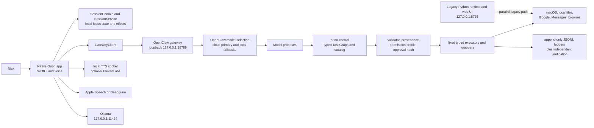

# ORION v2 Phase 0 — live inventory and gate status

Recorded 2026-08-15 from `/Users/nickmadaio/Desktop/ORION`.

## Outcome

Phase 0 is **started and intentionally not closed**. A dedicated branch named
`orion-v2/phase-0-inventory` now exists. The large pre-existing uncommitted
worktree was preserved exactly; nothing was reset, stashed, committed, pushed,
installed, launched, or deployed.

The branch name creates a development boundary, but it does not yet create a
recoverable snapshot of the inherited dirty worktree. Do not begin structural
refactors until Nick chooses how that work should be checkpointed.

This pass added only Phase 0 safeguards and documentation:

- a dependency-free, redacting secret scanner;
- five scanner regression tests, including removed-secret Git history coverage;
- a redacting live-route smoke check plus three offline contract tests;
- a sanitized live-authority exporter, three contract tests, and a versioned
  snapshot of all 157 current capabilities;
- a local repeatable command that scans the working tree and full Git history;
- a fingerprint allowlist containing only deliberate security-test fixtures;
- a server-lifecycle fix so the legacy scheduler stops before SQLite closes;
- this living inventory.

External CI was deliberately not enabled because uploading full repository
history requires a separate, explicit decision.

The read-only live doctor subsequently passed end to end: the loopback gateway
completed a real agent turn, the TTS daemon answered using ElevenLabs, Deepgram
was configured with a present key, the installed app was running, and its
signature used the stable `Orion Local Signing` identity. The installed ORION
Control dist and manifest were also byte-for-byte identical to the tested repo
build. No service was restarted to obtain this evidence.

The dedicated live smoke then sent one uniquely identified request through the
installed normal `openclaw agent` route. It authorized only the read-only
`system_status` action, suppressed raw agent/tool output, and accepted success
only after observing a new durable task-ledger row. The recorded task succeeded
with authenticated `recent` provenance, one verified `system_status` step, and
an independently observed outcome. No generic exec, mutation, restart, install,
deployment, or external communication was authorized.

## Source of truth used

In order of precedence:

1. the live repository and current branch/worktree;
2. root `HANDOFF.md` for the latest verified runtime state;
3. `planning/HANDOFF.md` and gate records for session architecture and tests;
4. older audits only where current code or live checks still corroborate them;
5. the ORION v2 implementation manifest as the target architecture.

The root README still describes the old Python-first product and is not an
accurate overview of the installed OpenClaw/native system.

## Current architecture



The current enforcement path already approximates the permanent core rule:
the model proposes a typed graph, the validator and capability/profile gates
decide whether it may run, fixed executors perform it, and ledgers record the
outcome. It is not yet the manifest's shared ORION Core or full deterministic
R0-R5 policy engine. Device identity, cloud ownership, delegation, signed
approvals, and cross-device targeting do not exist yet.

## Component inventory

| Component | Location | Current role | v2 disposition |
|---|---|---|---|
| Native Mac app | `native/Orion/Sources/Orion` | SwiftUI UI, voice, health views, connections, Calendar/Reminders, Console, gateway client | Mac adapter and UI; platform-independent decisions must move behind Core interfaces later |
| Session domain | `native/Orion/Sources/SessionDomain` | Pure reducer, clocks, reconciliation, policy values | Preserve as a proven pure domain; do not create a second session writer |
| Session service | `native/Orion/Sources/SessionService` | Sole session-state writer, persistence, IPC, effects, sensors, audio | Preserve writer ownership; adapt through typed Core contracts |
| ORION Control | `openclaw-plugins/orion-control/src` | Central action catalog, TypeBox schemas, graph validation, provenance, permissions, execution, audit | Strong starting point for tool contracts, policy, and audit; normalize to v2 schemas incrementally |
| OpenClaw workspace | `openclaw-workspace` and live `~/.openclaw/workspace` | Agent instructions, memory, procedural playbook | Treat as knowledge/context, never authority |
| Wrapper toolbelt | `scripts/orion-*` and `scripts/lib` | Fixed local integrations and diagnostic/repair commands | Keep fixed argv contracts; replace generic shell-shaped paths with explicit capabilities |
| Native bridge | `native/OrionMacBridge` | EventKit/Reminders and macOS bridge operations | Mac adapter behind typed broker |
| TTS and voice ID daemons | `scripts/orion_tts_daemon.py`, `scripts/orion_voiceid_daemon.py` | Local Unix-socket voice services with optional cloud TTS | Local device services; credentials remain outside model context |
| Legacy Python runtime | `orion`, `main.py`, `data/orion.db` | Older local HTTP assistant, SQLite state, planner and tool loop | Inventory and retain for regression; do not treat it as the active architecture |
| Archived prototypes/plans | `archive`, `planning/_archive` | Historical evidence | Read-only reference; not runtime input |
| Cloud backend | absent | None | Phase 10+, after Phases 1-9 pass |
| iPhone app | absent | None | Phase 16+, after backend/security foundations |

## How the current UI communicates with runtimes

- The active native app invokes OpenClaw through `GatewayClient`, using the
  loopback gateway/CLI path and parsing its response stream.
- Session commands use a local Unix-domain socket owned by `SessionService`;
  `scripts/orion-session` is a client, never a second engine.
- TTS and speaker verification use dedicated local Unix sockets.
- The older browser UI talks to the legacy Python `ThreadingHTTPServer` on
  loopback port 8765. That Python runtime can invoke a separate Mac bridge.
- These are parallel paths today. Phase 1 must define one Core contract rather
  than silently choosing one implementation and breaking the other.

## Models and inference providers

| Purpose | Current implementation |
|---|---|
| Active OpenClaw reasoning | Latest handoff reports Anthropic Haiku 4.5 primary, with local `llama3.2:3b` then `qwen3.6:27b` fallbacks |
| Native local narrative/reasoning | Ollama on loopback port 11434 |
| Legacy Python router | local `gpt-oss:20b`, optional Anthropic fast/deep roles and monthly budget from environment |
| Speech to text | Apple Speech locally or Deepgram when explicitly configured |
| Text to speech | local MLX/say fallback; ElevenLabs only when selected/configured |

Provider selection is centralized within each of the OpenClaw, legacy Python,
and native subsystems, but not yet centralized once for ORION as a whole. Model
credentials currently remain outside prompt construction in the reviewed paths.

## Tool, permission, and automation inventory

The live authority derivation reported 157 entries:

| Level | Count | Meaning in the current implementation |
|---|---:|---|
| AUTO | 99 | available without a user approval prompt |
| NOTIFY | 14 | may run, then must disclose the effect |
| APPROVAL | 13 | requires a hash bound to the exact action arguments |
| NEVER/internal | 31 | wrapper/internal command or unavailable direct route |

The authority report is derived from the installed catalog, live capability
flags, permission profile, approval allowlist, and wrapper source. It is more
reliable than prose capability lists.

`planning/v2/CURRENT_AUTHORITY.json` is the versioned Phase 0 snapshot of that
report. It records every capability's current level, derivation rule,
enforcement layer, action tier/risk/reversibility, command coarse-gate flags,
and recognized subcommands. Its exporter deliberately omits installed paths,
command spellings, source excerpts, and configuration values. The snapshot can
be checked against the live derivation without rewriting it.

Current automation consists of three OpenClaw jobs according to the latest
handoff: focus guard, standing orders, and daily memory. Permanent automation
is not yet represented by the manifest's unified trigger/conditions/actions/
permissions/expiration schema.

Current macOS permission surfaces found in code and the app bundle:

- Accessibility: global Option-key input, application/document sensing, and
  the focus shield's global Escape path;
- Microphone and Speech Recognition: voice input;
- Calendar Full Access: local calendar reads and typed changes;
- Reminders Full Access: the Orion reminder list;
- Contacts: local name/number resolution;
- Camera: opt-in focus-presence sampling;
- Apple Events/Automation: Apple Music focus controls.

No Screen Recording API use was found in the active source, so Phase 0 does not
request Screen Recording. The app entitlements also include unsigned executable
memory and disabled library validation; these expand the attack surface and need
an explicit signing/runtime review before public release.

## Filesystem, shell, browser, and Mac control

- ORION Control uses named actions with schemas and fixed execution policies.
- Mutable roots distinguish ORION-owned scratch/test space from the Desktop;
  home access is separately classified and is not a blanket write grant.
- Fixed wrapper commands are executed with argv; the catalog does not expose a
  generic raw-shell capability to the model.
- Existing self-repair/self-plugin paths are high impact even with compile,
  test, health, rollback, and provenance gates because edited in-process code
  can run as the user. Keep them gated during v2 foundation work.
- Browser opening is typed and policy-checked in the plugin path. The native
  UI also contains direct convenience URL paths that must be brought behind the
  shared broker in Phase 1-5.
- Current remote-control files/scripts are legacy local machinery, not proof of
  the manifest's outbound authenticated Mac connection, device identity, signed
  jobs, TTLs, or replay prevention.

## Storage and persistence inventory

| Store | Data |
|---|---|
| `data/orion.db` | legacy Python conversations, messages, tool executions, tasks, approvals, memories, timers, jobs, provider usage, native actions |
| `~/.openclaw/orion-controlled/*.json/jsonl` | permission state/audit, task and repair ledgers, focus state/history, health log, remote state, inbox/outbox, reminders and automation delivery state |
| `~/.openclaw/workspace` and configured Brain paths | working instructions, episodic and semantic memory sources |
| macOS UserDefaults | UI, voice, focus, and connection preferences; not credentials |
| macOS Keychain | native connector tokens/secrets for Whoop, Plaid, and OAuth-based connections |
| repository `data/*.log` and `~/.openclaw/logs` | developer/runtime diagnostics |
| focus/session JSON plus immutable JSONL history | active session state and terminal history, written by `SessionService` |

The legacy SQLite schema has no migration framework and assumes a local single
user. It must not become the cloud multi-user database by accident.

## Network inventory

Live listeners observed during this pass:

| Address | Owner/purpose |
|---|---|
| `127.0.0.1:11434` | Ollama |
| `127.0.0.1:8765` | legacy Python ORION HTTP runtime |
| `127.0.0.1:18789` and `[::1]:18789` | OpenClaw gateway |

All observed listeners were loopback-only. No public Mac control listener was
found or introduced.

Potential outbound integrations visible in active code include Anthropic,
Deepgram, ElevenLabs, Whoop, Plaid, Google OAuth/APIs, Gmail via the fixed Gog
client, Discord webhook delivery, Brave Search, Open-Meteo, and optional social
OAuth definitions. Presence in code does not mean a connector is enabled.

## Secrets and credentials

No credential value was printed during this inventory.

| Location | Secret-shaped fields present | Current assessment |
|---|---|---|
| `.env` (gitignored) | Anthropic, Deepgram, ElevenLabs, Gog keyring password, Discord webhook, plus non-secret voice/config fields | expected local secret file, but plaintext |
| `.env.save` (gitignored) | Anthropic key | redundant plaintext copy; decide whether to securely remove after verifying it is obsolete |
| `~/.openclaw/openclaw.json` | gateway auth token, Anthropic provider key, Ollama provider key field | plaintext config; migrate appropriate fields to SecretRefs/vault before expanding authority |
| macOS Keychain | native connector credentials | preferred current local storage; values were not read |

The redacting scanner found three non-fixture working-tree findings across
`.env` and `.env.save`. Four additional findings are deliberate prompt-injection
test fixtures and are allowlisted by exact path, rule, and SHA-256 fingerprint.
The scan of all 109 reachable commits found no high-confidence committed secret
match. This is evidence for the implemented patterns, not proof that no generic
or low-entropy secret ever entered history.

An older audit records that the Anthropic key was once printed to a terminal.
Treat rotation as still required unless Nick has already rotated it after that
event. Rotation and deletion are deliberately not performed unattended.

## Error handling and logging

- Native components write structured subsystem-prefixed diagnostics, but some
  logs still contain free-form external error text and need central redaction.
- ORION Control uses append-only JSONL task, permission, repair, and forge
  ledgers plus independent outcome verification.
- The legacy Python runtime records tool arguments/results directly in SQLite;
  it lacks the manifest's central sensitive-field redaction middleware.
- Current job/session code has idempotency and effect acknowledgement in several
  places, but there is not yet one versioned event/job envelope across systems.

## Dependency and toolchain inventory

- macOS 26 arm64 development target.
- Swift 6.3.3; the native package uses Apple frameworks and no third-party Swift
  package dependency.
- Node 26.5.0 / npm 11.17.0.
- ORION Control runtime dependency: TypeBox; OpenClaw is a peer dependency;
  TypeScript and Vitest are development dependencies.
- Python 3.13.14 in the repository virtual environment; the core `pyproject`
  declares no third-party runtime dependency. Voice enrollment/MLX paths have
  machine-level optional packages and must be reproduced separately.
- `uv` 0.11.32 manages the legacy Python environment.

## Regression and reproducibility baseline

| Gate | Result on 2026-08-15 |
|---|---|
| Native SessionDomain/SessionService | passed; latest handoff count 287 tests |
| ORION Control | 134/134 passed |
| Legacy Python/TTS/Phase 0 | 216/216 passed; no background scheduler exception |
| Phase 0 scanner | 5/5 passed |
| Phase 0 authority snapshot | 3/3 exporter tests passed; live 157-capability snapshot current |
| Native release app bundle | built and signed in-repo with `Orion Local Signing`; not installed |
| ORION Control TypeScript build | passed; not deployed |
| Installed ORION Control parity | repo dist and manifest match the installed extension |
| Installed normal agent route | live doctor passed; dedicated smoke produced an authenticated, verified `system_status` ledger row |
| Full Git-history high-confidence scan | completed across 109 commits; no historical match |

An initial `pytest` command failed because pytest is not a project dependency;
the documented standard-library unittest runner then passed. This is a tooling
discovery, not a product test failure.

The first combined run also printed scheduler-thread exceptions after tests had
already closed their temporary SQLite stores while still returning success.
`OrionServer.server_close()` now stops the scheduler it owns before closing the
HTTP socket, and a regression test proves the thread is stopped before the store
is closed. The final 216-test run was clean.

One 213-test run executed concurrently with the full-history scanner had a
single TTS Unix-socket connection timing miss. The test passed immediately in
isolation and the complete 213-test suite passed when rerun without competing
history-scan load. No product change was made for a non-reproducible event; the
transient is retained here so recurrence can be recognized instead of hidden.

## Behaviors that must remain unchanged during initial refactor

1. Native text and voice requests continue to reach the normal OpenClaw route.
2. The model cannot execute an action directly or grant itself authority.
3. External email, page, message, document, and screen content remains tainted
   and cannot expand capability or approve an action.
4. SessionService remains the only focus-session state/history writer.
5. Approval hashes remain bound to exact arguments for approval-gated effects.
6. Gmail read/search remains read-only by construction; sending is not widened.
7. Outbound Messages and other external communication remain approval-gated.
8. Filesystem mutations remain rooted, typed, reversible where practical, and
   independently verified.
9. Credentials remain outside model context and ordinary logs.
10. All Mac listeners remain local-only until the outbound authenticated remote
    connection phase is deliberately implemented.
11. Wake word, TTS/STT fallbacks, focus sessions, Calendar/Reminders, memory,
    and the installed native UI remain working through the refactor.
12. No Phase 1 module move may be merged without the current regression gates.

## Phase 0 exit gate

| Requirement | Status | Remaining work |
|---|---|---|
| Dedicated v2 development branch | partial | branch exists; checkpoint inherited dirty worktree before structural edits |
| Architecture documented | complete for Phase 0 | live normal agent trace and installed app/signature validated |
| Critical regression coverage | partial | normal-route smoke and durable ledger verification now pass; add broader secret/log redaction invariants |
| Secrets accounted for | partial | decide on `.env.save`, rotate previously exposed Anthropic key if still current, migrate plaintext OpenClaw secrets |
| Existing ORION reproducible | partial | source builds pass; perform a clean checkout/build and compare installed/runtime artifacts without replacing them |
| Security-sensitive capabilities known | complete for Phase 0 | versioned 157-entry snapshot is generated from live enforcement metadata and fails closed on malformed/duplicate rows |

**Do not start Phase 1 yet.** The next safe work is still Phase 0: checkpoint the
inherited dirty baseline, close the credential decisions, and reproduce the
current source state from a clean checkout. Only then should module boundaries
move.

## Commands for the next pass

```bash
uv run python -m unittest discover -s tests -v
uv run python scripts/orion_v2_live_smoke.py
uv run python scripts/orion_v2_authority_snapshot.py --check
cd openclaw-plugins/orion-control && npm test && npm run build
cd native/Orion && ./Tests/run-domain-test.sh && ./make_app_bundle.sh
python3 scripts/orion_v2_secret_scan.py \
  --root . \
  --history \
  --allowlist planning/v2/secret-scan-allowlist.json
python3 scripts/orion_v2_secret_scan.py \
  --root . \
  --history \
  --include-ignored \
  --allowlist planning/v2/secret-scan-allowlist.json
```

The scan command is designed so suspected secret values never appear in its
output. The first command is the repeatable source gate. The second is a local
credential inventory and is expected to fail while plaintext secrets exist in
ignored files. Do not replace either with a raw grep that prints matched text.
